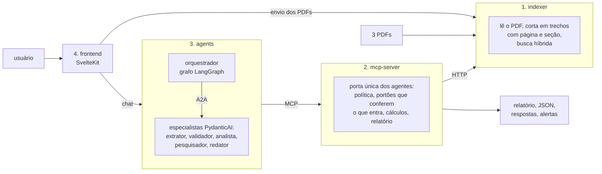

# Análise de demonstrações financeiras com agentes

Solução do teste prático de Engenharia de IA: ler três PDFs de demonstrações financeiras
(Brasal, Millet e Light), extrair os indicadores com a origem de cada valor, analisar o texto,
responder perguntas com citação, sinalizar inconsistências e gerar um relatório consolidado.

Este arquivo é só um índice. A solução está em quatro sistemas, cada um completo na sua pasta, com
README, `.env.example`, Docker e testes.



| Sistema | O que faz | README |
|---|---|---|
| 1. `indexer/` | Recebe os PDFs, lê com Docling ou Azure Document Intelligence, gera trechos com página, seção, tipo e unidade, e responde busca híbrida (semântica + palavras) | [indexer/README.md](indexer/README.md) |
| 2. `mcp-server/` | Servidor MCP com governança: decide o que cada agente pode chamar, confere tudo o que eles gravam, calcula, valida e monta o relatório | [mcp-server/README.md](mcp-server/README.md) |
| 3. `agents/` | Orquestrador e especialistas, feitos com PydanticAI; a orquestração é um grafo LangGraph. O orquestrador chama os especialistas por A2A; todos usam as ferramentas pelo servidor MCP. O usuário conversa: os agentes lembram os turnos anteriores, e o raciocínio do modelo fica registrado | [agents/README.md](agents/README.md) |
| 4. `frontend/` | A tela: envio dos PDFs com o progresso da indexação, e o chat com os agentes (perguntas, relatório, qualquer pedido), bloqueado até a resposta e mostrando o que o sistema está fazendo. O token fica num cookie httpOnly, no servidor da tela | [frontend/README.md](frontend/README.md) |

## A entrega

Em [`agents/entrega/`](agents/entrega/), gerada pela solução:

| Arquivo | Item do teste |
|---|---|
| [`relatorio.md`](agents/entrega/relatorio.md) | 6. Relatório consolidado: resumo por empresa, tabela comparativa, análise qualitativa, as 5 perguntas e os alertas |
| [`extracao_enxuta/`](agents/entrega/extracao_enxuta/) | 2. Extração estruturada em JSON, só com os campos do enunciado e só com o que está escrito nos documentos: valor, unidade, valor do período comparável e variação quando a empresa a escreve, cada um com página e trecho, ou "não encontrado". Nada calculado |
| [`extracao/`](agents/entrega/extracao/) | O mesmo, completo: também os valores calculados por fórmula fixa (com os operandos), a variação calculada, os valores de apoio e as validações |
| [`analise/`](agents/entrega/analise/) | 3. Análise qualitativa, cada item com a citação e a página |
| [`respostas.md`](agents/entrega/respostas.md) | 4. As 5 perguntas, com documento e página |
| [`alertas/`](agents/entrega/alertas/) | 5. Inconsistências e informações não encontradas |
| [`avaliacao.md`](agents/entrega/avaliacao.md) | Acerto contra o gabarito conferido à mão, campo a campo |
| [`execucao.json`](agents/entrega/execucao.json) | Tempo, tokens, custo e os passos da execução que gerou a entrega |

## Como rodar

Pré-requisitos: Docker e uma chave da OpenAI. Cada pasta tem um `.env.example`.

```bash
# 1. Indexador
cd indexer && cp .env.example .env          # OPENAI_API_KEY e JWT_SECRET
docker compose up --build -d
uv run python scripts/smoke.py              # cria o usuário e envia os 3 PDFs

# 2. Servidor MCP
cd ../mcp-server && cp .env.example .env    # MCP_AGENT_SECRET e ADMIN_KEY
docker compose up --build -d

# 3. Agentes
cd ../agents && cp .env.example .env        # OPENAI_API_KEY, o mesmo MCP_AGENT_SECRET e A2A_SECRET
docker compose up --build -d

# Relatório completo + pasta de entrega
uv run python scripts/gerar_entrega.py --usuario <usuário> --senha <senha> --rodar

# 4. Tela
cd ../frontend && docker compose up --build -d   # http://localhost:3000
```

A tela fica em `http://localhost:3000`. Swagger: indexador em `http://localhost:8000/docs`, agentes
em `http://localhost:8200/docs`.
Os detalhes (usuário, parser, variáveis) estão no README de cada sistema.

## Onde está cada ponto pedido no enunciado

| Ponto | Em resumo | Onde |
|---|---|---|
| **1. Arquitetura** | Três sistemas: índice, servidor MCP com portões, agentes em hub-and-spoke (A2A entre eles, MCP para as ferramentas) | Diagramas em cada README |
| **2. Decisões e trade-offs** | Parser trocável; chunks por estrutura; regras no servidor e não no prompt; modelo pequeno com portões e modelo forte só no validador; A2A e MCP | [indexer](indexer/README.md#do-pdf-ao-chunk-etapa-por-etapa), [agents](agents/README.md#decisões-e-trade-offs) |
| **3. Combate à alucinação** | O agente aponta, o código lê: nenhum número é digitado pelo modelo. "Não encontrado" tem prova. Calculado fica separado do informado | [agents](agents/README.md#combate-à-alucinação-como-um-número-chega-ao-relatório), [mcp-server](mcp-server/README.md#portões-o-que-precisa-conferir-para-entrar-na-base) |
| **4. Avaliação de qualidade** | Gabarito de 24 campos conferido à mão nos PDFs. Na execução entregue: 24/24 no status, 13/13 nos valores, 10/10 nos cálculos, nenhuma invenção, 5/5 perguntas. O histórico das 15 execuções mostra como se chegou aí, e que trocar a base dos agentes (para PydanticAI e LangGraph) não mudou a qualidade | [agents](agents/README.md#avaliação-de-qualidade) |
| **5. Custo e desempenho** | Agentes: 332 s e US$ 1,02 para os três documentos com o raciocínio registrado (146 s e US$ 0,58 sem ele). Uma pergunta numa conversa: US$ 0,01 a 0,03. Indexação: 86 s com a Azure ou 26 min com o Docling | [agents](agents/README.md#custo-e-desempenho), [indexer](indexer/README.md#resultados-medidos) |
| **6. Segurança** | Chaves só em `.env`; identidade por agente e por usuário; texto de documento é dado, e o que um agente desviado consegue fazer é limitado pela política e pelos portões | [mcp-server](mcp-server/README.md#segurança), [agents](agents/README.md#segurança), [indexer](indexer/README.md#segurança) |
| **7. Limitações** | O modelo ainda escolhe entre linhas legítimas; três documentos; execuções variam (23 a 24 de 24 indicadores iguais entre repetições); o validador não acha sempre as mesmas inconsistências | [agents](agents/README.md#limitações), [mcp-server](mcp-server/README.md#limitações), [indexer](indexer/README.md#premissas-e-limitações) |
| **8. Produção no Azure** | Document Intelligence, AI Search, Foundry (modelos e agentes), Entra ID por agente, API Management, Application Insights, lote e cache para o custo | Fim de cada README |

## Premissas adotadas

- **Os documentos são anuais.** O enunciado fala em releases trimestrais; os três PDFs são
  demonstrações do exercício de 2022, com a coluna de 2021. "Período" aqui é o exercício, e a
  variação é contra 2021.
- **Brasal e Millet não têm relatório da administração** nem informam EBITDA, margem ou
  alavancagem. Esses campos saem como "não encontrado", com a evidência da busca, e ao lado vai o
  valor calculado por fórmula fixa, marcado como calculado. Nada é estimado.
- **A Light tem erros no próprio texto** (um ano trocado, uma conta que não fecha, um sinal
  omitido). Eles aparecem como alertas, com a citação. Nada é corrigido.
- **"Alavancagem" é dívida líquida / EBITDA.** Índices com o mesmo nome e outra conta (dívida
  sobre patrimônio ou sobre capital) não entram nesse campo.
- **A tela é para uso e demonstração.** A entrega oficial (relatório, JSON, avaliação) sai por
  script, e as APIs têm Swagger.

## O que ficou de fora

- Classificação de tom com ML tradicional (diferencial opcional): o tom é classificado pelo
  agente analista, com a justificativa e a citação.
- Relatório em PDF ou HTML: sai em Markdown.
