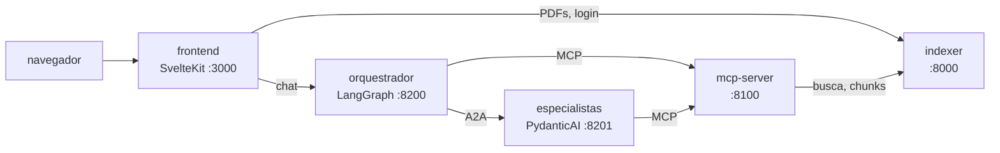

# Análise de demonstrações financeiras com agentes

PDFs de demonstrações financeiras viram indicadores com a origem de cada valor, análise
qualitativa com citação, respostas a perguntas e um relatório consolidado. O sistema é dividido
em quatro serviços independentes, cada um com Docker, testes e README próprios, mais uma pilha de
observabilidade que junta traces, métricas e logs de todos.



| Serviço | Papel |
|---|---|
| [`indexer/`](indexer/README.md) | Ingestão: API com login, filas Kafka, parse (Docling ou Azure Document Intelligence), chunks com página e seção, busca híbrida no Qdrant |
| [`mcp-server/`](mcp-server/README.md) | Porta única dos agentes: política por agente, portões que conferem tudo o que é gravado, fórmulas fixas, auditoria e montagem do relatório |
| [`agents/`](agents/README.md) | Orquestrador em grafo e cinco especialistas ligados por A2A; conversa com memória e raciocínio registrado |
| [`frontend/`](frontend/README.md) | Envio dos PDFs e chat; sessão em cookie httpOnly e proxy para as APIs |
| [`observability/`](observability/README.md) | Tempo, Prometheus, Loki e Grafana, com o Alloy como coletor: um trace atravessa os quatro serviços, e os painéis mostram custo, tokens e portões dos agentes |

## Princípios

- **O agente aponta, o código lê.** O modelo indica chunk, linha e coluna; o servidor lê a
  célula e grava com a página. Nenhum número é digitado pelo modelo.
- **Regras no servidor, não no prompt.** Permissões, ordem do trabalho e conferências ficam no
  servidor MCP.
- **Calculado separado do informado**, com fórmula e páginas de origem. **Não encontrado tem
  prova**: a busca que sustenta a ausência fica registrada.

## Como subir

```bash
cd indexer    && cp .env.example .env && docker compose up -d --build   # :8000
cd mcp-server && cp .env.example .env && docker compose up -d --build   # :8100
cd agents     && cp .env.example .env && docker compose up -d --build   # :8200, :8201
cd frontend   && docker compose up -d --build                           # :3000
cd observability && docker compose up -d                                # Grafana :3001
```

Os serviços se falam pela rede Docker do indexador (`indexer_default`). Indexador e agentes
precisam de uma chave da OpenAI.

## Configuração

Em todos os sistemas, a mesma divisão:

| Onde | O quê | Quando vale |
|---|---|---|
| `<sistema>/config/ajustes.yaml` | o que se ajusta: parser, chunks, preços, limites, atalhos do chat | no próximo pedido, sem build nem restart |
| `agents/agentes/<nome>.md` | modelo, raciocínio, turnos e prompt de cada agente | quando o arquivo muda |
| `mcp-server/config/policy.yaml` | o que cada agente vê e chama | quando o arquivo muda |
| `<sistema>/.env` | só chaves e segredos | ao recriar o contêiner |
| `docker-compose.yml` | endereços da infraestrutura | ao recriar o contêiner |

As pastas `config/` são montadas nos contêineres. Arquivo inválido não derruba nada: continua
valendo a versão anterior, e o motivo aparece no `/health` do serviço.

## Documentação

Páginas HTML com os fluxos desenhados (abrem direto no navegador, sem internet):

- [Visão geral](docs/visao-geral.html): arquitetura, fluxo completo passo a passo, fluxo de uma pergunta,
  fluxo do relatório (quem faz o quê e em que ordem), identidade
- [Indexador](indexer/docs/fluxos.html) · [Servidor MCP](mcp-server/docs/fluxos.html) ·
  [Agentes](agents/docs/fluxos.html) · [Frontend](frontend/docs/fluxos.html) ·
  [Observabilidade](observability/docs/fluxos.html)
