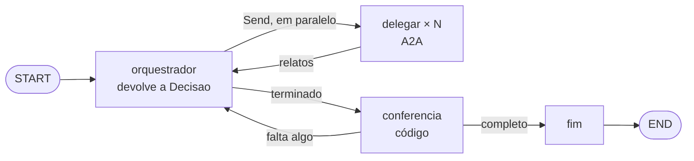
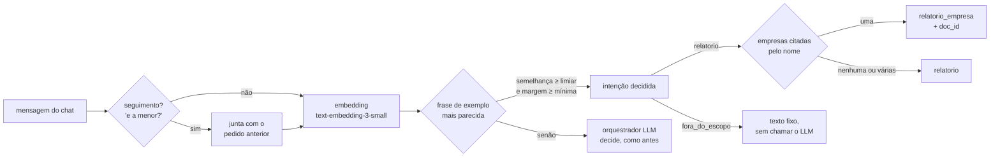

# Agentes

Um orquestrador em grafo (LangGraph) e cinco especialistas (PydanticAI), cada um no próprio
serviço, com Dockerfile e porta próprios, ligados por A2A. Todos usam as ferramentas pelo [servidor MCP](../mcp-server/README.md). Os
fluxos estão desenhados em [docs/fluxos.html](docs/fluxos.html).



## Como funciona

- **Orquestrador**: agente PydanticAI com saída estruturada
  `Decisao{delegacoes, terminado, mensagem, intencao}`. Ele não chama ninguém; o grafo executa
  as delegações da onda em paralelo e volta com os relatos montados pelo código.
- **Conferência**: o código pergunta ao MCP o que falta (`pendencias`). "Terminei" dito pelo
  modelo não encerra; até 2 rodadas extras, depois a execução fica `incompleta`.
- **Ordem**: num relatório, antes de cada onda o código consulta `pendencias`; a delegação que
  chega antes da hora (perguntas sem análise, resumo sem revisão) não sai e volta ao orquestrador
  como relato `nao_delegado`, dizendo o que delegar no lugar.
- **Intenção**: no chat, cada mensagem é `pergunta`, `relatorio`, `relatorio_empresa` ou
  `fora_do_escopo`, e o tipo decide o que a conferência cobra: `pergunta` exige resposta gravada
  com fonte; `relatorio`, o consolidado montado; `relatorio_empresa`, as pendências e o relatório
  daquela empresa; `fora_do_escopo` não executa nada e devolve um texto fixo com as opções. Quem
  decide, nesta ordem (veja [Intenção](#intenção)):
  1. o **roteador semântico**, quando tem certeza (embedding da mensagem contra frases de exemplo);
  2. senão, o **orquestrador** (LLM), na primeira decisão, como antes.
- **A2A**: o orquestrador assina um token por chamada (destino, execução, usuário); só ele entra
  no serviço de cada especialista. Cada especialista chega ao MCP com um token de agente próprio.
- **Um serviço por especialista**: o mesmo código (`app/especialistas/servico.py`) com
  `ESPECIALISTA=<nome>` atende só aquele agente. O orquestrador tem o endereço de cada um
  (`ESPECIALISTAS_ENDERECOS` no compose) e monta a equipe perguntando a cada serviço: um serviço
  fora do ar tira só aquele especialista da execução (fica em `fora_do_ar` no trace e em
  `GET /api/agentes`), e o resto trabalha; a conferência mostra o que ficou pendente. Fora do
  Docker, sem `ESPECIALISTA`, um serviço só atende todos (`ESPECIALISTAS_URL`).

| Serviço | Porta | Dockerfile |
|---|---|---|
| orquestrador | 8200 | `agentes/orquestrador/Dockerfile` |
| extrator | 8201 | `agentes/extrator/Dockerfile` |
| validador | 8202 | `agentes/validador/Dockerfile` |
| analista | 8203 | `agentes/analista/Dockerfile` |
| pesquisador | 8204 | `agentes/pesquisador/Dockerfile` |
| redator | 8205 | `agentes/redator/Dockerfile` |

| Agente | Faz | Modelo |
|---|---|---|
| `orquestrador` | Decide as ondas e acompanha; classifica a mensagem quando o roteador não tem certeza | padrão |
| `extrator` | Os 8 indicadores de um documento, com origem | padrão |
| `validador` | Inconsistências no texto da fonte, a partir dos candidatos achados por regra no MCP | padrão |
| `analista` | Motivos, riscos, guidance, eventos, tom | padrão |
| `pesquisador` | Uma pergunta, com fontes | padrão |
| `redator` | Resumo por empresa e montagem do relatório | padrão |

Um agente é uma pasta, `agentes/<nome>/`, com o arquivo `<nome>.md` (cabeçalho + prompt, relido
sem reiniciar) e o `Dockerfile` do serviço dele. A
permissão é uma entrada em `mcp-server/config/policy.yaml`: quem escreve o agente não concede a própria
permissão.

## Intenção

Antes do orquestrador, o roteador ([app/orquestrador/intencao.py](app/orquestrador/intencao.py))
tenta decidir sozinho. Ele não substitui o LLM: decide o que é claro e deixa o resto para ele.



| Peça | Como | Por quê |
|---|---|---|
| **Rotas** | `config/intencoes.yaml`: frases de exemplo de `relatorio`, `pergunta` e `fora_do_escopo`, limiar e margem. Relido sem reiniciar | O que é claro sai em ~0,4 s e por centésimos de centavo, sem LLM |
| **Empresa** | Regra: as palavras da mensagem contra os nomes dos documentos do usuário (sem as genéricas, como "Participações" e "Holding"). Uma empresa citada: `relatorio_empresa` com o `doc_id` dela; nenhuma ou várias: `relatorio` | Embedding não diz qual empresa; o nome está escrito na mensagem |
| **Seguimento** | Mensagem de até 8 palavras que começa como continuação ("e", "por que", "explique"…) é comparada junto com o pedido anterior. A empresa da própria mensagem vale mais que a do pedido anterior | "e a menor?" sozinho não diz nada |
| **Dúvida** | Semelhança abaixo do limiar, ou duas rotas quase empatadas: o tipo fica `auto`, e o orquestrador classifica com o histórico da conversa | O LLM continua com os casos difíceis |

No trace, o passo `roteador` traz a decisão, a semelhança, a margem, a frase de exemplo mais
parecida, o seguimento e as empresas achadas; o passo `intencao` diz quem decidiu
(`fonte: roteador` ou `llm`). O embedding entra no custo da execução (agente `roteador`), e a
métrica `agentes.intencoes` conta por intenção e por quem decidiu. Arquivo de rotas inválido não
derruba nada: vale o anterior, e o motivo aparece em `GET /health` (`roteador_intencao`).

**Medida** ([avaliacao/intencoes.yaml](avaliacao/intencoes.yaml), `scripts/avaliar_intencao.py`): 52
mensagens rotuladas à mão, nenhuma igual às frases de exemplo, em dois conjuntos. Limiar (0,45) e
margem (0,03) foram escolhidos no de ajuste, antes de medir no de teste:

| No conjunto de teste (37 mensagens) | Resultado |
|---|---|
| Roteador: decide | 30 de 37 (81%) |
| Roteador: certas entre as que decide | 30 de 30 |
| LLM sozinho (as regras de intenção do prompt do orquestrador) | 33 de 37; dos 4 erros, 3 são de formato da empresa no script de comparação e 1 é o caro: "Compare o fluxo de caixa operacional das três" virou relatório |
| Roteador + LLM, como roda | 37 de 37 |
| Tempo por mensagem | roteador ~0,4 s; LLM ~0,9 s |

As mensagens foram escritas por quem fez o sistema: o número mede as regras, não o uso real. Com
mensagens reais, o próximo passo seria um classificador treinado nelas (SetFit, por exemplo)
comparado com este.

## Estado e memória

| O quê | Onde |
|---|---|
| Resultados (valores, análise, respostas, relatório) | base do servidor MCP, fonte da verdade |
| Turnos da conversa | checkpoint LangGraph em SQLite, `thread_id` = conversa |
| Memória de cada especialista | SQLite por (usuário, conversa, agente, documento), compactada na leitura; cada especialista no próprio volume (`memoria-<nome>`) |
| Trace com raciocínio e mensagens completas | `data/execucoes/` |

## Freios

`max_turnos` por agente, teto de tokens e tempo por execução, ondas por rodada, rodadas da
conferência e memória reenviada (`execucao` e `memoria_max_tokens` no `config/ajustes.yaml`),
limite de chamadas na política do MCP, e nenhuma execução começa com o token do usuário a menos
de 15 min de vencer.

## Configuração

| Onde | O quê | Quando vale |
|---|---|---|
| `agentes/<nome>/<nome>.md` | `modelo`, `raciocinio`, `max_turnos` e o prompt de cada agente | quando o arquivo muda |
| `config/ajustes.yaml` | preços, freios, raciocínio padrão, tempos | no próximo pedido |
| `config/intencoes.yaml` | frases de exemplo, limiar e margem do roteador da intenção | na próxima mensagem |
| `.env` | só chaves e segredos | ao recriar o contêiner |

As duas pastas são montadas no contêiner: mudar não pede build nem restart. Arquivo inválido
não derruba nada: continua valendo o anterior, e o motivo aparece em `GET /health`
(`arquivos_invalidos`, `erro_ajustes`, `roteador_intencao`).

## Rodar

```bash
cp .env.example .env          # só chaves: OPENAI_API_KEY, MCP_AGENT_SECRET (o mesmo do MCP), A2A_SECRET
docker compose up -d --build --remove-orphans  # orquestrador :8200, especialistas :8201 a :8205
uv run pytest                 # sem rede: modelo com roteiro, MCP em memória, A2A por ASGI

uv run python scripts/gerar_entrega.py --usuario <u> --senha <s> --rodar   # relatório + JSON em entrega/
uv run python scripts/avaliar.py --usuario <u> --senha <s>                 # contra avaliacao/gabarito.json
uv run python scripts/avaliar_intencao.py [--com-llm] [--varrer]          # intenção contra avaliacao/intencoes.yaml
```

O `modelo` do agente é o nome no provedor. Com o prefixo `groq:` (por exemplo
`groq:openai/gpt-oss-120b`), ele vai à Groq pela API compatível com a OpenAI, com `GROQ_API_KEY`. Tools sem argumento seguem sem `strict`, porque a Groq recusa esse caso.

## Nota contra o gabarito

Ao fim de cada relatório completo (consolidado ou de uma empresa), o orquestrador tira o retrato
da base e compara com `avaliacao/gabarito.json`, conferido à mão: status e valor de cada
indicador, página, ano anterior, calculados, invenções, alertas, inconsistências da fonte, as
cinco perguntas e as citações. Não chama modelo. A nota fica na execução (`avaliacao`), no
trace (passo `avaliacao`) e vira métrica no painel "Agentes" do Grafana.

- O documento é reconhecido pelo **conteúdo** (`doc_id`, o hash do PDF), não pelo nome. Documento
  sem gabarito não entra na conta e aparece em `sem_gabarito`; sem nenhum, a execução diz que não
  houve nota.
- As **perguntas** comparam as empresas: só contam quando a base tem exatamente os documentos do
  gabarito. No relatório de uma empresa, não contam.
- Liga e desliga em `config/ajustes.yaml` (`avaliacao.ao_fim_do_relatorio`). O mesmo cálculo roda
  à mão com `scripts/avaliar.py`.

| Rota | Função |
|---|---|
| `POST /api/conversas`, `POST /api/conversas/{id}/mensagens` | Conversa e turno em texto livre |
| `GET /api/conversas[/{id}]` | Conversas e turnos |
| `POST /api/relatorios`, `/api/perguntas` | Atalhos com tipo definido |
| `GET /api/execucoes/{id}[/mensagens]` | Estado, passos, custo; mensagens de cada agente |

Relatório completo dos três documentos, com raciocínio ligado:

| Modelos | Tempo | Custo | Indicadores certos | Inconsistências da fonte | Perguntas |
|---|---|---|---|---|---|
| `gpt-5.4-nano` em todos, com candidatos com prova, descarte com motivo e a trava de ordem (atual) | 151 s | US$ 0,15 | 24 de 24 | **7 de 7** | 5 de 5 |
| o mesmo, sem a prova e o descarte | 231 s | US$ 0,14 | 24 de 24 | 6 de 7 | 5 de 5 |
| o mesmo, antes da trava de ordem | 311 s | US$ 0,20 | 24 de 24 | 6 de 7 | 4 de 5 |
| `gpt-5.4-nano` em todos, sem os candidatos | 195 s | US$ 0,14 | 24 de 24 | 2 de 6 | 5 de 5 |
| `gpt-5.4-mini` + `gpt-5.4` no validador, sem os candidatos | 332 s | US$ 1,02 | 24 de 24 | 4 de 6 | 5 de 5 |
| `gpt-5-nano` em todos | parou em 12 min | US$ 0,08 | nenhuma extração fechada | — | — |

Em todas as que terminaram, nenhum valor ausente foi gravado como informado, os valores
calculados saíram certos e todas as citações existem no trecho citado.

**Inconsistências da fonte.** O validador começa pela lista de candidatos que o servidor MCP acha
por regra (`candidatos_inconsistencia`) e julga cada um: registra (`registrar_alerta`) ou descarta
dizendo por quê (`descartar_candidato`, guardado e auditado, fora do relatório); o
`concluir_revisao` recusa enquanto houver candidato sem julgamento. Nos quadros, o candidato traz
uma `prova`: os mesmos números achados em outro quadro do documento, com a coluna e o ano de lá.

- Só com a lista: 6 de 7 em duas execuções. A que faltou (Millet, p. 41: o texto diz 31/12/2021 e o
  quadro é de 2022) estava na lista, e o modelo julgou que não era erro, sem deixar o motivo.
- Com a prova e o descarte: 7 de 7, nenhum descarte. A prova da Millet dizia que 24.176 aparece
  como "Consolidado - 31/12/2022" no quadro da p. 32, e a descrição registrada cita os valores
  de 2022. É uma execução: mostra o caminho, não a taxa.

A sétima (Light, p. 21 do arquivo: o consolidado diz 2021 nas duas colunas) foi achada pelas regras
e entrou no gabarito depois de conferida no PDF. As regras foram desenhadas olhando estes
documentos: em outro PDF, a medida honesta é rodar e conferir.

**Ordem do trabalho.** Na execução de 311 s, o orquestrador pediu as cinco perguntas antes da
análise qualitativa; o MCP recusou as gravações 13 vezes, e ele repetiu o pedido em mais três
ondas (22 delegações ao pesquisador, 78 chamadas ao modelo) até a conferência listar o que
faltava. Desde então o grafo consulta `pendencias` antes de cada onda de um relatório e não
manda a delegação cujos itens ainda aguardam outra etapa: ela volta ao orquestrador como relato
`nao_delegado`, com o que falta antes e o que já pode ser feito (passo `barrada` no trace). Na
execução seguinte (231 s, US$ 0,14) o orquestrador seguiu a ordem sozinho e a trava não precisou
agir: a diferença entre as duas é, em boa parte, variação do modelo, e a trava garante o pior
caso. A pergunta 2 que falhou na de 311 s (faltou um motivo da receita da Light) saiu certa na
seguinte.

## Mapa do código

```
agentes/<nome>/             UMA PASTA POR AGENTE: <nome>.md (modelo, raciocínio, turnos e prompt)
                            e o Dockerfile do serviço dele
config/ajustes.yaml         preços, freios, tempos, traces com conteúdo
config/intencoes.yaml       frases de exemplo, limiar e margem do roteador da intenção
avaliacao/                  gabarito.json (os indicadores) e intencoes.yaml (mensagens rotuladas)

app/
├─ config.py                .env (chaves) + config/ajustes.yaml
├─ telemetria.py
│
├─ orquestrador/            O SERVIÇO :8200
│  ├─ api.py                rotas: conversas, mensagens, execuções, atalhos
│  ├─ grafo.py              o grafo: orquestrador → delegar → conferência → fim
│  ├─ intencao.py           roteador semântico da intenção, empresa citada e seguimento
│  ├─ execucoes.py          execuções, conversas e trace em disco
│  ├─ especialistas_a2a.py  descobrir e chamar os especialistas por A2A
│  └─ usuario.py            quem é o usuário (login do indexador)
│
├─ especialistas/           O SERVIÇO DE CADA ESPECIALISTA (:8201 a :8205)
│  ├─ servico.py            o arquivo do agente vira um agente A2A (ESPECIALISTA=<nome>: só ele)
│  └─ memoria.py            histórico de cada especialista na conversa, compactado
│
├─ nucleo/                  O QUE OS DOIS USAM
│  ├─ agentes.py            ler e validar agentes/<nome>/<nome>.md
│  ├─ executar.py           rodar UM agente PydanticAI: modelo, tools do MCP, passos, freios
│  ├─ mcp.py                conexão com o servidor MCP
│  ├─ tokens.py             token A2A e token do agente
│  └─ custos.py             custo pelos tokens e pelos preços do ajustes.yaml
│
└─ ferramentas/             APOIO
   ├─ cli.py                python -m app.ferramentas.cli validar | novo-agente
   ├─ avaliacao.py          a conta: a base contra o gabarito (só os documentos que têm gabarito)
   ├─ retrato.py            o retrato da base, lido pelo servidor MCP como "sistema"
   └─ avaliacao_automatica.py  a nota ao fim de cada relatório e as métricas dela

scripts/                    avaliar.py, gerar_entrega.py, avaliar_intencao.py
```

Para criar um agente: `python -m app.ferramentas.cli novo-agente <nome> --descricao "..."` cria
`agentes/<nome>/` (o arquivo e o Dockerfile, na porta seguinte à do último especialista) e mostra
o que colar: a entrada em `mcp-server/config/policy.yaml` e o serviço, o volume da memória e o
endereço no `docker-compose.yml`.
