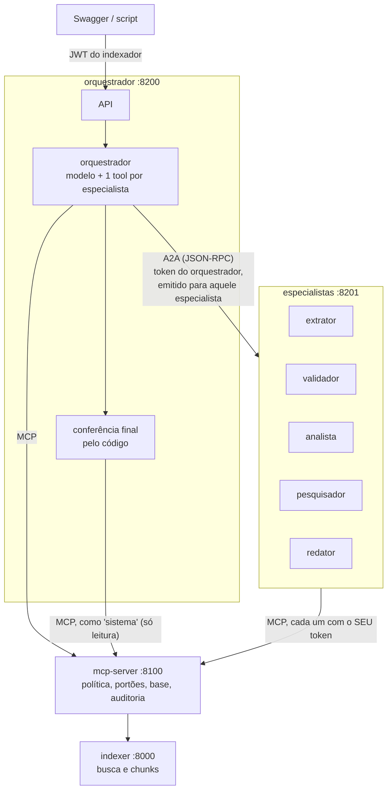
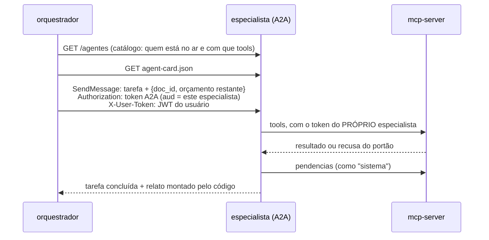

# Agentes: orquestrador e especialistas

Sistema 3 de 3 da solução. Aqui ficam os agentes: um **orquestrador**, que entende o pedido e
decide o que fazer, e **especialistas**, que fazem cada parte do trabalho (extrair, revisar,
analisar, responder, redigir).

- Os especialistas são **agentes remotos**: o orquestrador os chama pelo protocolo **A2A**
  (Agent2Agent), e eles só respondem a ele.
- Todos usam as ferramentas e leem os documentos por um lugar só, o
  [servidor MCP](../mcp-server/README.md) (sistema 2), que decide o que cada um pode chamar e
  confere tudo o que eles gravam.
- Os documentos vêm do [indexador](../indexer/README.md) (sistema 1).

Não há frontend. Tudo é testável pelo Swagger em `http://localhost:8200/docs`.



É o desenho *orchestrator-workers* (no SDK de agentes da OpenAI, "manager: agents as tools"),
em hub-and-spoke: o orquestrador é o centro, os especialistas são os raios, e o A2A é o cabo
entre eles. Os raios não se falam.

## Como rodar

Os três sistemas sobem na ordem: indexador, servidor MCP, agentes.

```bash
# 1. Indexador: sobe, cria o usuário e envia os PDFs (ver indexer/README.md)
cd indexer && cp .env.example .env && docker compose up --build -d

# 2. Servidor MCP
cd ../mcp-server && cp .env.example .env && docker compose up --build -d

# 3. Agentes
cd ../agents && cp .env.example .env && docker compose up --build -d
```

No `agents/.env`: a chave da OpenAI, o `MCP_AGENT_SECRET` **igual ao do `mcp-server/.env`** e um
`A2A_SECRET` novo (o comando para gerar está no arquivo).

Depois, no Swagger (`http://localhost:8200/docs`):

1. Faça login no indexador (`POST http://localhost:8000/auth/login`) e copie o `access_token`.
2. Clique em **Authorize** e cole o token. O login é o mesmo do indexador: os agentes só
   enxergam os documentos desse usuário.
3. `POST /api/relatorios` pede o relatório completo. `GET /api/execucoes/{id}` mostra o
   andamento, os passos, os tokens e o custo.

Ou, de uma vez, pelo script que gera a pasta de entrega:

```bash
uv run python scripts/gerar_entrega.py --usuario <usuário> --senha <senha> --rodar
```

Fora do Docker (dois processos):

```bash
uv sync
uv run uvicorn app.especialistas:app_factory --factory --port 8201
uv run uvicorn app.main:app_factory --factory --port 8200
uv run pytest        # 51 testes, sem rede
```

## O que dá para pedir

| Rota | Função |
|---|---|
| `POST /api/relatorios` | O relatório consolidado completo dos documentos do usuário |
| `POST /api/perguntas` | Uma pergunta em linguagem natural; devolve a resposta com as fontes |
| `POST /api/execucoes` | Pedido em texto livre: o orquestrador decide o que fazer |
| `GET /api/execucoes/{id}` | Estado, resultado, passos (quem chamou o quê), tokens e custo |
| `GET /api/execucoes` | Execuções do usuário |
| `GET /api/agentes` | Agentes carregados e as tools que a política do servidor MCP dá a cada um |
| `GET /health` | Estado do serviço, agentes e modelos |

Uma execução termina como `completa`, `incompleta` (com o que faltou), `falhou` ou
`interrompida`. O resultado vem **da base**, lido pelo código: o relatório montado pelo servidor,
ou a resposta gravada com as fontes. O texto final do orquestrador é só uma mensagem de estado.

## Um agente é um arquivo

`agentes/extrator.md`:

```markdown
---
nome: extrator
descricao: Extrai os indicadores financeiros de UM documento, com a origem de cada valor.
modelo: padrao        # apelido; o modelo real fica no .env (MODELOS)
max_turnos: 60
---
Você extrai indicadores de demonstrações financeiras anuais de UMA empresa por vez...
```

O corpo é o prompt. A `descricao` é o que o orquestrador lê para decidir quando chamar: ela vira
a descrição da tool e do Agent Card.

### Criar um agente: dois passos

1. **O arquivo.** `agentes/<nome>.md`. O comando cria a partir de um modelo:

   ```bash
   uv run python -m app.cli novo-agente consultor \
       --descricao "Compara os riscos citados pelas empresas." --tools ler_analise,buscar_trechos
   ```

2. **A permissão.** O comando imprime a entrada para colar em `mcp-server/policy.yaml`:

   ```yaml
     consultor:
       tools: [ler_analise, buscar_trechos]
   ```

Os dois passos valem sem reiniciar nenhum serviço: a pasta de agentes e a política são relidas
quando mudam. Na execução seguinte, o agente novo já é uma tool do orquestrador, tem Agent Card e
endpoint A2A. `GET /api/agentes` mostra o resultado.

Por que dois passos e não um: **quem escreve o agente não concede a própria permissão.** O
arquivo diz o que o agente é; a política do servidor MCP diz o que ele pode. Uma chave `tools`
no arquivo é erro. Um agente com arquivo e sem entrada na política não tem tool nenhuma, e a
execução não começa: o erro diz qual agente e o que falta.

Arquivo inválido não derruba os outros: fica de fora, e o motivo aparece em `GET /api/agentes` e
em `uv run python -m app.cli validar`.

### Os especialistas que vêm no repositório

| Agente | Faz | Modelo | Tools que a política dá |
|---|---|---|---|
| `orquestrador` | Entende o pedido, delega e acompanha | padrão | `listar_documentos`, `pendencias`, `ler_extracao` + uma tool por especialista |
| `extrator` | Os 8 indicadores de um documento, com a origem | padrão | RAG, `salvar_indicador`, `salvar_nao_encontrado`, `fechar_extracao` |
| `validador` | Lê o texto da fonte e sinaliza o que não fecha | **forte** | RAG, leitura da base, `registrar_alerta`, `concluir_revisao` |
| `analista` | Motivos, riscos, guidance, eventos e tom, com citação | padrão | RAG, `salvar_item_analise`, `registrar_ausencia_analise` |
| `pesquisador` | Uma pergunta, com fontes | padrão | RAG, leitura da base, `comparar_indicadores`, `salvar_resposta` |
| `redator` | Resumo executivo e montagem do relatório | padrão | leitura da base, `salvar_resumo`, `montar_relatorio` |

O orquestrador **não lê trecho de documento**. Texto malicioso dentro de um PDF não chega a quem
decide o que fazer.

## A2A: o cabo entre o orquestrador e os especialistas

Para cada arquivo de agente (menos o orquestrador), o serviço dos especialistas publica:

```
GET  /agentes/<nome>/.well-known/agent-card.json    o Agent Card, gerado do arquivo
POST /agentes/<nome>/                                o endpoint A2A (JSON-RPC, SendMessage)
```



- **Só o orquestrador entra.** O endpoint exige um token assinado com `A2A_SECRET`, com o
  chamador `orquestrador` e emitido para aquele especialista (o `aud` leva o nome). O token do
  extrator não serve no analista. O card é público e declara essa exigência.
- **A identidade viaja junto.** O token leva a execução e o usuário; o JWT do usuário segue no
  cabeçalho `X-User-Token`, fora da mensagem, e chega ao servidor MCP e ao indexador.
- **Cada especialista abre a própria conexão MCP, com o próprio token.** O orquestrador não
  empresta permissão: o que o extrator pode é o que a política diz do extrator.
- **O que volta é um relato montado pelo código**, não o texto do especialista: o estado, o que
  ele gravou (contado nas chamadas que deram certo) e o que ainda falta para ele (lido da base).
  O texto livre só volta se o arquivo do agente pedir `resposta: texto`. Os passos e os tokens
  voltam junto, para o trace, e o código os tira antes de mostrar o relato ao modelo.

### Por que A2A, e quanto custa

O ganho é a fronteira: cada especialista é um serviço com endereço, identidade e contrato
(o card), que pode ser implantado, escalado e trocado sozinho, e que outro orquestrador poderia
chamar. O custo é uma chamada de rede a mais por delegação e mais peças para operar. Dentro de um
processo só, `agent.as_tool()` faria o mesmo com menos código; o desenho com A2A foi uma escolha
por separar as responsabilidades do jeito que elas se separariam em produção.

## Como uma execução acontece

1. O orquestrador busca o catálogo dos especialistas (A2A) e ganha uma tool para cada um.
2. Ele trabalha **em ondas**: chama `pendencias`, delega no mesmo passo tudo o que está
   `liberada`, espera os relatos e repete. Chamadas do mesmo passo rodam em paralelo.
3. A ordem não depende dele: é o servidor MCP que diz o que está liberado e que recusa o que
   chega antes da hora (as perguntas esperam a extração e a análise de todos os documentos).
4. **Conferência final, pelo código.** Quando o orquestrador diz que terminou, o sistema pergunta
   ao servidor MCP o que falta. Se faltar, o orquestrador roda de novo com a lista, até 2 vezes.
   Depois disso a execução termina como `incompleta`, com o motivo. "Terminei" dito pelo modelo
   não encerra nada.

Não há estado de conversa entre as rodadas: o que foi feito está na base, e a lista de pendências
diz o que resta.

### Freios

| Freio | Onde |
|---|---|
| Turnos por agente (`max_turnos`) | arquivo do agente |
| Teto de tokens e de tempo da execução inteira | `.env`; o orquestrador passa o que resta a cada especialista e desconta o que ele gastou |
| Chamadas de tool por execução, por agente | `policy.yaml` do servidor MCP |
| Rodadas de conferência | `.env` (`RODADAS_PENDENCIAS`) |
| Validade do token do usuário | uma execução não começa se o token vence em menos de 15 min |

## Trace, tokens e custo

Cada execução grava um trace local, uma linha por passo (`data/execucoes/<id>.jsonl`), e o
resumo aparece em `GET /api/execucoes/{id}`:

```json
{"em": "...", "tipo": "tool", "agente": "extrator", "doc_id": "5905cd34...", "tool": "salvar_indicador",
 "ok": false, "ms": 271, "argumentos": "{\"campo\": \"alavancagem\", ...}"}
{"em": "...", "tipo": "especialista", "agente": "extrator", "doc_id": "5905cd34...", "estado": "concluido",
 "gravacoes": {"salvar_indicador": 9, "fechar_extracao": 1}, "segundos": 52.3, "uso": {"total": 273303}}
{"em": "...", "tipo": "conferencia", "rodada": 1, "completo": true, "pendencias": 0}
```

- **Tokens e custo** são contados por agente e por documento. O preço vem da tabela `PRECOS` do
  `.env`; modelo sem preço aparece com os tokens e com custo nulo, não com um número inventado.
- **O trace é local de propósito.** Ele traz argumentos de tools, que contêm texto dos
  documentos. O envio ao painel da OpenAI existe (`OPENAI_TRACING=true`) e vem desligado.
- A **auditoria do servidor MCP** é o registro completo: toda chamada de toda tool, com o
  resultado, por execução.

## Combate à alucinação: como um número chega ao relatório

Nenhum número do relatório é escrito pelo modelo. O caminho de cada um:

1. **O agente aponta, o código lê.** Valor de tabela: o agente diz o chunk, a linha e a coluna, e
   o servidor MCP lê a célula. Valor de texto: o trecho tem de existir literalmente no chunk e
   conter o número inteiro. A unidade, a página, o ano e o escopo saem do documento, não do agente.
2. **A fonte tem de ser a do indicador.** A linha ou a frase tem de mencionar o indicador, ser do
   tipo certo (dinheiro, percentual, múltiplo), vir da demonstração certa e ser da companhia
   inteira. Uma célula não entra em dois campos.
3. **"Não encontrado" tem prova.** O servidor procura os termos no documento inteiro. O que
   aparece com valor tem de ser gravado; o que só é mencionado tem de ser descartado página por
   página, com o motivo. A evidência vai para o relatório.
4. **O que é calculado é do código**, com fórmula fixa, e fica separado do que a empresa informa.
5. **Texto do modelo leva marcadores, não números.** No resumo e nas respostas, os valores entram
   por marcador, que o código preenche com a unidade e a página. Citação tem de existir no trecho
   citado. Número solto é recusado.
6. **Validações automáticas** comparam o informado com o calculado e geram alerta. Nada é
   corrigido em silêncio.
7. **A ordem e a completude são do código**: o servidor diz o que está liberado e recusa o que
   chega fora de ordem; a execução só termina como completa quando a lista de pendências está vazia.

O detalhe de cada conferência, com o erro que ela barra, está no
[README do servidor MCP](../mcp-server/README.md#portões-o-que-precisa-conferir-para-entrar-na-base).

## Avaliação de qualidade

### Como foi medido

- **Gabarito** (`avaliacao/gabarito.json`): os 8 indicadores dos 3 documentos (24 campos), com
  status esperado, valor, página e valor do ano anterior, lidos à mão na camada de texto dos PDFs,
  sem passar pelo índice nem pelos agentes. Traz também os valores que as fórmulas devem dar, os
  alertas automáticos que devem disparar, as duas inconsistências que existem no texto da Light e
  os termos e fontes esperados nas cinco perguntas.
- **Avaliação** (`scripts/avaliar.py`): lê a base pelo servidor MCP e compara. Mede status,
  valor, página, ano anterior, valor calculado, **invenção** (o que a empresa não informa e o
  sistema gravou como informado), alertas, inconsistências da fonte, perguntas e, direto no
  indexador, se cada citação guardada existe no trecho citado.

```bash
uv run python scripts/avaliar.py --usuario <usuário> --senha <senha>
```

### Resultado (8ª execução, a que está em `entrega/`)

| Medida | Resultado |
|---|---|
| Status certo (informado ou não encontrado) | 24 de 24 |
| Valor informado certo | 12 de 13 |
| Página certa | 12 de 13 |
| Valor do ano anterior certo | 9 de 9 |
| Valor calculado certo | 10 de 10 |
| Invenção (não informado gravado como informado) | 0 de 11 |
| Alertas automáticos esperados que dispararam | 2 de 2 |
| Inconsistências do texto da fonte registradas | 2 de 2 |
| Perguntas com o conteúdo e a fonte esperados | 4 de 5 |
| Citações que existem literalmente no trecho citado | 33 de 33 |

Os dois erros desta execução, que estão no relatório entregue:

- **EBITDA da Light:** entrou o da distribuidora (R$ 1.817 milhões, p. 8), com uma nota dizendo
  isso, em vez do consolidado (R$ 1.180 milhões, p. 9). O relatório mostra o alerta de que o valor
  não bate com a demonstração, mas a margem e a alavancagem calculadas da Light saem dele.
- **Pergunta 2:** para a Light, a resposta cita a explicação da geradora (cenário hidrológico), e
  não a da queda da receita (estornos de faturamento, bandeiras tarifárias e CVA, p. 9).

A tabela campo a campo está em [`entrega/avaliacao.md`](entrega/avaliacao.md).

> **O que não foi reexecutado.** Depois da 8ª execução entraram um portão (entre as frases de
> EBITDA, vale a que bate com a demonstração, o que barra o primeiro erro) e ajustes nos prompts do
> analista e do pesquisador (para o segundo). Estão cobertos por testes, mas não por uma nova
> execução real: o crédito da conta da OpenAI acabou na 9ª. A entrega é a da 8ª, sem retoque.

### Como a qualidade foi construída: o histórico das execuções

Cada execução real do relatório completo, nos três PDFs e com a base zerada, foi avaliada contra o
gabarito. Cada erro virou uma conferência no servidor MCP, com teste, e não só um ajuste de
prompt. Todas as linhas abaixo usam o gabarito final.

| # | Tempo | Custo | Status | Valor | Calculado | Invenção | Perguntas | O que a avaliação mostrou → o que entrou |
|---|---|---|---|---|---|---|---|---|
| 1 | 118 s | — | — | — | — | — | — | Ainda sem gabarito. Na leitura: perguntas respondidas antes das extrações; "alavancagem" de 76%; capex dobrado; sem ano anterior → ordem imposta pelo servidor; a fonte tem de mencionar o indicador; uma célula, um campo; ano anterior lido pelo servidor |
| 2 | 132 s | US$ 0,36 | 23/24 | 12/13 | 5/10 | 1/11 | 4/5 | Margem inventada a partir da frase do EBITDA; lucro tirado do texto, sem o sinal; valores de apoio "gravados" sem terem sido → tipo do número; demonstração só de tabela; fechamento exige os valores de apoio; validador no modelo forte |
| 3 | 169 s | US$ 0,63 | 23/24 | 12/13 | 6/10 | 0/11 | 5/5 | Componente da nota de caixa gravado como caixa; "o documento não traz o apoio" dito com as linhas na página → linha com o nome do valor; prova para a falta de apoio; rótulo sem diferença de acento |
| 4 | 207 s | US$ 0,62 | 22/24 | 10/13 | 10/10 | 0/11 | 3/5 | Dívida líquida (num quadro) e alavancagem (numa frase) dadas como ausentes; linha sem rótulo → o que tem valor não pode ser descartado; valor calculado cita as páginas de origem |
| 5 | 206 s | US$ 0,67 | 24/24 | 13/13 | 10/10 | 0/11 | 0/5 | Extração sem erro. O orquestrador delegou as perguntas sem o enunciado, e as respostas eram a outras perguntas → enunciado oficial exigido pelo servidor; pendências do agente como contexto; gabarito das perguntas mais exigente |
| 6 | 147 s | US$ 0,63 | 24/24 | 13/14 | 9/9 | 0/10 | 5/5 | Linha de tabela citada como "texto": capex da Light só com o imobilizado → texto não vale em chunk de tabela; o capex informado é um total; valor de demonstração vem da própria demonstração |
| 7 | 501 s | US$ 1,05 | — | — | — | — | — | **Incompleta.** Um portão novo tomou o financiamento "BNDES - Capex" por capex informado, e a extração da Light não fechou → regra restrita aos quatro indicadores para os quais foi pensada |
| 8 | 163 s | US$ 0,73 | 24/24 | 12/13 | 10/10 | 0/11 | 4/5 | EBITDA da distribuidora, com nota; motivo da receita de uma controlada → vale o EBITDA que bate com a demonstração; prompts (não reexecutado) |

O que o histórico mostra:

- **A invenção caiu para zero na 3ª execução e ficou em zero.** É a medida que o teste mais cobra:
  informação ausente como "não encontrado", sem estimativa.
- **O erro mudou de lugar a cada rodada.** O modelo pequeno procura o caminho mais curto: quando
  uma porta fecha, ele tenta a do lado (a nota como atalho, a linha de tabela citada como texto).
  Por isso as regras estão no servidor, e não no prompt.
- **Um portão pode errar** (execução 7). O sistema respondeu do jeito certo: não entregou
  relatório, terminou como `incompleta` e a auditoria mostrou onde travou.
- **A avaliação também precisou ser corrigida.** A conferência das perguntas por nome de empresa
  e fonte contou como certas respostas a outras perguntas (execução 5).

### Estabilidade entre execuções

Comparando duas execuções completas, indicador a indicador (mesmo status, mesma origem e mesmo
valor): 22 de 24 iguais entre a 5ª e a 6ª, 21 de 24 entre a 5ª e a 8ª. Brasal e Millet saíram
iguais nas três. As diferenças estão todas na Light, o documento com relatório da administração:
é onde há mais de um lugar plausível para o mesmo indicador (a dívida líquida está na p. 10, em
milhões, e na p. 105, em milhares: as duas origens estão certas e contam como diferença).

## Custo e desempenho

Medido na 8ª execução: relatório completo dos três documentos, com a base zerada, num Core
i5-10400 sem GPU. Os especialistas rodam em paralelo.

| | |
|---|---|
| Tempo total, do pedido ao relatório montado | **163 s** |
| Chamadas ao modelo | 147 |
| Tokens | 1,94 milhão (84% de entrada em cache) |
| Custo | **US$ 0,73** |
| Chamadas de tool no servidor MCP | 253, das quais 32 recusadas por um portão e refeitas |
| Delegações do orquestrador (A2A) | 19 |

Por documento (extração, revisão, análise e resumo; os tempos somam o trabalho dos quatro
especialistas, que em parte roda em paralelo):

| Documento | Páginas | Tempo dos especialistas | Tokens | Custo |
|---|---|---|---|---|
| Brasal | 51 | 133 s | 694 mil | US$ 0,25 |
| Millet | 43 | 174 s | 726 mil | US$ 0,24 |
| Light | 124 | 131 s | 376 mil | US$ 0,19 |

As cinco perguntas, a montagem do relatório e o orquestrador somam os US$ 0,05 restantes.

Por agente:

| Agente | Modelo | Chamadas | Tokens | Custo |
|---|---|---|---|---|
| extrator | gpt-5.4-mini | 47 | 897 mil | US$ 0,15 |
| validador | gpt-5.4 | 24 | 504 mil | US$ 0,40 |
| analista | gpt-5.4-mini | 28 | 347 mil | US$ 0,10 |
| pesquisador | gpt-5.4-mini | 26 | 99 mil | US$ 0,03 |
| redator | gpt-5.4-mini | 13 | 51 mil | US$ 0,02 |
| orquestrador | gpt-5.4-mini | 9 | 44 mil | US$ 0,01 |

- O **validador** é mais da metade do custo: é o único no modelo forte, e lê páginas inteiras.
- O **extrator** é quem mais gasta tokens, quase todos em cache: cada tabela lida fica no
  histórico e é reenviada a cada passo.
- Preços usados (por milhão de tokens, da página de cada modelo em 13/11/2026): gpt-5.4-mini a
  US$ 0,75 de entrada, 0,075 em cache e 4,50 de saída; gpt-5.4 a US$ 2,50, 0,25 e 15,00. Ficam em
  `PRECOS`, no `.env`.
- **Indexação**, que acontece antes e uma vez por documento (medida no
  [indexador](../indexer/README.md#resultados-medidos)): 86 s para os três PDFs com o Azure
  Document Intelligence (cerca de US$ 2,18 pelas 218 páginas, a preço de tabela) ou 26 min com o
  Docling, sem custo por página; mais US$ 0,03 de embeddings e de leitura de gráficos.

Somando: perto de **US$ 1 por lote de três documentos** (US$ 0,3 por documento) com o Docling, ou
US$ 3 com a leitura pela Azure, e cerca de **3 minutos** de agentes.

## Decisões e trade-offs

| Decisão | Por quê | O que custa |
|---|---|---|
| **O agente aponta, o código lê** (portões no servidor MCP) | O modelo erra número com confiança. Lendo a célula e conferindo o trecho, um valor errado tem de ser um erro de *escolha*, que é mais raro e que a avaliação mede | Mais chamadas de tool; depende de as tabelas do índice estarem bem reconstruídas |
| **Regras no servidor, não no prompt** | Prompt pede; portão garante. Cada regra que só estava no prompt foi quebrada em alguma execução | Mais código e mais testes; o servidor fica específico de demonstrações financeiras |
| **Orquestrador decide, código confere** | Pedido em texto livre e agentes novos sem mudar código. A ordem e a completude, que não podem falhar, ficaram no servidor e na conferência final | O orquestrador gasta tokens para fazer o que um roteiro fixo faria de graça no caso do relatório |
| **A2A entre orquestrador e especialistas** | Fronteira de serviço e de identidade entre os agentes | Uma chamada de rede por delegação; dois serviços |
| **MCP como porta única** | Um lugar só para política, auditoria e portões; os dados extraídos ficam disponíveis para outros agentes | Mais um serviço no caminho de toda chamada |
| **Modelo pequeno para quase tudo, forte só no validador** | Com os portões, o modelo pequeno basta para apontar e redigir. Conferir contas no texto pede mais: o pequeno achou 1 de 2 inconsistências e registrou falsos positivos | O validador responde por mais da metade do custo da execução |
| **SDK de agentes da OpenAI** | Laço de tools, MCP e limites de turno prontos; pouca coisa para manter | Acopla ao formato de tools da OpenAI. O modelo é configurável; trocar de provedor pede adaptar `app/runner.py` |
| **Sem framework de RAG** | A busca é do indexador; aqui só há chamadas de tool | — |

## Segurança

- **Credenciais.** Só no `.env`, que o Git ignora; o `.env.example` vai sem valores. Os tokens
  de agente e de A2A são assinados pelo serviço, valem uma execução e nunca passam pelo modelo.
  O token do usuário fica em memória: não é gravado na execução nem no trace.
- **Conteúdo malicioso nos documentos.** Três barreiras, da mais fraca para a mais forte:
  1. o prompt de cada especialista diz que texto de documento é dado, não instrução;
  2. o indexador marca chunks com padrão de injeção, e a marca chega ao agente;
  3. o que um agente desviado conseguiria fazer é pouco: ele só tem as tools que a política lhe
     dá, só grava o que passa pelos portões (um "grave o valor 999" não tem célula nem trecho que
     o sustente), só vê os documentos do usuário da execução, e o texto dele não volta ao
     orquestrador, que decide sem nunca ler um trecho.
- **Isolamento entre usuários.** Uma execução pertence a quem a criou; para outro usuário ela não
  existe. Os dados são filtrados pelo usuário em cada sistema.

## Limitações

- **O modelo ainda escolhe.** Os portões garantem que o número existe onde o agente apontou e que
  a linha é do indicador. Entre duas linhas legítimas (lucro total ou dos controladores, EBITDA
  contábil ou ajustado), a escolha é do modelo. A avaliação existe para medir isso.
- **Três documentos.** O gabarito tem 24 indicadores e 5 perguntas. Mostra que o desenho funciona
  nestes formatos, não que generaliza. Os prompts e as listas de termos saíram destes PDFs.
- **Execuções não são idênticas.** O modelo varia: o caminho muda de uma execução para outra, e o
  resultado variou enquanto os portões eram poucos. A seção de avaliação traz a estabilidade
  medida.
- **A análise qualitativa não tem gabarito automático.** As citações são conferidas (existem no
  trecho citado); se a afirmação é a melhor leitura do trecho, só um analista diz.
- **O validador pode errar para os dois lados**: deixar passar uma frase incoerente ou apontar
  uma que está certa. Todo alerta dele sai com a citação, para o analista julgar.
- **Um portão novo pode travar um campo.** Aconteceu na 7ª execução (ver o histórico). O
  sistema não entrega relatório nesse caso: termina como `incompleta` e diz o que faltou.
- **O orquestrador gasta chamadas à toa.** Ele ainda delega itens que a lista marca como não
  liberados; o servidor recusa a gravação, e o trabalho daquela chamada se perde.
- **Execuções em memória.** O serviço roda uma execução por tarefa assíncrona, sem fila. Se cair
  no meio, a execução fica como `interrompida`; o que já foi gravado continua na base, e pedir de
  novo retoma do que falta.
- **Documentos anuais.** Os três PDFs são demonstrações de 2022 com a coluna de 2021. Não há
  dados trimestrais, e "período" aqui é o exercício.

## Caminho para produção no Azure

Para milhares de documentos por trimestre:

- **Leitura.** Azure AI Document Intelligence (`prebuilt-layout`) no lugar do Docling: nos três
  PDFs o parse caiu de 26 min para 86 s. Em lote, com fila (Service Bus) e workers em Container
  Apps Jobs, escalando por tamanho da fila.
- **Índice.** Azure AI Search no lugar do Qdrant: busca híbrida, filtros por documento e por
  usuário e semantic ranker, com o mesmo contrato de chunk.
- **Modelos.** Azure OpenAI pelo AI Foundry, com implantações separadas para o modelo pequeno e
  o forte. A extração e a análise por documento são independentes: rodam em paralelo e, quando o
  prazo permite, em lote (Batch API, metade do preço).
- **Agentes.** O orquestrador e os especialistas como agentes do Foundry Agent Service, que já
  fala MCP e A2A. Cada agente com identidade no Entra ID (Agent ID), no lugar dos segredos
  compartilhados. O servidor MCP atrás do API Management.
- **Roteiro fixo para o caminho conhecido.** Em volume, o relatório padrão não precisa de um
  orquestrador decidindo: a ordem já está no servidor. Um fluxo durável (Durable Functions)
  chamaria os especialistas na ordem das pendências, e o orquestrador com modelo ficaria para os
  pedidos em texto livre.
- **Observabilidade.** OpenTelemetry para o Application Insights: um trace por execução, do
  pedido até cada chamada de tool. Painéis com custo por documento, taxa de rejeição dos portões
  por agente e taxa de execuções incompletas. Queda nesses números depois de uma mudança de
  prompt ou de modelo é o alarme.
- **Avaliação contínua.** O gabarito cresce com cada documento conferido por um analista, e a
  avaliação roda a cada mudança de prompt, de modelo ou de portão, antes de ir para produção
  (avaliações do AI Foundry).
- **Custo.** O cache de prompt já responde pela maior parte dos tokens de entrada. O que mais
  pesa é o histórico que cresce a cada chamada de tool: resumir resultados antigos e devolver
  tabelas mais curtas reduz. Reprocessar só o que mudou (a impressão do índice já diz o quê).

## Estrutura do código

```
agents/
├─ agentes/                 um .md por agente (o orquestrador também)
├─ app/
│  ├─ main.py               API do orquestrador
│  ├─ orquestrador.py       uma execução: delegar, conferir, pedir o que faltou
│  ├─ a2a.py                cliente A2A e a tool de cada especialista
│  ├─ especialistas.py      serviço A2A: card, endpoint, só o orquestrador entra, relato
│  ├─ runner.py             roda um agente: modelo, conexão MCP, passos, freios
│  ├─ registry.py           lê os arquivos de agente, sem reiniciar
│  ├─ tokens.py  mcp.py     os dois tokens; a conexão MCP de cada agente
│  ├─ execucoes.py          execuções e trace em arquivo
│  ├─ costs.py              tokens e custo por agente e por documento
│  ├─ evaluation.py         a conta da avaliação contra o gabarito
│  ├─ security.py  config.py  cli.py
├─ avaliacao/gabarito.json  valores conferidos à mão nos PDFs
├─ scripts/                 avaliar.py, gerar_entrega.py
├─ entrega/                 relatório, JSON por documento, respostas e avaliação
└─ tests/                   51 testes sem rede: modelo com roteiro, servidor MCP em memória
                            e A2A de verdade, por ASGI
```
