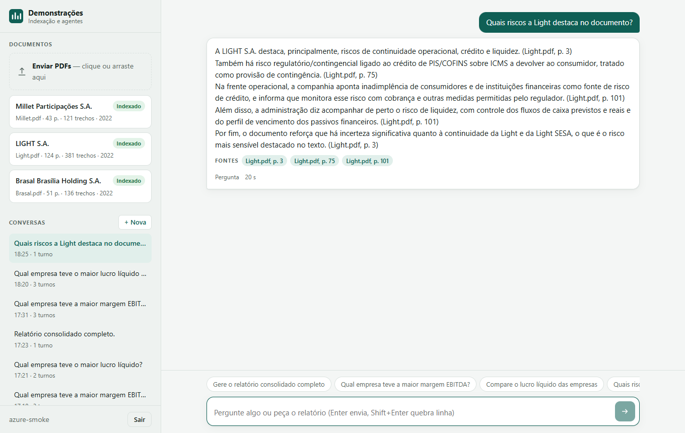
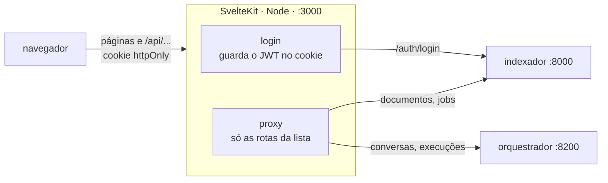
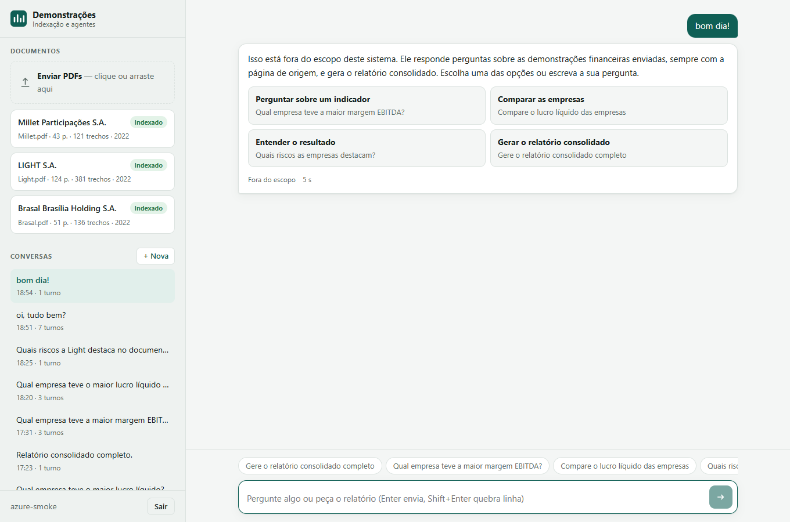
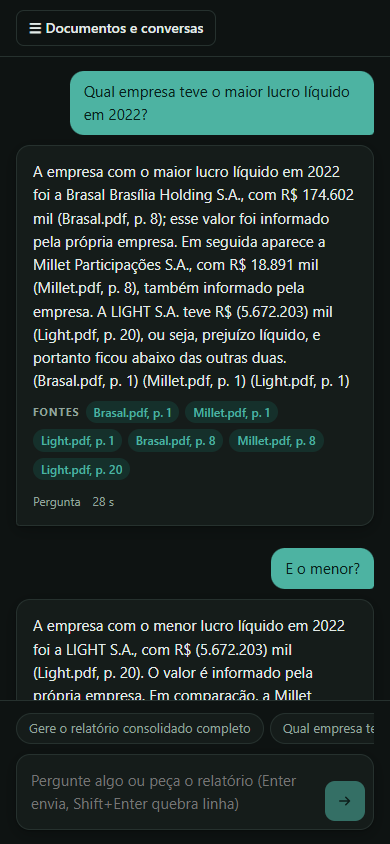
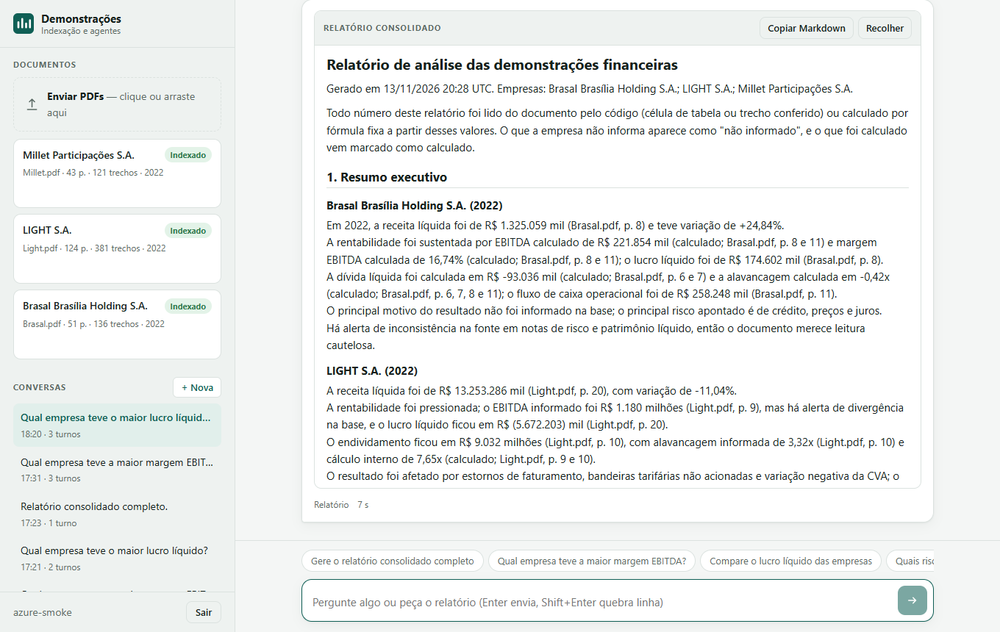

# Frontend: envio dos documentos e conversa com os agentes

Sistema 4 de 4. A tela do usuário, em SvelteKit:

- **enviar os PDFs** para o [indexador](../indexer/README.md), com o progresso da indexação;
- **conversar com os [agentes](../agents/README.md)**: perguntas com fonte e o relatório
  consolidado, em texto livre. O que não for isso recebe "fora do escopo", com as opções;
- enquanto o sistema responde, **o chat fica bloqueado**, e um aviso diz o que está acontecendo
  ("Buscando informações nos documentos…", "Lendo os números da LIGHT S.A.…").




## Como rodar

Com o indexador, o servidor MCP e os agentes no ar (ver o [README da raiz](../README.md)):

```bash
docker compose up --build -d      # http://localhost:3000
```

Entre com um usuário do indexador, ou crie uma conta na própria tela.

Fora do Docker (Node 22 ou mais novo):

```bash
cp .env.example .env              # INDEXER_URL e AGENTS_URL
npm install
npm run dev                       # http://localhost:3000, recarrega a cada mudança
```

## Como funciona



**O token não fica no navegador.** O login é feito pelo servidor do SvelteKit, que guarda o JWT
do indexador num cookie `httpOnly` e `SameSite=Strict`. O JavaScript da página não o lê (o teste
de ponta a ponta confere). Cada chamada da página vai a `/api/indexador/...` ou
`/api/agentes/...`, e o servidor repassa ao sistema certo com o token no cabeçalho. Com isso
também não há CORS: o navegador só fala com a própria tela.

**Lista fechada.** O proxy só repassa o que a tela usa ([`src/lib/server/rotas.ts`](src/lib/server/rotas.ts)):

| Sistema | Rotas |
|---|---|
| indexador | `GET`/`POST /api/documents`, `GET`/`DELETE /api/documents/{id}`, `GET /api/documents/{id}/jobs`, `GET /api/jobs/{id}` |
| orquestrador | `GET`/`POST /api/conversas`, `GET /api/conversas/{id}`, `POST /api/conversas/{id}/mensagens`, `GET /api/execucoes/{id}` |

Busca direta, as mensagens completas dos agentes e o resto ficam de fora. Um 401 vindo de cima
apaga o cookie e manda para o login.

**A sessão termina antes do token.** O token do indexador vale 60 minutos, e o orquestrador
recusa começar uma execução com menos de 15 minutos restantes (as buscas falhariam no meio). Com
menos de 16 minutos, a tela pede o login de novo, em vez de deixar a mensagem falhar.

### O chat

Uma mensagem vai para `POST /api/conversas/{id}/mensagens` com `aguardar: false`. O orquestrador
diz o que ela é (pergunta, relatório ou fora do escopo), e o código cobra o que cada tipo exige
(ver [Estado, memória e conversa](../agents/README.md#estado-memória-e-conversa)). A tela não
precisa de botões de modo: o usuário só escreve.

O sistema não é de conversa: "oi", "me conta uma piada", "vale a pena comprar ações da Light?"
recebem um texto fixo, escrito pelo código, e as opções do que o sistema faz. Clicar numa opção
manda o exemplo dela.



- **Bloqueio.** Do envio até a execução terminar (`completa`, `incompleta` ou `falhou`), a caixa,
  o botão e as sugestões ficam desabilitados. O orquestrador também recusa um segundo pedido na
  mesma conversa (409).
- **Acompanhamento.** A tela consulta `GET /api/execucoes/{id}` a cada 1,5 s e lê os passos do
  trace. O aviso vem do que está acontecendo de verdade ([`src/lib/progresso.ts`](src/lib/progresso.ts)):

  | Passo mais recente | Aviso |
  |---|---|
  | ainda nenhum | Carregando… |
  | início, catálogo dos especialistas, turnos anteriores | Entendendo o pedido… |
  | orquestrador decidindo | Pensando… |
  | pesquisador trabalhando | Buscando informações nos documentos… |
  | extrator em um documento | Lendo os números de *empresa*… |
  | validador em um documento | Conferindo as fontes de *empresa*… |
  | analista em um documento | Analisando o texto de *empresa*… |
  | redator | Escrevendo… |
  | vários ao mesmo tempo | *N* especialistas trabalhando ao mesmo tempo… (e a lista) |
  | conferência final | Conferindo se está tudo pronto… |

  Quem está trabalhando sai dos passos `delegando` (quando o especialista começa) e
  `especialista` (quando termina). Depois que o orquestrador classifica a mensagem, o aviso diz
  "Entendido como pergunta" (ou relatório, ou fora do escopo). Se nada muda por 8 segundos e ninguém
  está trabalhando, o aviso alterna entre "Pensando…", "Buscando informações…" e "Carregando…",
  para não parecer travado. O tempo decorrido fica ao lado.
- **Recarregar no meio.** A conversa aberta fica no endereço (`?c=conv-...`). Ao voltar, se o
  último turno ainda está rodando, o chat continua bloqueado e o acompanhamento recomeça.
- **A resposta.** Pergunta: o texto em Markdown e as fontes (documento e página). Relatório: o
  relatório em Markdown, com tabelas, recolhível, e um botão para copiar. Fora do escopo: o texto
  fixo e as opções. A mensagem livre do orquestrador nunca aparece como resposta. Turno incompleto
  ou com falha aparece como tal, com o motivo. O Markdown que vem dos agentes passa pelo
  DOMPurify antes de ir para a tela.

### Os documentos

Arrastar e soltar (ou escolher) um ou mais PDFs. A lista se atualiza sozinha enquanto houver
documento na fila ou em processamento, com o progresso do job ("Lendo páginas: 12 de 51",
"Indexando os trechos…"). Remover pede confirmação na própria lista.

## Testes

```bash
npm run check     # tipos (svelte-check)
npm test          # 16 testes (Vitest): o aviso de andamento, a lista do proxy, a sessão
npm run build
```

O caminho inteiro foi conferido no navegador (Edge, pelo Playwright), contra os sistemas reais:

- login, cookie `httpOnly`;
- pergunta, seguimento ("E o menor?") e o relatório pedido no chat, com a caixa bloqueada e os
  avisos mudando;
- cinco mensagens fora do escopo (saudação, piada, previsão do tempo, conselho de investimento,
  agradecimento), todas barradas sem chamar especialista, e uma pergunta de verdade passando;
- recarregar no meio;
- conta nova, envio de um PDF até "Indexado" e remoção;
- celular e tema escuro, sem rolagem horizontal.

| Celular, tema escuro | Relatório pedido no chat |
|---|---|
|  |  |

## Variáveis

| Variável | Para quê | Padrão no Docker |
|---|---|---|
| `INDEXER_URL`, `AGENTS_URL` | Onde estão o indexador e o orquestrador, vistos do servidor da tela | `http://api:8000`, `http://orquestrador:8200` (rede `indexer_default`) |
| `ORIGIN` | O endereço que o navegador usa. O SvelteKit confere a origem do formulário de login com ele | `http://localhost:3000` |
| `BODY_SIZE_LIMIT` | Tamanho máximo de um envio pelo proxy (o padrão do adapter-node é 512 KB) | `60M` |
| `COOKIE_SECURE` | `true` quando a tela for servida por HTTPS | `false` |

Nenhuma chave de API: o único segredo é o token de cada usuário, que vem do login.

## Decisões e limitações

- **SvelteKit com servidor (adapter-node), não um site estático.** O servidor é o que guarda o
  token fora do alcance do JavaScript e evita CORS nas APIs. Custa um processo Node a mais.
- **Consulta periódica, não streaming.** A cada 1,5 s a tela lê a execução inteira, com todos os
  passos (num relatório, algumas centenas). É simples e basta para um usuário; para muitos, o
  orquestrador deveria mandar os passos por SSE.
- **O aviso depende do trace.** Ele mostra quem está trabalhando, não o que o modelo está
  "pensando" naquele instante: o raciocínio só chega quando a chamada do agente termina.
- **Criar conta é aberto**, como no indexador. Em produção, o cadastro seria pelo provedor de
  identidade (Entra ID), e a tela só faria o login.
- **Sem baixar arquivos.** O relatório pode ser copiado em Markdown; os JSON da entrega continuam
  saindo pelo script dos agentes.

## Estrutura

```
frontend/
├─ src/
│  ├─ hooks.server.ts              lê a sessão do cookie e barra quem não entrou
│  ├─ lib/
│  │  ├─ server/sessao.ts          cookie httpOnly, validade do token
│  │  ├─ server/rotas.ts           a lista do que o proxy repassa
│  │  ├─ server/config.ts          endereços dos sistemas
│  │  ├─ api.ts                    cliente do navegador (só fala com a própria tela)
│  │  ├─ progresso.ts              passos do trace → aviso de andamento
│  │  ├─ markdown.ts               Markdown → HTML limpo (marked + DOMPurify)
│  │  └─ components/               Documentos, Conversas, Chat, Turno, Andamento, Markdown
│  └─ routes/
│     ├─ login/                    entrar e criar conta (form actions)
│     ├─ sair/                     encerra a sessão
│     ├─ api/[sistema]/[...rota]/  o proxy
│     └─ +page.svelte              a tela principal
├─ tests/                          Vitest
├─ docs/                           capturas de tela
├─ Dockerfile  docker-compose.yml  .env.example
```
