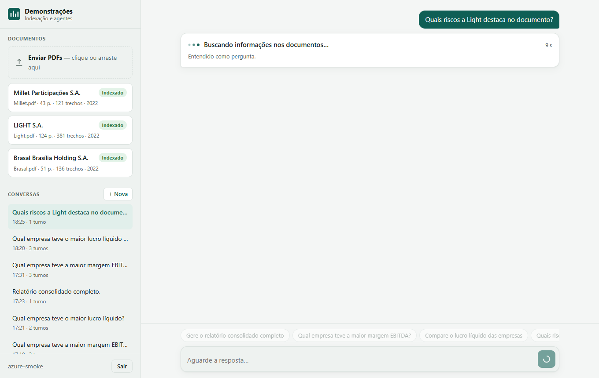
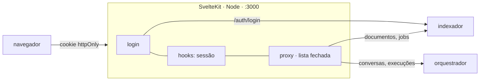

# Frontend

Tela em SvelteKit para enviar os PDFs ao [indexador](../indexer/README.md) e conversar com os
[agentes](../agents/README.md). Os fluxos e as telas estão em [docs/fluxos.html](docs/fluxos.html).





## Como funciona

- **Sessão**: o login é feito pelo servidor do SvelteKit; o JWT fica num cookie `httpOnly`,
  `SameSite=Strict`, fora do alcance do JavaScript. A sessão termina com menos de 16 min de
  token, antes de o orquestrador recusar um pedido.
- **Proxy**: `/api/indexador/…` e `/api/agentes/…` repassam só as rotas da lista
  (`src/lib/server/rotas.ts`), com o token no cabeçalho. Sem CORS nas APIs.
- **Chat**: a mensagem vai com `aguardar: false`; a caixa fica bloqueada e a tela consulta a
  execução a cada 1,5 s. O aviso ("Buscando informações nos documentos…", "Lendo os números de
  LIGHT S.A.…") é lido dos passos do trace (`src/lib/progresso.ts`). Recarregar retoma a conversa
  (`?c=…`) e o bloqueio.
- **Resposta**: pergunta com as fontes; relatório em Markdown com tabelas; fora do escopo com as
  opções clicáveis. Todo Markdown passa pelo DOMPurify.
- **Documentos**: envio de vários PDFs, progresso do job, remoção com confirmação.

## Rodar

```bash
docker compose up -d --build      # http://localhost:3000

cp .env.example .env && npm install && npm run dev    # fora do Docker
npm run check && npm test && npm run build
```

`config/ajustes.yaml`: os atalhos acima do chat, o intervalo da consulta do andamento e a
margem da sessão. Relido quando muda: vale no próximo carregamento da página, sem build.

| Variável (docker-compose) | Para quê |
|---|---|
| `INDEXER_URL`, `AGENTS_URL` | Endereços vistos do servidor (no Docker: `api:8000`, `orquestrador:8200`) |
| `ORIGIN` | Origem conferida no formulário de login |
| `BODY_SIZE_LIMIT` | Tamanho do envio pelo proxy (`60M`) |
| `COOKIE_SECURE` | `true` atrás de HTTPS |

## Estrutura

```
src/hooks.server.ts               sessão
src/lib/server/                   cookie, lista do proxy, endereços
src/lib/progresso.ts              trace → aviso
src/lib/components/               Documentos, Conversas, Chat, Turno, Andamento, Markdown
src/routes/api/[sistema]/[...rota] proxy
```
