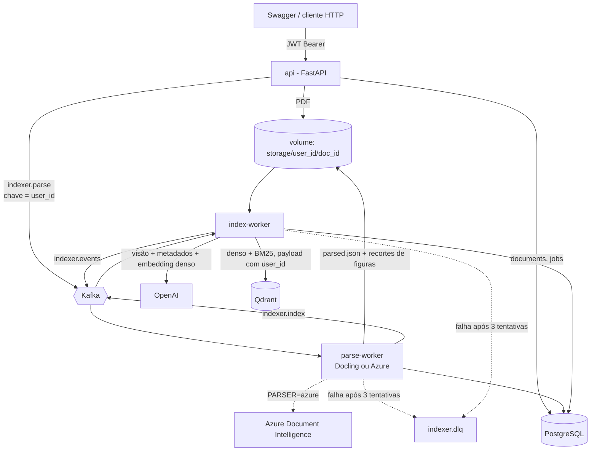

# Indexador de Demonstrações Financeiras

Sistema 1 de 2 da solução. Ele recebe PDFs de demonstrações financeiras por uma API com login,
divide cada documento em trechos (chunks) que guardam a página e a seção de origem, e grava
esses trechos no Qdrant com dois vetores: um semântico e um de palavras-chave.

O sistema 2, o agente que extrai indicadores, responde perguntas com citação e gera o relatório,
vai consultar esse índice. Ele ainda não foi construído.

O PDF pode ser lido por dois parsers, trocáveis por uma variável: o Docling, que roda na
máquina, ou o Azure AI Document Intelligence.

Não há frontend. Tudo é testável pelo Swagger em `http://localhost:8000/docs`.

## O caminho de um PDF



1. **Upload.** A API confere o login e o arquivo, grava o PDF em disco, cria um job e põe uma
   mensagem na fila. Responde na hora com `202`; não processa nada.
2. **Parse.** O parse-worker lê o PDF com o parser escolhido (Docling, na máquina, ou Azure
   Document Intelligence) e produz uma lista de elementos (títulos, parágrafos, tabelas,
   recortes de gráficos), cada um com a sua página. Com o Docling, é a etapa lenta.
3. **Indexação.** O index-worker transcreve e confere os gráficos, identifica empresa e período,
   monta os chunks, calcula os dois vetores e grava no Qdrant.
4. **Consulta.** O índice fica pronto para busca híbrida (semântica + palavras-chave, combinadas
   por RRF). A rota `POST /api/search` já faz essa busca, para conferência.

## Como rodar

Pré-requisitos: Docker com Compose e pelo menos 8 GB de memória disponíveis para o Docker. O
parse-worker chega a 4 GB; no Docker Desktop com WSL 2 o padrão é metade da RAM da máquina.

```bash
cp .env.example .env        # preencha OPENAI_API_KEY e JWT_SECRET
docker compose up --build   # kafka, postgres, qdrant, api, parse-worker, index-worker
```

A primeira construção demora cerca de 25 minutos na máquina de desenvolvimento. A imagem do
parse-worker tem 4,3 GB, com PyTorch só-CPU e os modelos do Docling e do OCR já baixados, para
que nada seja baixado em execução. A imagem da API e do index-worker tem 825 MB. As construções
seguintes reaproveitam as camadas e levam segundos.

Depois, no Swagger (`/docs`):

1. `POST /auth/register`: crie um usuário.
2. Botão **Authorize**: informe usuário e senha. O Swagger faz o login e guarda o token.
3. `POST /api/documents`: envie um PDF (há três em `data/pdfs/`). A resposta traz `doc_id` e `job_id`.
4. `GET /api/jobs/{job_id}`: acompanhe até `status = done`. Durante o parse, o progresso é por página.
5. `GET /api/documents/{doc_id}/chunks` e `POST /api/search`: confira o que foi indexado.

Ou tudo de uma vez, pela linha de comando:

```bash
uv run python scripts/smoke.py    # registra, loga, envia os 3 PDFs, acompanha e imprime tempos e custos
```

O dashboard do Qdrant fica em `http://localhost:6333/dashboard`.

### Escolher o parser

Quem lê o PDF é decidido pela variável `PARSER` no `.env`:

```bash
PARSER=docling            # padrão: roda na máquina, sem custo por página

PARSER=azure              # Azure AI Document Intelligence
AZURE_DI_ENDPOINT=https://<recurso>.cognitiveservices.azure.com/
AZURE_DI_KEY=<chave>      # recurso no nível S0; o gratuito lê só 2 páginas por documento
```

Para trocar:

1. mude `PARSER` no `.env`;
2. rode `docker compose up -d`, que recria os serviços com a variável nova;
3. confira o campo `parser` em `GET /health`;
4. reenvie o PDF (ou rode `scripts/smoke.py`). O documento é reindexado com o parser novo.

Cada parser guarda o próprio cache por documento, então voltar ao anterior leva segundos e não
paga nada de novo. Com `PARSER=azure` e sem as credenciais, `/health` mostra o que falta e o
upload responde `503`, em vez de aceitar um job que ficaria parado.

Para usar só a Azure, sem construir a imagem do Docling (4,3 GB):

```bash
docker compose -f docker-compose.yml -f docker-compose.azure.yml up --build
```

### Desenvolvimento fora do Docker

```bash
docker compose up -d kafka postgres qdrant
uv sync                                    # inclui Docling, torch e RapidOCR (grupo "parse")
uv run pytest                              # 142 testes, sem rede nem contêiner
uv run python -m app.warmup                # baixa os modelos uma vez
uv run uvicorn app.main:app --port 8000
uv run python -m app.workers.parse_worker
uv run python -m app.workers.index_worker
```

Sem chave da OpenAI, `EMBEDDING_PROVIDER=fake` roda o pipeline inteiro com um vetor denso sem
significado (o BM25 continua real) e sem as chamadas de LLM. Serve para exercitar a mecânica,
não para avaliar a busca.

## Rotas

Todas as rotas `/api/*` exigem `Authorization: Bearer <token>`.

| Método | Rota | Função |
|---|---|---|
| POST | `/auth/register` | Cria usuário |
| POST | `/auth/login` | Troca usuário e senha por um token JWT |
| GET | `/auth/me` | Usuário do token |
| POST | `/api/documents` | Envia um PDF (`company` e `period` opcionais). Responde `202` com `doc_id` e `job_id` |
| GET | `/api/documents` | Lista os documentos do usuário |
| GET | `/api/documents/{doc_id}` | Detalhe: metadados, contagem de chunks, origem de cada metadado |
| GET | `/api/documents/{doc_id}/jobs` | Histórico de jobs do documento |
| PATCH | `/api/documents/{doc_id}` | Corrige metadados e reindexa a partir do parse em cache |
| DELETE | `/api/documents/{doc_id}` | Remove pontos do Qdrant, registros e arquivos |
| GET | `/api/documents/{doc_id}/chunks` | Prévia paginada dos chunks indexados |
| GET | `/api/jobs/{job_id}` | Etapa, progresso por página, tentativas, tempos, tokens, custo, erro |
| POST | `/api/jobs/{job_id}/retry` | Reenfileira um job que falhou, na etapa em que falhou |
| POST | `/api/search` | Busca híbrida com RRF nos documentos do usuário (para conferência) |
| GET | `/health` | API, Postgres, Kafka e Qdrant, e qual parser está configurado |

## Arquitetura

| Peça | Papel |
|---|---|
| **api** | Autentica, valida o PDF, grava o arquivo e o job, publica no Kafka e responde `202`. |
| **parse-worker** | PDF → elementos com página, pelo parser escolhido. Com o Docling é pesado em CPU; com a Azure, quase só rede. |
| **index-worker** | Gráficos, metadados, chunks, vetores e gravação no Qdrant. Quase só rede; não depende de Docling nem de torch. |
| **Kafka** | Duas filas de trabalho, uma de eventos e uma de mensagens mortas. |
| **PostgreSQL** | Usuários, documentos e jobs (estado, progresso, tempos, tokens, custo). |
| **Qdrant** | Uma coleção, dois vetores por ponto, isolamento por `user_id`. |

São dois tipos de worker porque as cargas são diferentes: o parse é limitado por CPU e leva
minutos; a indexação é limitada por chamadas de rede e leva segundos. Cada um escala sozinho:

```bash
docker compose up -d --scale parse-worker=2 --scale index-worker=3
```

### Filas

| Tópico | Produz | Consome | Conteúdo |
|---|---|---|---|
| `indexer.parse` | api | parse-worker | `{job_id, user_id, doc_id, attempt}` |
| `indexer.index` | parse-worker, api | index-worker | `{job_id, user_id, doc_id, attempt, reason}` |
| `indexer.events` | workers | sistema do agente | `document.indexed` / `document.failed` |
| `indexer.dlq` | workers | (ninguém) | mensagem original + erro |

- **A mensagem leva só referências.** O PDF fica no volume compartilhado.
- **Chave = `user_id`.** Os documentos de um usuário ficam em ordem na mesma partição, e quem
  envia cem PDFs não trava a fila dos outros.
- **Entrega ao menos uma vez.** O offset só é confirmado depois que a etapa terminou. As etapas
  são idempotentes (parse em cache, ids de ponto determinísticos, apaga antes de gravar), então
  uma reentrega após a queda de um worker não duplica nada.
- **Retry.** Falha transitória volta à fila com `attempt+1` e espera crescente. Na terceira vai
  para a DLQ e o job fica `failed` com a mensagem de erro. `POST /api/jobs/{id}/retry`
  reenfileira na etapa que falhou, sem refazer o parse.
- **Parse longo.** O parse-worker usa `max_poll_records=1` e `max_poll_interval_ms` de 30
  minutos. Sem isso o broker expulsaria o consumidor no meio de um PDF grande.
- **Kafka fora do ar.** Se a publicação falhar, o job é marcado `failed` e a API responde `503`.
  Nada fica "na fila" sem estar.

### Autenticação e isolamento entre usuários

`POST /auth/login` devolve um JWT (HS256) com `sub = user_id`. O `user_id` nunca é parâmetro:
vem do token assinado, então ninguém age em nome de outro trocando um id. O isolamento existe em
três camadas:

- **Postgres:** chave primária `(user_id, doc_id)`; toda consulta filtra por usuário.
- **Disco:** `storage/{user_id}/{doc_id}/`; o nome enviado pelo cliente nunca vira caminho.
- **Qdrant:** o filtro por `user_id` é montado dentro do `VectorStore`, não nas rotas. Não existe
  chamada ao índice sem ele. O índice de payload usa `is_tenant=true`.

Recurso de outro usuário responde `404`, não `403`, para não confirmar que o id existe.

## Do PDF ao chunk, etapa por etapa

### 1. Parse: dois parsers, o mesmo resultado

O parse transforma o PDF numa lista de elementos (títulos, parágrafos, tabelas em Markdown,
recortes de gráfico), cada um com a sua página, que é o que permite citar a origem. O resultado
é gravado em `parsed.json`, num esquema próprio do projeto. Há dois parsers que produzem esse
mesmo arquivo, escolhidos pela variável `PARSER`. O resto do pipeline não sabe qual rodou.

| | `PARSER=docling` (padrão) | `PARSER=azure` |
|---|---|---|
| Quem lê o PDF | Docling, na máquina | Azure AI Document Intelligence, modelo `prebuilt-layout` |
| Tempo nos 3 PDFs | 26 min em CPU | 86 s |
| Custo | zero | por página: US$ 2,18 nos 3 PDFs, a US$ 10 por mil páginas (preço de referência) |
| Imagem do parse-worker | 4,3 GB, até 4 GB de memória | a leve (825 MB) basta |
| O PDF sai da máquina | não | sim, vai para o recurso da Azure |
| Texto de dentro dos gráficos | OCR local (RapidOCR) do recorte | palavras que o serviço leu na página, inclusive por OCR nos gráficos em imagem |
| O que exige | nada | `AZURE_DI_ENDPOINT`, `AZURE_DI_KEY` e recurso no nível S0 |

Os dois foram medidos com os mesmos três PDFs; a comparação completa está em "Os dois parsers,
lado a lado".

O que é igual nos dois:

- A camada de texto de cada página também é guardada (via `pypdf`). É a referência exata das
  conferências de metadados e de gráficos, e da auditoria.
- Tudo o que vem depois do parse: gráficos, metadados, chunks e vetores.
- **Um cache por parser.** Cada parser grava em `storage/{user}/{doc}/parse/{parser}/` o seu
  `parsed.json`, os recortes e as transcrições dos gráficos. Retry, correção de metadados e
  reindexação não repetem o parse, e trocar de parser não apaga o que o outro fez.
- O chunk guarda quem leu o PDF (campo `parser`), e o job também (`timings.parser`).
- **Números de tabela contra a camada de texto.** O Docling lê a camada de texto do PDF; um
  serviço de nuvem pode ler a página por OCR. Por isso o parse-worker conta, com qualquer
  parser, quantos números de tabela não existem no texto da página
  (`timings.table_numbers_unconfirmed` no job). Com o Docling é zero.

#### Docling

Os três PDFs têm texto nativo, mas as tabelas da Brasal e da Millet não têm bordas. O Docling
reconstrói a estrutura dessas tabelas (modelo TableFormer). O que foi preciso tratar:

- **Fontes de sistema no Linux.** O modelo de layout trabalha sobre a página renderizada, e
  estes PDFs referenciam Arial sem embutir a fonte em várias páginas. Numa imagem `python:slim`,
  sem nenhuma fonte, as letras viram "caixinhas", o modelo classifica páginas inteiras como
  figura e as tabelas somem, sem erro nenhum, porque o texto extraído continua certo. Na Millet
  isso derrubava de 37 para 8 tabelas. A imagem do parse-worker instala `fonts-liberation`
  (mesmas métricas de Arial, Times e Courier) e o worker se recusa a subir num Linux sem fontes.
- **Conversão em lotes de 10 páginas** (`PARSE_PAGE_BATCH`). O Docling guarda as páginas
  renderizadas até o fim de cada conversão. Com a Light (124 páginas) convertida de uma vez, o
  worker passou de 5,7 GB e esgotou a memória e o swap do Docker. Em lotes, o pico ficou em
  4,0 GB nos três documentos e não cresce com o número de páginas.
- **Marcador de lista.** O Docling separa o marcador ("3.1", "b)") do texto de um item de lista
  numerada. O parser junta os dois de novo, porque a numeração define a seção.
- **Parágrafo que atravessa a quebra de página.** O Docling junta num item só o parágrafo que
  começa numa página e termina na seguinte. O parser guarda as duas páginas, e o chunk cita o
  intervalo. Guardando só a primeira, um trecho da p. 28 da Light seria citado como p. 27.
- **Cabeçalho de tabela com a marca na coluna errada.** Na Brasal, só as colunas de 2021 trazem
  "(não auditado)". Em 11 das 64 tabelas o modelo de tabelas estendia essa célula para a coluna
  de 2022, ou a partia em "(não" e "auditado)", e o cabeçalho da DRE dizia que 2022 também não
  foi auditado. A correção usa a posição: a célula que está na linha logo abaixo dos anos e é
  estreita demais para cobrir duas colunas volta para a coluna sobre a qual está escrita. Um
  cabeçalho de grupo ("Controladora"), que fica acima das colunas, nunca é alterado. A regra foi
  conferida rodando o Docling nos três PDFs e comparando as 227 tabelas antes e depois: mudaram
  as 11 da Brasal e nenhuma outra.

Além disso:

- Depois do Docling, o RapidOCR lê cada recorte de figura com 4% da página ou mais e guarda cada
  texto com a posição dele na imagem (`ocr_words`). Isso é usado na conferência dos gráficos.
- O OCR de página inteira só é ligado quando o documento tem página sem texto nativo.

#### Azure Document Intelligence

O serviço devolve parágrafos com papel (título, cabeçalho de página...), tabelas com as células
e figuras com a região que ocupam na página. Nos três PDFs ele tirou o texto da camada de texto
do PDF (todos os números de tabela existem nela) e leu por OCR o que só existe em imagem,
inclusive os gráficos colados como imagem. A conversão para o `parsed.json`:

- **Ordem de leitura.** Parágrafos, tabelas e figuras são intercalados pela posição de cada um
  no texto corrido que o serviço devolve. O que está dentro de uma tabela ou de uma figura não
  vira texto corrido.
- **Cabeçalho e rodapé de página.** O rótulo do serviço falha nos dois sentidos, e o que separa
  os casos é a repetição: cabeçalho corrido aparece em mais de uma página.
  - Na Light, dois cabeçalhos vieram rotulados 170 vezes e sem rótulo 5 vezes. O parágrafo sem
    rótulo que tem o texto de um cabeçalho rotulado em outras páginas, e está na mesma faixa da
    página, também é descartado.
  - Um título que só existe no alto de uma página veio rotulado como cabeçalho: "Demonstrações
    dos fluxos de caixa" na Millet, "Anexo I" na Light. Ele é mantido quando é o nome de uma
    demonstração, ou quando tem cara de título e a página não abre com outro. Timbre com
    endereço e telefone continua fora.
- **Bloco de título das demonstrações.** O serviço devolve num parágrafo só a empresa, o título,
  o período e a unidade. O parser separa as linhas: o título abre a seção ("BALANÇOS
  PATRIMONIAIS") e o resto vai como texto para o alto da tabela ("EM 31 DE DEZEMBRO DE 2022 E DE
  2021 (Em milhares de reais)"). Linha de período rotulada como título ("Exercício findo em 31
  de dezembro de 2021") também vai como texto. Sem isso, a tabela das mutações do patrimônio
  líquido da Millet ficava na seção da demonstração anterior.
- **Tabelas.** As células viram Markdown no mesmo formato do Docling, com os níveis do cabeçalho
  juntados ("Consolidado - 2022"). Célula de dados que cobre várias colunas fica só na primeira,
  para um número não aparecer repetido. Dois consertos:
  - *"(não auditado)".* Na Brasal a marca vale só para as colunas de 2021. O serviço a devolve
    como linha de dados, numa célula que cobre várias colunas ou sob a coluna errada (40
    tabelas). Ela volta para o cabeçalho da coluna sobre a qual está escrita, pela posição das
    palavras na página: "Controladora - 2021 - (não auditado)".
  - *Rótulo quebrado em duas linhas.* "Lucro operacional antes das receitas e despesas" com os
    valores e, na linha seguinte, só "financeiras": a continuação volta para o rótulo.
- **Caixas de seleção.** O serviço marca caixas de seleção onde há um pontilhado ou um traço:
  123 nos três documentos, coladas em rótulos e valores ("Estoques ☐"). Elas são descartadas.
  Onde a caixa existe de verdade (o balanço social da Light), o PDF já a escreve como "( X )".
- **Gráficos.** O serviço informa só a região da figura, e ela é mais justa que a do Docling: só
  a área do gráfico, sem título nem margem. O recorte é renderizado aqui, com o `pypdfium2`, e
  é ele que vai para o modelo de visão.
  - Três gráficos da Light ficam entre 3% e 4% da página, abaixo do limite que separa gráfico de
    logotipo. Figura pequena (a partir de 2%) é tratada como gráfico quando o serviço leu
    números dentro dela.
  - O texto de dentro da figura vem das palavras que o serviço leu naquela região, reagrupadas
    em trechos: "Perdas Totais" é um trecho; "dez/20" e "mar/21", num eixo, são dois. Palavra
    escrita na vertical não se junta à horizontal ao lado, e dois números vizinhos são sempre
    dois valores (os de uma barra empilhada ficam encostados).
  - A camada de texto do PDF dentro da região também é guardada. Ela completa os valores que o
    modelo de visão pula (etapa 2).
  - Se o serviço não devolver nenhum número dentro de uma figura grande e o OCR local estiver
    instalado (imagem do alvo `parse`), ele lê o recorte. Nos três PDFs não foi preciso.
- **Parágrafo em duas páginas, nota de rodapé de tabela e legenda de figura** têm o mesmo
  tratamento do Docling.
- **PDF com restrição de permissões** (caso da Brasal): é regravado sem a criptografia antes do
  envio, porque o serviço pede que a proteção seja removida.
- **Resposta guardada.** A resposta crua do serviço fica ao lado do `parsed.json`, em
  `response.json.gz`. Se a conversão for refeita, por mudança de regra ou de versão do pipeline,
  o serviço não é chamado nem cobrado de novo.
- **Nível gratuito.** O F0 analisa só as duas primeiras páginas de cada documento. Se o serviço
  devolver menos páginas do que o PDF tem, o job falha com essa explicação, em vez de indexar o
  documento pela metade.
- **Erros.** Credencial ou endpoint recusado vai direto para `failed`, sem novas tentativas.
  Limite de requisições e erro do servidor seguem o retry normal.
- **Custo.** O job registra `usage.parse_cost_usd`: páginas enviadas ao serviço vezes o preço por
  página (`AZURE_DI_PRICE_PER_1K_PAGES`, US$ 10 por mil páginas por padrão; confira a tabela da
  sua região). Parse em cache e conversão refeita a partir da resposta guardada não são cobrados.

**Como o parser da Azure foi validado.** Em 13/11/2026, contra o serviço real (recurso S0 em
East US, API 2024-11-30), com os três PDFs, em contêineres. A primeira execução mostrou os
desvios descritos acima; todos foram corrigidos, e os números de "Os dois parsers, lado a lado"
são os de depois. Como a resposta do serviço fica guardada, as correções foram conferidas sem
chamá-lo de novo. A variante com a imagem leve (`docker-compose.azure.yml`) também foi
executada. Além disso, 28 testes automatizados cobrem a conversão e a troca de parser com
respostas no formato da API e um cliente falso; rodam sem rede.

### 2. Gráficos (modelo de visão + conferência)

Cada recorte de gráfico vai para um modelo de visão (`gpt-4o-mini`), que devolve, para cada
valor, o número e os rótulos que dizem a que ele se refere. O modelo é necessário porque texto e
OCR devolvem números soltos; só ele diz que "26,51%" é o valor de "dez/22".

O problema é que ele erra. Nos gráficos da Light ele leu número errado, leu rótulo errado e ligou
número ao rótulo errado. Por isso **nada do que ele devolve entra no índice sem ser conferido por
uma fonte que não é o LLM**: o texto nativo da página e o OCR do recorte.

| O que o modelo afirma | Como é conferido | Se não confere |
|---|---|---|
| **O número** (`26,51%`) | Tem de existir no texto da página ou no OCR com os mesmos grupos de dígitos. "26,51" confere com "26.51", mas não com "2.651". Um dígito solto no OCR não vale. | O valor é omitido. |
| **O texto** (título, rótulo, nota) | As palavras têm de existir na página ou no recorte. Rótulo tem de estar escrito no recorte. Nota com número não entra. | O texto é omitido. |
| **A ligação** (`dez/22 → 26,51%`) | Tem de aparecer na posição: o rótulo é o texto do eixo mais próximo do valor (colunas) ou está na mesma linha dele (barras horizontais), e na região do rótulo não há valor que o modelo ligou a outro rótulo. | O valor fica na linha "Valores sem rótulo conferido". |

Detalhes da regra:

- O número é gravado como a fonte o escreve. Se o modelo devolve "94.2%" e a página tem "94,2%",
  o índice guarda "94,2%".
- Quando só o OCR confirma e o número é do tipo "1.234" (milhar ou decimal?), o separador também
  tem de ser o mesmo.
- Um título no alto da figura, ou um texto que cobre todos os valores, não é aceito como rótulo:
  a posição dele não distingue nada.
- Logotipos e fotos são descartados antes: por área (menos de 4% da página) ou quando o modelo
  classifica a figura como decorativa. A exceção é a figura pequena, a partir de 2% da página,
  em que uma segunda fonte leu números: é um gráfico pequeno. Acontece com o parser da Azure,
  que delimita só a área do gráfico.

**Conferir não é completar.** A conferência garante que o que entra está certo, não que está
tudo lá: num gráfico cheio o modelo às vezes transcreve só parte dos valores. Numa das execuções
ele devolveu 30 dos 43 valores do gráfico de perdas da Light, e o "26,51%" de dez/22 ficou de
fora. Quando o parser entrega a camada de texto do PDF dentro da região da figura (hoje, só o da
Azure), os valores que o modelo pulou entram a partir dela, numa linha própria e sem rótulo:
"Valores escritos na figura que o modelo não transcreveu: 9.902; ...; 26,51%". Essa camada é
uma fonte exata: são os rótulos de um gráfico vetorial como o PDF os escreve. Só contam as
linhas feitas só de valores (em "12 meses", o 12 é parte de um rótulo), e gráfico colado como
imagem não tem essa camada.

**Legenda de cores não é indexada como ligação.** Saber que a barra laranja é "Uso Rede" depende
da cor, e nenhuma das duas fontes confere cor. Os nomes da legenda entram no chunk como texto,
para a busca achar o gráfico, mas o índice não afirma qual valor é de qual série.

Exemplo de chunk (consumo por classe, Light p. 5):

```text
[Figura: grafico]
2021 | Industrial: 5.409; 4.996; 413
2022 | Industrial: 5.269; 4.887; 382
...
Outros textos da figura, sem ligação conferida com os valores: Uso Rede; Cativo
(Transcrição por modelo de visão. Valores: 27 de 27 conferidos, 0 no texto da página e 27 por OCR
do recorte. Rótulos: 54 de 70 ligações conferidas pela posição na figura. O que não conferiu foi omitido.)
```

O que não conferiu fica registrado em `unverified_values`. O chunk guarda `verified_ratio`
(valores conferidos), `verified_by_ocr` (quantos só o OCR confirmou), `verified_labels_ratio`
(ligações conferidas) e `extraction_method = "vision_llm"`.

### 3. Metadados

- **Empresa, período e tipo de documento:** uma chamada ao LLM sobre as três primeiras páginas.
  Para cada campo ele precisa informar a página e um trecho copiado dela. O valor só é aceito se
  o trecho existir literalmente naquela página; senão vale o regex e, por fim, `null`.
  Precedência: valor informado pelo usuário > LLM com evidência > regex.
- `PATCH /api/documents/{doc_id}` corrige um metadado e reindexa a partir do cache.

**Unidade (R$ mil / R$ milhões)** é decidida por chunk, por regra fixa, sem LLM. No relatório da
Light o texto da administração cita valores em milhões e as demonstrações estão em milhares; uma
unidade por documento estaria errada em parte dele. O sistema procura a unidade escrita no
próprio documento, nesta ordem, e para na primeira que achar:

| `unit_source` | Onde a unidade foi achada | Exemplo |
|---|---|---|
| `chunk` | Declaração dentro do próprio chunk. É o caso típico de tabela, que leva junto as linhas de título acima dela. | "(Valores expressos em milhares de reais)", "Valor (mil R$)" |
| `page` | Declaração no texto da página do chunk. | cabeçalho "(Em milhares de reais)" |
| `mentions` | Valores citados no texto do chunk; vale a unidade que mais aparece. | "R$1.817 milhões" |
| `inherited` | Convenção declarada numa página anterior, que vale até a próxima. | "(Em milhares de Reais - R$, exceto quando indicado de outra forma)" na abertura das notas |
| vazio | Nenhuma das anteriores. | texto sobre perdas em GWh |

- **Não há chute.** Se nada for achado, `unit` fica vazio. Uma versão anterior usava a unidade
  mais comum do documento como reserva e carimbava "R$ mil" em chunks sem valor em reais.
- **Convenção herdada.** Só vale como convenção a frase "em milhares/milhões de reais". Um
  cabeçalho de coluna "(R$ mil)" vale para a tabela e a página dele, não para as páginas seguintes.
- **Gráfico.** A unidade de um gráfico é só a que está escrita nele. Um gráfico de perdas em GWh
  não recebe a unidade monetária da página nem do documento.

### 4. Chunks

O corte segue a estrutura do documento, não um tamanho fixo:

- **Texto:** parágrafos da mesma seção agrupados até cerca de 450 tokens, com corte em fronteira
  de parágrafo.
- **Tabela:** um chunk por tabela, em Markdown, com as linhas de título que a antecedem (período,
  "Valores expressos em milhares de reais") e as notas de rodapé que vêm logo abaixo ("(a) Não
  auditado pelos auditores independentes"). Tabela muito grande é dividida por linhas, repetindo
  o cabeçalho em cada parte. Uma tabela nunca é cortada no meio de uma linha.
- **Gráfico:** um chunk por gráfico, só com o que foi conferido na etapa 2.
- **Cabeçalhos e rodapés corridos** (nome da empresa, "Notas explicativas...", o logotipo do
  auditor lido como título) são removidos pela repetição: a mesma linha curta, na borda da
  página, em muitas páginas. Senão virariam "seção" de tudo e gerariam dezenas de chunks
  idênticos. O rodapé fixo das demonstrações ("As notas explicativas são parte integrante das
  demonstrações financeiras") sai sempre, mesmo quando aparece em poucas páginas.
- **Índice.** O índice do documento não é indexado: ele repete o nome de todas as seções e
  aparecia como resultado de qualquer busca por elas. É reconhecido em texto corrido (linhas
  com pontilhado e número de página) e em forma de tabela, que é como o parser da Azure o
  devolve: quase todas as linhas são um título e um número de página, e as páginas não diminuem
  de uma linha para a outra. O texto curto que sobra na página do índice também sai.

A seção de cada chunk (`section_path`) vem destas regras:

- **Notas numeradas.** A hierarquia vem da numeração ("22." > "22.1" > "a)"), que é explícita.
  O pai de uma nota é a nota cujo número é prefixo do dela: o pai de "3.4" é a "3", nunca a
  "3.3" que veio antes. Se a nota-mãe não foi vista, a nota fica sem pai.
- **O que conta como número de nota.** Depois do número tem de vir um título: ponto ou espaço e
  uma maiúscula. "31 de dezembro de 2022 e 2021" e "5 anos" começam com número e não são notas.
- **Continuação.** Título com "--Continuação" no topo da página seguinte não abre seção nova. A
  comparação ignora caixa, espaços e pontuação ("7.Investimentos" = "7. Investimentos").
- **Subtítulo sem número.** Fica dentro da nota atual enquanto houver, mais adiante, um título
  numerado que continue essa nota ou abra a seguinte. Quando a numeração acaba ou recomeça, ele
  abre outra parte do documento (o parecer do auditor depois das notas, por exemplo).
- **Título quebrado em linhas.** Dois títulos sem número seguidos, sem nada entre eles, são
  juntados: "LIGHT S.A. · DEMONSTRAÇÕES DE RESULTADOS · PARA OS EXERCÍCIOS FINDOS...". O mesmo
  vale para título e subtítulo: "Holding (Light S.A.) · Desempenho Financeiro".
- **Título que o layout não reconheceu.** O rótulo "título" vem do modelo de layout e muda com o
  ambiente: no Linux, com outra fonte, "3.1 Políticas contábeis" saiu como item de lista. Por
  isso uma linha curta, numerada, iniciada por maiúscula e sem pontuação final também é tratada
  como título, desde que continue a sequência das notas. Essa condição impede uma enumeração
  qualquer ("1. Identificar o contrato") de virar seção. O nome de uma demonstração primária
  ("Balanços patrimoniais...", "Demonstrações dos fluxos de caixa...") também abre seção quando
  vem rotulado como texto.
- **Cabeçalho de contexto.** Cada chunk é vetorizado com um prefixo determinístico, por exemplo
  `[Brasal Brasília Holding S.A. | 2022 | R$ mil | 21. Receita operacional líquida | p. 43]`.
  Uma tabela sozinha não diz de que empresa, período ou nota é. O campo `text` do payload fica
  sem o prefixo, literal, para citação.

### 5. Vetores e Qdrant

- **Denso (semântico):** OpenAI `text-embedding-3-small`, 1536 dimensões, cosseno.
- **Esparso (palavras-chave):** BM25 do FastEmbed com stemmer e stopwords em português. A coleção
  usa `Modifier.IDF`, então o IDF é calculado pelo Qdrant sobre a coleção inteira.

Os dois são calculados sobre o mesmo texto e gravados no mesmo ponto. Antes de gravar, os pontos
antigos do documento são apagados, então reindexar não deixa sobra.

## Onde o LLM entra e como é controlado

O LLM é usado em dois pontos, e só neles. Texto e tabelas, que são 634 dos 641 chunks, não passam
por LLM: são extraídos pelo Docling e montados por regras.

| Chamada | Para que serve | Como é conferida | Se não confere |
|---|---|---|---|
| Transcrição de gráfico | Dizer o que cada número do gráfico é | Texto da página e OCR do recorte, com posição (etapa 2) | Número, rótulo ou ligação é omitido |
| Metadados | Empresa, período e tipo de documento | O trecho citado tem de existir literalmente na página citada | Vale o regex; se ele também falhar, `null` |

- As duas chamadas têm saída validada por schema. O conteúdo do PDF vai em mensagem de usuário,
  com instrução de não obedecer nada que esteja escrito nele, e nada do que o modelo devolve é
  executado.
- As respostas ficam em cache por documento. Reindexar não paga a chamada de novo.
- O texto é preservado como está no documento, inclusive erros da fonte (por exemplo,
  "1;061;410" na nota 3.3 da Brasal). Sinalizar inconsistência é papel do agente.
- Todo chunk carrega página e seção, então cada origem pode ser aberta no PDF.

## Contrato do índice (para o sistema do agente)

Coleção `financial_docs`:

| Item | Valor |
|---|---|
| Vetor denso | `dense`, 1536, COSINE |
| Vetor esparso | `bm25`, `modifier = IDF` |
| Id do ponto | UUIDv5 de `"{user_id}:{doc_id}:{chunk_index}"` |
| `doc_id` | 16 primeiros hex do SHA-256 do arquivo |

Payload de cada ponto:

| Campo | Significado |
|---|---|
| `user_id`, `doc_id`, `file_name` | Dono e documento |
| `company`, `period`, `doc_type` | Metadados do documento |
| `unit`, `unit_source` | Unidade monetária do chunk (`R$ mil`, `R$ milhões`, ou vazio) e de onde ela veio: `chunk`, `page`, `mentions` ou `inherited` |
| `chunk_index`, `chunk_type` | Posição no documento e tipo: `text`, `table` ou `figure` |
| `extraction_method` | `native_text`, `table_model` ou `vision_llm` |
| `parser` | Quem leu o PDF: `docling` ou `azure` |
| `section_path`, `page_start`, `page_end` | Seção e páginas de origem (página do arquivo PDF, 1-based) |
| `text` | Conteúdo literal, sem o cabeçalho de contexto. É o que o agente cita |
| `context_header` | Prefixo usado nos embeddings |
| `verified_ratio`, `verified_by_ocr`, `verified_labels_ratio`, `unverified_values` | Só em gráficos: o que foi conferido e o que ficou de fora |
| `suspicious` | `true` se o texto tem padrão de injeção de prompt |
| `token_count`, `indexed_at`, `pipeline_version` | Controle |

Índices de payload: `user_id` (tenant), `doc_id`, `company`, `chunk_type`, `extraction_method`,
`page_start`.

Busca híbrida com RRF, como `POST /api/search` faz:

```python
scope = Filter(must=[FieldCondition(key="user_id", match=MatchValue(value=user_id))])
client.query_points(
    "financial_docs",
    prefetch=[
        Prefetch(query=dense_vector, using="dense", limit=32, filter=scope),
        Prefetch(query=SparseVector(indices=..., values=...), using="bm25", limit=32, filter=scope),
    ],
    query=FusionQuery(fusion=Fusion.RRF),
    limit=8,
)
```

## Segurança

- **Credenciais:** só em `.env`, fora do Git. O `.env.example` documenta as variáveis.
- **Para onde o documento vai:** com qualquer parser, a OpenAI recebe o texto dos chunks (embeddings),
  o texto das três primeiras páginas e os recortes de gráfico. Com `PARSER=azure`, o PDF inteiro
  também é enviado ao recurso de Document Intelligence.
- **Senhas:** Argon2. **Tokens:** JWT com expiração. O login responde igual para senha errada e
  usuário inexistente.
- **Upload:** assinatura `%PDF-`, limite de tamanho e de páginas, leitura da estrutura com
  `pypdf`. PDF com senha de abertura é recusado; PDF só com restrição de permissões (caso da
  Brasal) é aceito.
- **Conteúdo malicioso no documento:** o texto do PDF é sempre dado. Chunks com padrões de
  injeção de prompt ("ignore as instruções anteriores", "system prompt") recebem
  `suspicious = true`: são indexados, mas marcados para o agente tratar.

## Resultados medidos

Feitos num Intel Core i5-10400 (12 threads, 16 GB, sem GPU), com os seis serviços em
contêineres, OpenAI real (`text-embedding-3-small` e `gpt-4o-mini`), `TABLE_MODE=accurate` e um
parse-worker. Tempos, tokens de LLM e custo são da execução completa de 11/11/2026, com a máquina
livre. Chunks e tokens de embedding são da reindexação de 12/11/2026, depois da auditoria
descrita abaixo.

| Documento | Páginas | Parse (Docling) | Indexação | Chunks (texto / tabela / gráfico) | Tokens de embedding | Tokens de LLM (entrada / saída) | Custo |
|---|---|---|---|---|---|---|---|
| Brasal | 51 | 303 s (5,9 s/pág) | 9 s | 139 (76 / 63 / 0) | 40.210 | 9.938 / 97 | US$ 0,0023 |
| Millet | 43 | 219 s (5,1 s/pág) | 7 s | 124 (88 / 36 / 0) | 39.512 | 1.074 / 89 | US$ 0,0010 |
| Light | 124 | 1.027 s (8,3 s/pág) | 31 s | 378 (243 / 128 / 7) | 137.359 | 143.954 / 1.913 | US$ 0,0255 |
| **Total** | 218 | 26 min | 47 s | 641 | 217.081 | 154.966 / 2.099 | **US$ 0,029** |

- O parse é 97% do tempo e é a etapa que escala com mais parse-workers ou com GPU. Reenviar um
  arquivo já parseado leva segundos: parse, transcrição de gráficos e metadados ficam em cache.
- O custo é dominado pelos gráficos da Light: cada recorte enviado ao modelo de visão custa de 9
  a 16 mil tokens de entrada. Os embeddings dos três documentos somam US$ 0,0044.
- Pico de memória do parse-worker: 4,0 GB.
- Fora do Docker (Windows, mesma máquina) o parse levou 241 s, 173 s e 932 s. O layout varia um
  pouco entre os dois ambientes, porque a fonte substituta muda a segmentação de alguns
  parágrafos. As tabelas batem, com uma exceção: o índice da p. 2 da Brasal sai como tabela no
  Windows (64 tabelas) e como texto no Linux (63).

### O que foi verificado de ponta a ponta

Em contêineres e com a OpenAI real:

- **Conteúdo.** A DRE da Brasal (p. 8) é um único chunk de tabela. A gestão de capital da Millet
  (p. 42) e o endividamento da Light (p. 10, "3,32x") estão nos chunks esperados.
- **Unidade** (reindexação de 12/11/2026). Origem da unidade nos chunks de cada documento:

  | Documento | No chunk | Na página | Por menções | Herdada | Sem unidade |
  |---|---|---|---|---|---|
  | Brasal | 6 | 124 | 0 | 0 | 9 |
  | Millet | 7 | 109 | 0 | 0 | 8 |
  | Light | 7 | 16 | 18 | 300 | 37 |

  Brasal e Millet repetem "em milhares de reais" em toda página; a Light declara uma vez, na
  abertura das notas, e por isso depende da convenção herdada. Os chunks sem unidade são capas e
  parecer do auditor nos três documentos e, na Light, o relatório da administração: os sete
  gráficos, duas tabelas operacionais (DEC/FEC e energia em MWm) e o texto sem valores em reais. No mesmo relatório, os 14
  chunks que citam valores em milhões saem com `"R$ milhões"` (por exemplo, o do endividamento
  na p. 10).
- **Metadados.** Empresa e tipo dos três documentos foram aceitos com o trecho literal da p. 1.
  O período da Millet veio do regex, porque o trecho citado pelo modelo não existia literalmente
  na página. O fallback funcionou como desenhado.
- **Busca híbrida.** "alavancagem dívida líquida EBITDA covenants" traz a Light p. 10 e as notas
  de covenants no topo. "Lei 14.385" (termo exato) traz as páginas 114 e 28 da Light. "risco de
  liquidez e vencimento das dívidas" traz a nota de risco de liquidez da Light e da Millet.
- **Idempotência.** Reenvio do mesmo PDF: mesmo `doc_id`, mesma contagem de pontos.
- **Queda de worker.** parse-worker derrubado no meio de um documento: a mensagem foi reentregue
  e o job terminou.
- **Erro permanente.** Chave da OpenAI inválida: três tentativas, mensagem na DLQ, job `failed`.
  Depois de corrigir a chave, `POST /api/jobs/{id}/retry` concluiu sem refazer o parse.
- **Isolamento.** Um segundo usuário não lista, não lê e não encontra na busca os documentos do
  primeiro.

### Auditoria do índice

Feita em 12/11/2026 sobre o índice em execução, comparando cada chunk com a camada de texto do
PDF. Ela achou os defeitos corrigidos nesta versão; os números abaixo são os de depois. Para
repetir, com os serviços no ar e os três PDFs indexados pelo `smoke.py`:

```bash
uv run python scripts/audit_index.py    # chunks contra o texto do PDF
uv run python scripts/eval_search.py    # 38 perguntas com página esperada
```

| Checagem | Resultado |
|---|---|
| Números das tabelas que existem no texto da página | 6.831 de 6.831 (Brasal 1.524, Millet 999, Light 4.308) |
| Números do PDF (4 dígitos ou mais) presentes nos chunks | 6.934 de 7.018 |
| Páginas com texto e sem nenhum chunk | 2: os índices da Millet (p. 2) e da Light (p. 17), removidos de propósito |
| Chunks acima do limite de tokens | 0 |
| Chunks com menos de 15 tokens | 2 |
| Tabelas da Brasal com "(não auditado)" na coluna de 2022 ou partido entre duas colunas | 0 |
| Parágrafos repetidos dentro de um chunk | 0 |
| Checagens de ponta a ponta (401 sem token, 404 para recurso alheio, contagem do Postgres igual à do Qdrant, arquivo que não é PDF recusado) | 14 de 14 |

- Dos 84 números do PDF que não estão no texto dos chunks, 82 são de cabeçalho e rodapé
  removidos (a data no cabeçalho de cada página, endereço, telefone, registro do contador), de
  número de nota (que fica em `section_path`) e das duas páginas de índice. Os outros 2 são um
  defeito real: na tabela do balanço social da Light (p. 15), o modelo de tabelas deixou de fora
  a receita líquida de 2022 e de 2021. Os dois valores estão na DRE (p. 20).
- **Defeitos de seção que a auditoria achou**, todos corrigidos:
  - Light: 34 chunks das políticas contábeis estavam sob "3.3 Caixa e equivalentes de caixa",
    porque um subtítulo sem número zerava a cadeia e a nota 3.3 virava "pai" das seguintes. Hoje
    os 40 chunks das notas 3.x estão sob "3. PRINCIPAIS POLÍTICAS CONTÁBEIS".
  - Light: a DRE estava na seção "PARA OS EXERCÍCIOS FINDOS EM...", sem o nome da demonstração.
  - Brasal: o balanço patrimonial estava na seção "Responsabilidades do auditor".
  - Millet: a nota 1 inteira estava na seção "Demonstrações dos fluxos de caixa", porque a data
    "31 de dezembro de 2022 e 2021" tinha sido lida como nota 31.
- **Página de parágrafo que atravessa a quebra:** na Light, 21 parágrafos começam numa página e
  terminam na seguinte. Os chunks que os contêm passaram a citar as duas páginas; antes citavam
  só a primeira. Na Brasal e na Millet não há nenhum caso.

**Busca.** Conjunto de 38 perguntas com a página esperada (indicadores do teste, demonstrações,
riscos, notas), em `scripts/eval_search.py`, rodado pela `POST /api/search` com os 8 primeiros
resultados:

| | Antes da auditoria | Depois |
|---|---|---|
| Chunk certo entre os 8 primeiros | 38 de 38 | 38 de 38 |
| Chunk certo em 1º lugar | 21 | 23 |
| MRR | 0,71 | 0,74 |

A busca acha o chunk certo, mas nem sempre em primeiro: para "receita operacional líquida", a
nota explicativa da receita vem antes da DRE na Brasal e na Millet. O agente deve combinar a
busca com filtro por `section_path` e `chunk_type`, não depender só da ordem.

### Os dois parsers, lado a lado

Medido em 13/11/2026, na mesma máquina, com os mesmos três PDFs e as mesmas chamadas à OpenAI.
Docling: `PARSER=docling`. Azure: `PARSER=azure`, recurso S0 em East US.

| | Docling | Azure |
|---|---|---|
| Parse dos 3 PDFs | 26 min | 86 s (Brasal 20 s, Light 46 s, Millet 20 s) |
| Custo do parse | zero | US$ 2,18 (218 páginas a US$ 10 por mil, preço de referência) |
| Chunks (texto / tabela / gráfico) | 641 (407 / 227 / 7) | 638 (396 / 234 / 8) |
| Números escritos nos chunks de tabela que não existem no texto da página | 0 de 6.831 | 0 de 6.760 |
| Números do PDF (4 dígitos ou mais) presentes nos chunks | 6.934 de 7.018 | 6.934 de 7.018 |
| Páginas com texto e sem chunk | os índices da Millet e da Light | os índices da Brasal, da Millet e da Light |
| Busca: chunk certo entre os 8 primeiros | 38 de 38 | 38 de 38 |
| Busca: chunk certo em 1º lugar | 23 | 22 |
| Busca: MRR | 0,74 | 0,74 |
| Checagens de ponta a ponta | 14 de 14 | 14 de 14 |

Os dois índices são equivalentes para o que o agente precisa. Na busca, duas indexações seguidas
com a Azure deram 23 e 22 perguntas em 1º lugar (MRR 0,75 e 0,74); a tabela traz a última. As
diferenças:

- **Por que 6.831 e 6.760.** A primeira linha conta os números que cada parser escreveu nos
  chunks de tabela, não os números do PDF. Os totais diferem porque os dois escrevem as tabelas
  de formas diferentes, não porque um perdeu números. Quase tudo vem de uma página: na tabela do
  balanço social da Light (p. 15), o Docling repete o valor de uma célula mesclada em todas as
  colunas que ela cobre ("1.893.435" aparece 9 vezes no chunk dele e 1 no da Azure), e essa
  página sozinha tem 75 números a mais no Docling. No resto as diferenças quase se compensam:
  trechos que um parser põe no chunk da tabela e o outro num chunk de texto, e o cabeçalho com
  os anos, que se repete quando uma tabela vira duas. Nas páginas conferidas, nenhum número que
  está só nas tabelas do Docling falta nos chunks da Azure. A medida que diz se algo se perdeu é
  a da linha seguinte.
- **Tempo e custo.** A Azure lê os três documentos em um minuto e meio, contra 26 minutos, e
  cobra por página. O preço usado na conta é o padrão do indexador, não o da tabela da Azure.
- **Conteúdo.** As duas contagens de 6.934 coincidem no total, mas não são os mesmos números. A
  Azure traz a receita líquida da tabela do balanço social da Light (p. 15), que o Docling deixa
  de fora, e o registro do contador no parecer da Brasal e da Millet. O Docling traz o telefone
  do timbre do auditor da Light, que a Azure descarta como cabeçalho.
- **Tabelas.** A Azure reconhece mais tabelas na Brasal (71 contra 63). Na p. 33, por exemplo,
  o Docling junta controladora e consolidado numa tabela e a Azure devolve duas.
- **Seções.** Nas demonstrações da Light, a seção da Azure é só o nome da demonstração
  ("DEMONSTRAÇÕES DE RESULTADOS"), e o período e a unidade vão no alto da tabela. Com o Docling
  as três linhas ficam juntas no nome da seção.
- **Gráficos.** A Azure separa "Carga fio" e "Perda não-técnica", que o Docling recorta como uma
  figura só: são oito chunks de gráfico, contra sete. No índice da Azure, 119 de 126 valores
  transcritos foram conferidos e 148 de 231 ligações rótulo → valor (no do Docling, 105 de 105 e
  120 de 211). Os valores barrados são quase todos do gráfico de carga fio, uma imagem pequena
  em que o OCR do serviço leu pela metade os números escritos na vertical dentro das barras
  ("105" onde está "5.105"). No gráfico de perdas o modelo leu "27,76%" onde está "27,27%": o
  errado foi barrado e o certo entrou pela camada de texto da figura. O modelo de visão varia
  entre execuções, e isso pesa mais nesses números do que o parser.
- **O que só a Azure lê.** Texto que só existe em imagem: os gráficos colados (que no caminho
  Docling dependem do OCR local) e, como efeito colateral, assinaturas manuscritas.

### Gráficos da Light

Os números desta seção são do caminho Docling. Nove recortes passaram no filtro de área. Dois
foram classificados como decorativos e sete foram transcritos.

| Gráfico | Página | Valores conferidos | Fonte do número | Ligações rótulo → valor conferidas |
|---|---|---|---|---|
| Efeito médio do reajuste tarifário | 5 | 7 de 7 | OCR do recorte | 7 de 7 |
| Consumo por classe | 5 | 27 de 27 | OCR do recorte | 54 de 70 |
| Evolução das perdas totais | 6 | 45 de 45 | Texto da página | 27 de 72 |
| Carga fio e perda não-técnica | 6 | 10 de 10 | OCR do recorte | 18 de 30 |
| Arrecadação por segmento | 6 | 8 de 8 | Texto da página | 8 de 16 |
| PECLD/ROB | 7 | 4 de 4 | Texto da página | 2 de 12 |
| Composição acionária | 11 | 4 de 4 | OCR do recorte | 4 de 4 |
| **Total** | | **105 de 105** | | **120 de 211** |

- As 120 ligações indexadas foram comparadas com as imagens e estão corretas.
- Entre as 91 omitidas há erros reais do modelo, que a versão anterior do indexador gravava:
  - no consumo por classe, ele trocava Cativo e Uso Rede na classe Industrial;
  - nas perdas totais, atribuía as curvas de percentual à série errada;
  - numa das execuções leu "Efetivo médio" onde está escrito "Efeito médio" e "27,76%" onde está
    "27,27%". O rótulo e o número foram barrados.
- As demais omissões são, quase todas, ligação por cor da legenda. O chunk da arrecadação, por
  exemplo, traz "Varejo: 94,2%; 94,0%" sem dizer qual é de dez/21 e qual é de dez/22.
- No gráfico de arrecadação o modelo devolveu os oito valores com ponto ("94.2%"). O índice
  guarda "94,2%", a forma que está na página.
- O OCR dos nove recortes levou cerca de 15 s e não refaz o parse.

## Premissas e limitações

Sobre os documentos:

- Os três PDFs fornecidos são demonstrações **anuais de 2022**, não trimestrais. `period` sai
  como `2022`.
- A página citada é a do arquivo PDF (1-based), não a numeração impressa, que diverge na Light.

Sobre o parse e os chunks:

- O parse em CPU leva minutos por documento na primeira vez (ver a tabela acima).
- **Subtítulos sem numeração fora das notas.** No relatório da administração os subtítulos não
  são numerados, então não há como saber qual está dentro de qual. Cada um vale sozinho, a não
  ser quando vem colado no título anterior. Na Light há três seções chamadas "Desempenho
  Financeiro" (distribuidora, geradora e comercializadora); o texto do chunk diz de qual empresa
  fala, a seção não.
- **Seção de gráfico.** O gráfico fica na seção do último título lido antes dele, que nem sempre
  é o assunto dele: o gráfico de perdas totais da Light (p. 6) está sob "Efeito médio para o
  consumidor". O título do próprio gráfico está no texto do chunk.
- **Tabela muito irregular.** No balanço social da Light (p. 15) o modelo de tabelas juntou o
  primeiro bloco ao cabeçalho e deixou duas células de fora (ver a auditoria acima).
- **Correção de cabeçalho de tabela.** Só trata os dois padrões descritos na etapa 1. Outro erro
  de estrutura do modelo de tabelas, se houver, passa sem ser notado: a auditoria confere se os
  números existem na página, não se cada número está na coluna certa.

Sobre a unidade:

- **Unidade herdada é convenção, não leitura.** Uma tabela das notas que esteja em outra unidade
  (quantidade de ações, MWh) e não diga isso recebe a unidade vigente do documento. O campo
  `unit_source = "inherited"` avisa o agente de que a unidade não foi lida no próprio chunk.
- **Ordem do documento.** A convenção vale da página em que é declarada em diante. Se um
  documento trouxer as demonstrações antes de um relatório em outra unidade, sem nova
  declaração, as tabelas desse relatório herdam a unidade errada.

Sobre os gráficos:

- **Legenda de cores.** A ligação de um valor com a série da legenda não é conferida e por isso
  não é indexada. Quem precisar dela tem de olhar a imagem.
- **OCR incompleto.** Se o OCR não lê um número de um gráfico em imagem, o valor fica só em
  `unverified_values`. Se não localiza o valor ou o rótulo, o valor entra sem rótulo: no
  PECLD/ROB (p. 7), dois dos quatro valores ficam assim.
- **Regra geométrica.** A conferência por posição não lê o gráfico; compara posições. Ela foi
  calibrada nos sete gráficos da Light. Num layout muito diferente (pizza com legenda lateral,
  rótulos inclinados) ela tende a perder rótulos, não a aceitar rótulo errado, mas isso não foi
  medido.
- **Dois gráficos num recorte.** Carga fio e perda não-técnica (p. 6) saem do parse como uma
  figura só e viram um chunk só. O título de cada gráfico só fica ligado aos valores mais
  próximos dele.
- **Variação entre execuções.** A transcrição do modelo de visão não é idêntica a cada chamada.
  Ela fica em cache por documento, então o índice só muda se o cache for apagado.

Sobre o parser da Azure:

- **Validado em três documentos.** As regras de título, cabeçalho e tabela foram ajustadas com a
  resposta do serviço para estes três PDFs. Outro documento pode trazer desvios que elas não
  cobrem; `scripts/audit_index.py` é o que mostra.
- **Preço de referência.** O custo registrado no job usa US$ 10 por mil páginas, que é o padrão
  do indexador. O valor real é o da tabela de preços da Azure para a região do recurso.
- **O PDF sai da máquina.** Com `PARSER=azure` o documento inteiro é enviado ao recurso da Azure.
- **Assinatura lida como palavra.** O serviço lê por OCR o que está em imagem, e uma assinatura
  manuscrita vira uma palavra sem sentido no meio do parágrafo ("Momentan", no parecer da
  Brasal).
- **Gráfico em imagem.** Com a Azure, a segunda fonte dos gráficos colados como imagem é o OCR
  do próprio serviço. O OCR local só entra se o serviço não devolver número nenhum dentro da
  figura, e só existe na imagem do alvo `parse`.
- **Complemento dos gráficos só com a Azure.** Os valores que o modelo de visão pula são
  completados pela camada de texto da figura, que só o parser da Azure extrai. Com o Docling,
  um valor que o modelo não transcreveu fica de fora.
- **Correção de cabeçalho de tabela é uma por parser.** O problema é o mesmo ("(não auditado)"
  na coluna errada), mas os dois erram de formas diferentes, e cada um tem a sua regra.
- **Medições das outras seções** deste README (tempo por documento, unidade, gráficos da Light,
  auditoria) são do caminho Docling. A comparação entre os dois está em "Os dois parsers, lado
  a lado".

Sobre a aplicação:

- `create_all` cria as tabelas no startup; não há migrações.

## Estrutura do código

```text
indexer/
├─ docker-compose.yml, Dockerfile     # alvos "light" (api, index-worker) e "parse" (Docling + OCR)
├─ docker-compose.azure.yml           # só o parser da Azure, sem a imagem do Docling
├─ data/pdfs/                         # os três PDFs do teste
├─ scripts/                           # smoke.py (fluxo completo), audit_index.py, eval_search.py
├─ app/
│  ├─ main.py, config.py, schemas.py
│  ├─ db.py, models.py, repo.py       # Postgres: usuários, documentos, jobs
│  ├─ security.py, storage.py         # JWT, senha, caminhos por usuário, validação de PDF
│  ├─ messaging.py                    # Kafka: tópicos, produtor, consumidor, retry e DLQ
│  ├─ api/                            # auth, documents, jobs, search
│  ├─ workers/                        # parse_worker, index_worker
│  └─ pipeline/
│     ├─ parsing.py                   # contrato comum dos parsers e a escolha por PARSER
│     ├─ docling_parser.py            # Docling em lotes → parsed.json
│     ├─ azure_parser.py              # Azure Document Intelligence → parsed.json
│     ├─ figure_ocr.py                # OCR local dos recortes, com posição
│     ├─ figures.py                   # modelo de visão + conferência
│     ├─ metadata.py                  # empresa, período, tipo e unidade
│     ├─ chunker.py                   # seções, texto, tabelas
│     ├─ embedder.py, vector_store.py # vetores e Qdrant
│     └─ indexing.py                  # junta as etapas da indexação
└─ tests/                             # 142 testes, sem rede nem contêiner
```

## Caminho para produção no Azure

| Aqui | Em produção |
|---|---|
| Volume compartilhado | Azure Blob Storage |
| Kafka em contêiner | Event Hubs (protocolo Kafka) ou Service Bus |
| Workers no compose | Container Apps com escala por tamanho de fila (KEDA); parse em GPU |
| `PARSER=docling` | `PARSER=azure`, já disponível: Document Intelligence (layout), com o parse-worker na imagem leve |
| Qdrant | Azure AI Search com busca híbrida e RRF nativos |
| OpenAI | Azure OpenAI no AI Foundry, com Batch API para embeddings |
| Logs em stdout | Application Insights / OpenTelemetry, com tempo e custo por etapa |
| JWT próprio | Microsoft Entra ID |
