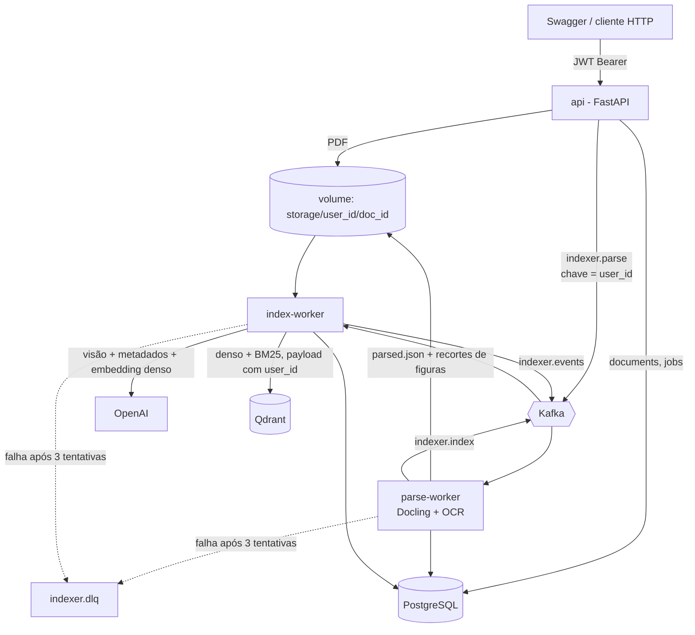

# Indexador de Demonstrações Financeiras

Sistema 1 de 2 da solução. Ele recebe PDFs de demonstrações financeiras por uma API com login,
divide cada documento em trechos (chunks) que guardam a página e a seção de origem, e grava
esses trechos no Qdrant com dois vetores: um semântico e um de palavras-chave.

O sistema 2, o agente que extrai indicadores, responde perguntas com citação e gera o relatório,
vai consultar esse índice. Ele ainda não foi construído.

Não há frontend. Tudo é testável pelo Swagger em `http://localhost:8000/docs`.

## O caminho de um PDF



1. **Upload.** A API confere o login e o arquivo, grava o PDF em disco, cria um job e põe uma
   mensagem na fila. Responde na hora com `202`; não processa nada.
2. **Parse.** O parse-worker lê o PDF com o Docling e produz uma lista de elementos (títulos,
   parágrafos, tabelas, recortes de gráficos), cada um com a sua página. É a etapa lenta.
3. **Indexação.** O index-worker transcreve e confere os gráficos, identifica empresa e período,
   monta os chunks, calcula os dois vetores e grava no Qdrant.
4. **Consulta.** O índice fica pronto para busca híbrida (semântica + palavras-chave, combinadas
   por RRF). A rota `POST /api/search` já faz essa busca, para conferência.

## Como rodar

Pré-requisitos: Docker com Compose e pelo menos 8 GB de memória disponíveis para o Docker. O
parse-worker chega a 4 GB; no Docker Desktop com WSL 2 o padrão é metade da RAM da máquina.

```bash
cp .env.example .env        # preencha OPENAI_API_KEY e JWT_SECRET
docker compose up --build   # kafka, postgres, qdrant, api, parse-worker, index-worker
```

A primeira construção demora cerca de 25 minutos na máquina de desenvolvimento. A imagem do
parse-worker tem 4,3 GB, com PyTorch só-CPU e os modelos do Docling e do OCR já baixados, para
que nada seja baixado em execução. A imagem da API e do index-worker tem 786 MB. As construções
seguintes reaproveitam as camadas e levam segundos.

Depois, no Swagger (`/docs`):

1. `POST /auth/register`: crie um usuário.
2. Botão **Authorize**: informe usuário e senha. O Swagger faz o login e guarda o token.
3. `POST /api/documents`: envie um PDF (há três em `data/pdfs/`). A resposta traz `doc_id` e `job_id`.
4. `GET /api/jobs/{job_id}`: acompanhe até `status = done`. Durante o parse, o progresso é por página.
5. `GET /api/documents/{doc_id}/chunks` e `POST /api/search`: confira o que foi indexado.

Ou tudo de uma vez, pela linha de comando:

```bash
uv run python scripts/smoke.py    # registra, loga, envia os 3 PDFs, acompanha e imprime tempos e custos
```

O dashboard do Qdrant fica em `http://localhost:6333/dashboard`.

### Desenvolvimento fora do Docker

```bash
docker compose up -d kafka postgres qdrant
uv sync                                    # inclui Docling, torch e RapidOCR (grupo "parse")
uv run pytest                              # 96 testes, sem rede nem contêiner
uv run python -m app.warmup                # baixa os modelos uma vez
uv run uvicorn app.main:app --port 8000
uv run python -m app.workers.parse_worker
uv run python -m app.workers.index_worker
```

Sem chave da OpenAI, `EMBEDDING_PROVIDER=fake` roda o pipeline inteiro com um vetor denso sem
significado (o BM25 continua real) e sem as chamadas de LLM. Serve para exercitar a mecânica,
não para avaliar a busca.

## Rotas

Todas as rotas `/api/*` exigem `Authorization: Bearer <token>`.

| Método | Rota | Função |
|---|---|---|
| POST | `/auth/register` | Cria usuário |
| POST | `/auth/login` | Troca usuário e senha por um token JWT |
| GET | `/auth/me` | Usuário do token |
| POST | `/api/documents` | Envia um PDF (`company` e `period` opcionais). Responde `202` com `doc_id` e `job_id` |
| GET | `/api/documents` | Lista os documentos do usuário |
| GET | `/api/documents/{doc_id}` | Detalhe: metadados, contagem de chunks, origem de cada metadado |
| GET | `/api/documents/{doc_id}/jobs` | Histórico de jobs do documento |
| PATCH | `/api/documents/{doc_id}` | Corrige metadados e reindexa a partir do parse em cache |
| DELETE | `/api/documents/{doc_id}` | Remove pontos do Qdrant, registros e arquivos |
| GET | `/api/documents/{doc_id}/chunks` | Prévia paginada dos chunks indexados |
| GET | `/api/jobs/{job_id}` | Etapa, progresso por página, tentativas, tempos, tokens, custo, erro |
| POST | `/api/jobs/{job_id}/retry` | Reenfileira um job que falhou, na etapa em que falhou |
| POST | `/api/search` | Busca híbrida com RRF nos documentos do usuário (para conferência) |
| GET | `/health` | API, Postgres, Kafka e Qdrant |

## Arquitetura

| Peça | Papel |
|---|---|
| **api** | Autentica, valida o PDF, grava o arquivo e o job, publica no Kafka e responde `202`. |
| **parse-worker** | Docling: PDF → elementos com página. Depois, OCR dos recortes de gráfico. Pesado em CPU. |
| **index-worker** | Gráficos, metadados, chunks, vetores e gravação no Qdrant. Quase só rede; não depende de Docling nem de torch. |
| **Kafka** | Duas filas de trabalho, uma de eventos e uma de mensagens mortas. |
| **PostgreSQL** | Usuários, documentos e jobs (estado, progresso, tempos, tokens, custo). |
| **Qdrant** | Uma coleção, dois vetores por ponto, isolamento por `user_id`. |

São dois tipos de worker porque as cargas são diferentes: o parse é limitado por CPU e leva
minutos; a indexação é limitada por chamadas de rede e leva segundos. Cada um escala sozinho:

```bash
docker compose up -d --scale parse-worker=2 --scale index-worker=3
```

### Filas

| Tópico | Produz | Consome | Conteúdo |
|---|---|---|---|
| `indexer.parse` | api | parse-worker | `{job_id, user_id, doc_id, attempt}` |
| `indexer.index` | parse-worker, api | index-worker | `{job_id, user_id, doc_id, attempt, reason}` |
| `indexer.events` | workers | sistema do agente | `document.indexed` / `document.failed` |
| `indexer.dlq` | workers | (ninguém) | mensagem original + erro |

- **A mensagem leva só referências.** O PDF fica no volume compartilhado.
- **Chave = `user_id`.** Os documentos de um usuário ficam em ordem na mesma partição, e quem
  envia cem PDFs não trava a fila dos outros.
- **Entrega ao menos uma vez.** O offset só é confirmado depois que a etapa terminou. As etapas
  são idempotentes (parse em cache, ids de ponto determinísticos, apaga antes de gravar), então
  uma reentrega após a queda de um worker não duplica nada.
- **Retry.** Falha transitória volta à fila com `attempt+1` e espera crescente. Na terceira vai
  para a DLQ e o job fica `failed` com a mensagem de erro. `POST /api/jobs/{id}/retry`
  reenfileira na etapa que falhou, sem refazer o parse.
- **Parse longo.** O parse-worker usa `max_poll_records=1` e `max_poll_interval_ms` de 30
  minutos. Sem isso o broker expulsaria o consumidor no meio de um PDF grande.
- **Kafka fora do ar.** Se a publicação falhar, o job é marcado `failed` e a API responde `503`.
  Nada fica "na fila" sem estar.

### Autenticação e isolamento entre usuários

`POST /auth/login` devolve um JWT (HS256) com `sub = user_id`. O `user_id` nunca é parâmetro:
vem do token assinado, então ninguém age em nome de outro trocando um id. O isolamento existe em
três camadas:

- **Postgres:** chave primária `(user_id, doc_id)`; toda consulta filtra por usuário.
- **Disco:** `storage/{user_id}/{doc_id}/`; o nome enviado pelo cliente nunca vira caminho.
- **Qdrant:** o filtro por `user_id` é montado dentro do `VectorStore`, não nas rotas. Não existe
  chamada ao índice sem ele. O índice de payload usa `is_tenant=true`.

Recurso de outro usuário responde `404`, não `403`, para não confirmar que o id existe.

## Do PDF ao chunk, etapa por etapa

### 1. Parse (Docling)

Os três PDFs têm texto nativo, mas as tabelas da Brasal e da Millet não têm bordas. O Docling
reconstrói a estrutura dessas tabelas (modelo TableFormer) e informa a página de cada elemento,
que é o que permite citar a origem. O resultado é gravado em `parsed.json`, num esquema próprio
do projeto. Por isso o index-worker não precisa de Docling.

O que foi preciso tratar:

- **Fontes de sistema no Linux.** O modelo de layout trabalha sobre a página renderizada, e
  estes PDFs referenciam Arial sem embutir a fonte em várias páginas. Numa imagem `python:slim`,
  sem nenhuma fonte, as letras viram "caixinhas", o modelo classifica páginas inteiras como
  figura e as tabelas somem, sem erro nenhum, porque o texto extraído continua certo. Na Millet
  isso derrubava de 37 para 8 tabelas. A imagem do parse-worker instala `fonts-liberation`
  (mesmas métricas de Arial, Times e Courier) e o worker se recusa a subir num Linux sem fontes.
- **Conversão em lotes de 10 páginas** (`PARSE_PAGE_BATCH`). O Docling guarda as páginas
  renderizadas até o fim de cada conversão. Com a Light (124 páginas) convertida de uma vez, o
  worker passou de 5,7 GB e esgotou a memória e o swap do Docker. Em lotes, o pico ficou em
  4,0 GB nos três documentos e não cresce com o número de páginas.
- **Marcador de lista.** O Docling separa o marcador ("3.1", "b)") do texto de um item de lista
  numerada. O parser junta os dois de novo, porque a numeração define a seção.

Além disso:

- A camada de texto de cada página também é guardada (via `pypdf`). Ela serve para conferir
  metadados e gráficos.
- Depois do Docling, o RapidOCR lê cada recorte de figura com 4% da página ou mais e guarda cada
  texto com a posição dele na imagem (`ocr_words`). Isso é usado na conferência dos gráficos.
- O OCR de página inteira só é ligado quando o documento tem página sem texto nativo.
- O parse fica em cache por arquivo: retry, correção de metadados e reindexação não o repetem.

### 2. Gráficos (modelo de visão + conferência)

Cada recorte de gráfico vai para um modelo de visão (`gpt-4o-mini`), que devolve, para cada
valor, o número e os rótulos que dizem a que ele se refere. O modelo é necessário porque texto e
OCR devolvem números soltos; só ele diz que "26,51%" é o valor de "dez/22".

O problema é que ele erra. Nos gráficos da Light ele leu número errado, leu rótulo errado e ligou
número ao rótulo errado. Por isso **nada do que ele devolve entra no índice sem ser conferido por
uma fonte que não é o LLM**: o texto nativo da página e o OCR do recorte.

| O que o modelo afirma | Como é conferido | Se não confere |
|---|---|---|
| **O número** (`26,51%`) | Tem de existir no texto da página ou no OCR com os mesmos grupos de dígitos. "26,51" confere com "26.51", mas não com "2.651". Um dígito solto no OCR não vale. | O valor é omitido. |
| **O texto** (título, rótulo, nota) | As palavras têm de existir na página ou no recorte. Rótulo tem de estar escrito no recorte. Nota com número não entra. | O texto é omitido. |
| **A ligação** (`dez/22 → 26,51%`) | Tem de aparecer na posição: o rótulo é o texto do eixo mais próximo do valor (colunas) ou está na mesma linha dele (barras horizontais), e na região do rótulo não há valor que o modelo ligou a outro rótulo. | O valor fica na linha "Valores sem rótulo conferido". |

Detalhes da regra:

- O número é gravado como a fonte o escreve. Se o modelo devolve "94.2%" e a página tem "94,2%",
  o índice guarda "94,2%".
- Quando só o OCR confirma e o número é do tipo "1.234" (milhar ou decimal?), o separador também
  tem de ser o mesmo.
- Um título no alto da figura, ou um texto que cobre todos os valores, não é aceito como rótulo:
  a posição dele não distingue nada.
- Logotipos e fotos são descartados antes: por área (menos de 4% da página) ou quando o modelo
  classifica a figura como decorativa.

**Legenda de cores não é indexada como ligação.** Saber que a barra laranja é "Uso Rede" depende
da cor, e nenhuma das duas fontes confere cor. Os nomes da legenda entram no chunk como texto,
para a busca achar o gráfico, mas o índice não afirma qual valor é de qual série.

Exemplo de chunk (consumo por classe, Light p. 5):

```text
[Figura: grafico]
2021 | Industrial: 5.409; 4.996; 413
2022 | Industrial: 5.269; 4.887; 382
...
Outros textos da figura, sem ligação conferida com os valores: Uso Rede; Cativo
(Transcrição por modelo de visão. Valores: 27 de 27 conferidos, 0 no texto da página e 27 por OCR
do recorte. Rótulos: 54 de 70 ligações conferidas pela posição na figura. O que não conferiu foi omitido.)
```

O que não conferiu fica registrado em `unverified_values`. O chunk guarda `verified_ratio`
(valores conferidos), `verified_by_ocr` (quantos só o OCR confirmou), `verified_labels_ratio`
(ligações conferidas) e `extraction_method = "vision_llm"`.

### 3. Metadados

- **Empresa, período e tipo de documento:** uma chamada ao LLM sobre as três primeiras páginas.
  Para cada campo ele precisa informar a página e um trecho copiado dela. O valor só é aceito se
  o trecho existir literalmente naquela página; senão vale o regex e, por fim, `null`.
  Precedência: valor informado pelo usuário > LLM com evidência > regex.
- `PATCH /api/documents/{doc_id}` corrige um metadado e reindexa a partir do cache.

**Unidade (R$ mil / R$ milhões)** é decidida por chunk, por regra fixa, sem LLM. No relatório da
Light o texto da administração cita valores em milhões e as demonstrações estão em milhares; uma
unidade por documento estaria errada em parte dele. O sistema procura a unidade escrita no
próprio documento, nesta ordem, e para na primeira que achar:

| `unit_source` | Onde a unidade foi achada | Exemplo |
|---|---|---|
| `chunk` | Declaração dentro do próprio chunk. É o caso típico de tabela, que leva junto as linhas de título acima dela. | "(Valores expressos em milhares de reais)", "Valor (mil R$)" |
| `page` | Declaração no texto da página do chunk. | cabeçalho "(Em milhares de reais)" |
| `mentions` | Valores citados no texto do chunk; vale a unidade que mais aparece. | "R$1.817 milhões" |
| `inherited` | Convenção declarada numa página anterior, que vale até a próxima. | "(Em milhares de Reais - R$, exceto quando indicado de outra forma)" na abertura das notas |
| vazio | Nenhuma das anteriores. | texto sobre perdas em GWh |

- **Não há chute.** Se nada for achado, `unit` fica vazio. Uma versão anterior usava a unidade
  mais comum do documento como reserva e carimbava "R$ mil" em chunks sem valor em reais.
- **Convenção herdada.** Só vale como convenção a frase "em milhares/milhões de reais". Um
  cabeçalho de coluna "(R$ mil)" vale para a tabela e a página dele, não para as páginas seguintes.
- **Gráfico.** A unidade de um gráfico é só a que está escrita nele. Um gráfico de perdas em GWh
  não recebe a unidade monetária da página nem do documento.

### 4. Chunks

O corte segue a estrutura do documento, não um tamanho fixo:

- **Texto:** parágrafos da mesma seção agrupados até cerca de 450 tokens, com corte em fronteira
  de parágrafo.
- **Tabela:** um chunk por tabela, em Markdown, com as linhas de título que a antecedem (período,
  "Valores expressos em milhares de reais"). Tabela muito grande é dividida por linhas, repetindo
  o cabeçalho em cada parte. Uma tabela nunca é cortada no meio de uma linha.
- **Gráfico:** um chunk por gráfico, só com o que foi conferido na etapa 2.
- **Seções:** a hierarquia vem da numeração das notas ("22." > "22.1" > "a)"), que é explícita.
  Título com "--Continuação" no topo da página seguinte não abre seção nova.
- **Título que o layout não reconheceu.** O rótulo "título" vem do modelo de layout e muda com o
  ambiente: no Linux, com outra fonte, "3.1 Políticas contábeis" saiu como item de lista. Por
  isso uma linha curta, numerada, iniciada por maiúscula e sem pontuação final também é tratada
  como título, desde que continue a sequência das notas. Essa condição impede uma enumeração
  qualquer ("1. Identificar o contrato") de virar seção.
- **Cabeçalhos corridos** (nome da empresa e "Notas explicativas..." no topo de toda página) são
  removidos. Senão virariam "seção" de tudo e gerariam dezenas de chunks idênticos.
- **Cabeçalho de contexto.** Cada chunk é vetorizado com um prefixo determinístico, por exemplo
  `[Brasal Brasília Holding S.A. | 2022 | R$ mil | 21. Receita operacional líquida | p. 43]`.
  Uma tabela sozinha não diz de que empresa, período ou nota é. O campo `text` do payload fica
  sem o prefixo, literal, para citação.

### 5. Vetores e Qdrant

- **Denso (semântico):** OpenAI `text-embedding-3-small`, 1536 dimensões, cosseno.
- **Esparso (palavras-chave):** BM25 do FastEmbed com stemmer e stopwords em português. A coleção
  usa `Modifier.IDF`, então o IDF é calculado pelo Qdrant sobre a coleção inteira.

Os dois são calculados sobre o mesmo texto e gravados no mesmo ponto. Antes de gravar, os pontos
antigos do documento são apagados, então reindexar não deixa sobra.

## Onde o LLM entra e como é controlado

O LLM é usado em dois pontos, e só neles. Texto e tabelas, que são 667 dos 674 chunks, não passam
por LLM: são extraídos pelo Docling e montados por regras.

| Chamada | Para que serve | Como é conferida | Se não confere |
|---|---|---|---|
| Transcrição de gráfico | Dizer o que cada número do gráfico é | Texto da página e OCR do recorte, com posição (etapa 2) | Número, rótulo ou ligação é omitido |
| Metadados | Empresa, período e tipo de documento | O trecho citado tem de existir literalmente na página citada | Vale o regex; se ele também falhar, `null` |

- As duas chamadas têm saída validada por schema. O conteúdo do PDF vai em mensagem de usuário,
  com instrução de não obedecer nada que esteja escrito nele, e nada do que o modelo devolve é
  executado.
- As respostas ficam em cache por documento. Reindexar não paga a chamada de novo.
- O texto é preservado como está no documento, inclusive erros da fonte (por exemplo,
  "1;061;410" na nota 3.3 da Brasal). Sinalizar inconsistência é papel do agente.
- Todo chunk carrega página e seção, então cada origem pode ser aberta no PDF.

## Contrato do índice (para o sistema do agente)

Coleção `financial_docs`:

| Item | Valor |
|---|---|
| Vetor denso | `dense`, 1536, COSINE |
| Vetor esparso | `bm25`, `modifier = IDF` |
| Id do ponto | UUIDv5 de `"{user_id}:{doc_id}:{chunk_index}"` |
| `doc_id` | 16 primeiros hex do SHA-256 do arquivo |

Payload de cada ponto:

| Campo | Significado |
|---|---|
| `user_id`, `doc_id`, `file_name` | Dono e documento |
| `company`, `period`, `doc_type` | Metadados do documento |
| `unit`, `unit_source` | Unidade monetária do chunk (`R$ mil`, `R$ milhões`, ou vazio) e de onde ela veio: `chunk`, `page`, `mentions` ou `inherited` |
| `chunk_index`, `chunk_type` | Posição no documento e tipo: `text`, `table` ou `figure` |
| `extraction_method` | `native_text`, `table_model` ou `vision_llm` |
| `section_path`, `page_start`, `page_end` | Seção e páginas de origem (página do arquivo PDF, 1-based) |
| `text` | Conteúdo literal, sem o cabeçalho de contexto. É o que o agente cita |
| `context_header` | Prefixo usado nos embeddings |
| `verified_ratio`, `verified_by_ocr`, `verified_labels_ratio`, `unverified_values` | Só em gráficos: o que foi conferido e o que ficou de fora |
| `suspicious` | `true` se o texto tem padrão de injeção de prompt |
| `token_count`, `indexed_at`, `pipeline_version` | Controle |

Índices de payload: `user_id` (tenant), `doc_id`, `company`, `chunk_type`, `extraction_method`,
`page_start`.

Busca híbrida com RRF, como `POST /api/search` faz:

```python
scope = Filter(must=[FieldCondition(key="user_id", match=MatchValue(value=user_id))])
client.query_points(
    "financial_docs",
    prefetch=[
        Prefetch(query=dense_vector, using="dense", limit=32, filter=scope),
        Prefetch(query=SparseVector(indices=..., values=...), using="bm25", limit=32, filter=scope),
    ],
    query=FusionQuery(fusion=Fusion.RRF),
    limit=8,
)
```

## Segurança

- **Credenciais:** só em `.env`, fora do Git. O `.env.example` documenta as variáveis.
- **Senhas:** Argon2. **Tokens:** JWT com expiração. O login responde igual para senha errada e
  usuário inexistente.
- **Upload:** assinatura `%PDF-`, limite de tamanho e de páginas, leitura da estrutura com
  `pypdf`. PDF com senha de abertura é recusado; PDF só com restrição de permissões (caso da
  Brasal) é aceito.
- **Conteúdo malicioso no documento:** o texto do PDF é sempre dado. Chunks com padrões de
  injeção de prompt ("ignore as instruções anteriores", "system prompt") recebem
  `suspicious = true`: são indexados, mas marcados para o agente tratar.

## Resultados medidos

Feitos em 11/11/2026 num Intel Core i5-10400 (12 threads, 16 GB, sem GPU), com os seis serviços
em contêineres, OpenAI real (`text-embedding-3-small` e `gpt-4o-mini`), `TABLE_MODE=accurate` e
um parse-worker. Os gráficos foram reindexados em 12/11/2026 com a conferência por posição.

| Documento | Páginas | Parse (Docling) | Indexação | Chunks (texto / tabela / gráfico) | Tokens de embedding | Tokens de LLM (entrada / saída) | Custo |
|---|---|---|---|---|---|---|---|
| Brasal | 51 | 303 s (5,9 s/pág) | 9 s | 143 (80 / 63 / 0) | 40.270 | 9.938 / 97 | US$ 0,0023 |
| Millet | 43 | 219 s (5,1 s/pág) | 7 s | 126 (89 / 37 / 0) | 39.796 | 1.074 / 89 | US$ 0,0010 |
| Light | 124 | 1.027 s (8,3 s/pág) | 31 s | 405 (269 / 129 / 7) | 140.674 | 143.954 / 1.913 | US$ 0,0255 |
| **Total** | 218 | 26 min | 47 s | 674 | 220.740 | 154.966 / 2.099 | **US$ 0,029** |

- O parse é 97% do tempo e é a etapa que escala com mais parse-workers ou com GPU. Reenviar um
  arquivo já parseado leva segundos: parse, transcrição de gráficos e metadados ficam em cache.
- O custo é dominado pelos gráficos da Light: cada recorte enviado ao modelo de visão custa de 9
  a 16 mil tokens de entrada. Os embeddings dos três documentos somam US$ 0,0044.
- Pico de memória do parse-worker: 4,0 GB.
- Fora do Docker (Windows, mesma máquina) o parse levou 241 s, 173 s e 932 s. A contagem de
  chunks varia um pouco entre os dois ambientes (Brasal 147 no Windows, 143 no Linux), porque a
  fonte substituta muda a segmentação de alguns parágrafos. As tabelas batem, com uma exceção: o
  índice da p. 2 da Brasal sai como tabela no Windows e como texto no Linux.

### O que foi verificado de ponta a ponta

Em contêineres e com a OpenAI real:

- **Conteúdo.** A DRE da Brasal (p. 8) é um único chunk de tabela. A gestão de capital da Millet
  (p. 42) e o endividamento da Light (p. 10, "3,32x") estão nos chunks esperados.
- **Unidade** (reindexação de 12/11/2026). Origem da unidade nos chunks de cada documento:

  | Documento | No chunk | Na página | Por menções | Herdada | Sem unidade |
  |---|---|---|---|---|---|
  | Brasal | 6 | 128 | 0 | 0 | 9 |
  | Millet | 7 | 110 | 0 | 0 | 9 |
  | Light | 7 | 25 | 18 | 318 | 37 |

  Brasal e Millet repetem "em milhares de reais" em toda página; a Light declara uma vez, na
  abertura das notas, e por isso depende da convenção herdada. Os chunks sem unidade são capas e
  parecer do auditor nos três documentos e, na Light, o relatório da administração: os sete
  gráficos, duas tabelas operacionais (DEC/FEC e energia em MWm) e o texto sem valores em reais. No mesmo relatório, os 14
  chunks que citam valores em milhões saem com `"R$ milhões"` (por exemplo, o do endividamento
  na p. 10).
- **Metadados.** Empresa e tipo dos três documentos foram aceitos com o trecho literal da p. 1.
  O período da Millet veio do regex, porque o trecho citado pelo modelo não existia literalmente
  na página. O fallback funcionou como desenhado.
- **Busca híbrida.** "alavancagem dívida líquida EBITDA covenants" traz a Light p. 10 e as notas
  de covenants no topo. "Lei 14.385" (termo exato) traz as páginas 114 e 28 da Light. "risco de
  liquidez e vencimento das dívidas" traz a nota de risco de liquidez da Light e da Millet.
- **Idempotência.** Reenvio do mesmo PDF: mesmo `doc_id`, mesma contagem de pontos.
- **Queda de worker.** parse-worker derrubado no meio de um documento: a mensagem foi reentregue
  e o job terminou.
- **Erro permanente.** Chave da OpenAI inválida: três tentativas, mensagem na DLQ, job `failed`.
  Depois de corrigir a chave, `POST /api/jobs/{id}/retry` concluiu sem refazer o parse.
- **Isolamento.** Um segundo usuário não lista, não lê e não encontra na busca os documentos do
  primeiro.

### Gráficos da Light

Nove recortes passaram no filtro de área. Dois foram classificados como decorativos e sete
foram transcritos.

| Gráfico | Página | Valores conferidos | Fonte do número | Ligações rótulo → valor conferidas |
|---|---|---|---|---|
| Efeito médio do reajuste tarifário | 5 | 7 de 7 | OCR do recorte | 7 de 7 |
| Consumo por classe | 5 | 27 de 27 | OCR do recorte | 54 de 70 |
| Evolução das perdas totais | 6 | 45 de 45 | Texto da página | 27 de 72 |
| Carga fio e perda não-técnica | 6 | 10 de 10 | OCR do recorte | 18 de 30 |
| Arrecadação por segmento | 6 | 8 de 8 | Texto da página | 8 de 16 |
| PECLD/ROB | 7 | 4 de 4 | Texto da página | 2 de 12 |
| Composição acionária | 11 | 4 de 4 | OCR do recorte | 4 de 4 |
| **Total** | | **105 de 105** | | **120 de 211** |

- As 120 ligações indexadas foram comparadas com as imagens e estão corretas.
- Entre as 91 omitidas há erros reais do modelo, que a versão anterior do indexador gravava:
  - no consumo por classe, ele trocava Cativo e Uso Rede na classe Industrial;
  - nas perdas totais, atribuía as curvas de percentual à série errada;
  - numa das execuções leu "Efetivo médio" onde está escrito "Efeito médio" e "27,76%" onde está
    "27,27%". O rótulo e o número foram barrados.
- As demais omissões são, quase todas, ligação por cor da legenda. O chunk da arrecadação, por
  exemplo, traz "Varejo: 94,2%; 94,0%" sem dizer qual é de dez/21 e qual é de dez/22.
- No gráfico de arrecadação o modelo devolveu os oito valores com ponto ("94.2%"). O índice
  guarda "94,2%", a forma que está na página.
- O OCR dos nove recortes levou cerca de 15 s e não refaz o parse.

## Premissas e limitações

Sobre os documentos:

- Os três PDFs fornecidos são demonstrações **anuais de 2022**, não trimestrais. `period` sai
  como `2022`.
- A página citada é a do arquivo PDF (1-based), não a numeração impressa, que diverge na Light.

Sobre o parse e os chunks:

- O parse em CPU leva minutos por documento na primeira vez (ver a tabela acima).
- A hierarquia de seções depende da numeração das notas. Subtítulo sem numeração, em página onde
  o título da nota não aparece, fica sem a seção-mãe. A escolha foi perder a seção-mãe a exibir
  uma errada.

Sobre a unidade:

- **Unidade herdada é convenção, não leitura.** Uma tabela das notas que esteja em outra unidade
  (quantidade de ações, MWh) e não diga isso recebe a unidade vigente do documento. O campo
  `unit_source = "inherited"` avisa o agente de que a unidade não foi lida no próprio chunk.
- **Ordem do documento.** A convenção vale da página em que é declarada em diante. Se um
  documento trouxer as demonstrações antes de um relatório em outra unidade, sem nova
  declaração, as tabelas desse relatório herdam a unidade errada.

Sobre os gráficos:

- **Legenda de cores.** A ligação de um valor com a série da legenda não é conferida e por isso
  não é indexada. Quem precisar dela tem de olhar a imagem.
- **OCR incompleto.** Se o OCR não lê um número de um gráfico em imagem, o valor fica só em
  `unverified_values`. Se não localiza o valor ou o rótulo, o valor entra sem rótulo: no
  PECLD/ROB (p. 7), dois dos quatro valores ficam assim.
- **Regra geométrica.** A conferência por posição não lê o gráfico; compara posições. Ela foi
  calibrada nos sete gráficos da Light. Num layout muito diferente (pizza com legenda lateral,
  rótulos inclinados) ela tende a perder rótulos, não a aceitar rótulo errado, mas isso não foi
  medido.
- **Dois gráficos num recorte.** Carga fio e perda não-técnica (p. 6) saem do parse como uma
  figura só e viram um chunk só. O título de cada gráfico só fica ligado aos valores mais
  próximos dele.
- **Variação entre execuções.** A transcrição do modelo de visão não é idêntica a cada chamada.
  Ela fica em cache por documento, então o índice só muda se o cache for apagado.

Sobre a aplicação:

- `create_all` cria as tabelas no startup; não há migrações.

## Estrutura do código

```text
indexer/
├─ docker-compose.yml, Dockerfile     # alvos "light" (api, index-worker) e "parse" (Docling + OCR)
├─ data/pdfs/                         # os três PDFs do teste
├─ scripts/smoke.py                   # fluxo completo pela API
├─ app/
│  ├─ main.py, config.py, schemas.py
│  ├─ db.py, models.py, repo.py       # Postgres: usuários, documentos, jobs
│  ├─ security.py, storage.py         # JWT, senha, caminhos por usuário, validação de PDF
│  ├─ messaging.py                    # Kafka: tópicos, produtor, consumidor, retry e DLQ
│  ├─ api/                            # auth, documents, jobs, search
│  ├─ workers/                        # parse_worker, index_worker
│  └─ pipeline/
│     ├─ parser.py                    # Docling em lotes → parsed.json
│     ├─ figure_ocr.py                # OCR dos recortes, com posição
│     ├─ figures.py                   # modelo de visão + conferência
│     ├─ metadata.py                  # empresa, período, tipo e unidade
│     ├─ chunker.py                   # seções, texto, tabelas
│     ├─ embedder.py, vector_store.py # vetores e Qdrant
│     └─ indexing.py                  # junta as etapas da indexação
└─ tests/                             # 96 testes, sem rede nem contêiner
```

## Caminho para produção no Azure

| Aqui | Em produção |
|---|---|
| Volume compartilhado | Azure Blob Storage |
| Kafka em contêiner | Event Hubs (protocolo Kafka) ou Service Bus |
| Workers no compose | Container Apps com escala por tamanho de fila (KEDA); parse em GPU |
| Docling | Azure AI Document Intelligence (modelo de layout) para volume alto |
| Qdrant | Azure AI Search com busca híbrida e RRF nativos |
| OpenAI | Azure OpenAI no AI Foundry, com Batch API para embeddings |
| Logs em stdout | Application Insights / OpenTelemetry, com tempo e custo por etapa |
| JWT próprio | Microsoft Entra ID |
