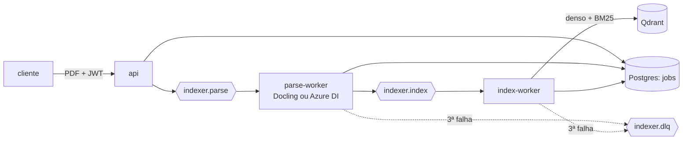

# Indexador

Recebe PDFs por uma API com login, transforma cada documento em trechos (chunks) com página e
seção, e grava no Qdrant com dois vetores para busca híbrida. Os fluxos estão desenhados em
[docs/fluxos.html](docs/fluxos.html).



## Pipeline

1. **API** (FastAPI): valida o PDF, grava em `storage/{user}/{doc}/`, cria o job, publica no
   Kafka e responde `202`.
2. **Parse**: PDF → elementos (título, parágrafo, tabela em Markdown, recorte de gráfico) com
   página, em `parsed.json`. Dois parsers trocáveis por `parser` no `config/ajustes.yaml`, sem
   reiniciar, com cache por parser.
3. **Indexação**: gráficos transcritos por um modelo de visão e **conferidos** contra o texto da
   página e o OCR; metadados (empresa, período) aceitos só com trecho copiado da página; unidade
   decidida por chunk, por regra; chunks cortados pela estrutura (texto ~450 tokens, tabela
   inteira com título e notas); prefixo de contexto no vetor; denso (`text-embedding-3-small`) +
   BM25 em português.
4. **Busca**: `POST /api/search`, híbrida com RRF, filtrada sempre pelo usuário.

| | Docling | Azure Document Intelligence |
|---|---|---|
| 3 PDFs, 218 páginas | 26 min em CPU | 86 s |
| Custo | zero | ~US$ 10 por mil páginas |
| Worker | 4,3 GB, pico de 4 GB de RAM | 825 MB |

## Filas e isolamento

- Chave Kafka = `user_id`; entrega ao menos uma vez com etapas idempotentes; retry com espera
  crescente, DLQ na terceira falha; `POST /api/jobs/{id}/retry` retoma na etapa que falhou.
- Isolamento em três camadas: Postgres `(user_id, doc_id)`, pasta por usuário, filtro obrigatório
  no Qdrant (`is_tenant`). Recurso de outro usuário responde `404`.
- Trechos com padrão de injeção de prompt são indexados com `suspicious=true`.

## Rodar

```bash
cp .env.example .env          # só chaves: OPENAI_API_KEY, JWT_SECRET (e a Azure, se usar)
docker compose up -d --build  # kafka, postgres, qdrant, api, parse-worker, index-worker
uv run python scripts/smoke.py   # cria usuário, envia os PDFs de data/pdfs e mede

uv run pytest                 # sem rede nem contêiner
```

Só com Azure, sem a imagem do Docling: `docker compose -f docker-compose.yml -f docker-compose.azure.yml up -d --build`.

`config/ajustes.yaml` guarda o que se ajusta: parser (`docling` ou `azure`), modo das tabelas,
tamanho dos chunks, modelo e preços da OpenAI, limites de envio e tentativas. A API relê a
cada pedido e os workers a cada mensagem; trocar o parser monta o novo no próximo PDF. O que
não pode mudar com documentos já indexados (modelo e dimensão dos embeddings, idioma do BM25)
fica no código. Erro no arquivo aparece em `GET /health` (`components.ajustes`).

| Rota | Função |
|---|---|
| `POST /auth/register`, `/auth/login` | Usuário e JWT |
| `POST/GET /api/documents`, `GET/PATCH/DELETE /api/documents/{id}` | Documentos |
| `GET /api/jobs/{id}`, `POST /api/jobs/{id}/retry` | Progresso, tempos, custo, retry |
| `GET /api/documents/{id}/chunks`, `POST /api/search` | Chunks e busca |

## Estrutura

```
app/api/        rotas (auth, documents, jobs, search)
app/pipeline/   parsers, figuras, metadados, chunker, embedder, vector_store
app/workers/    parse_worker, index_worker
scripts/        smoke.py
```
