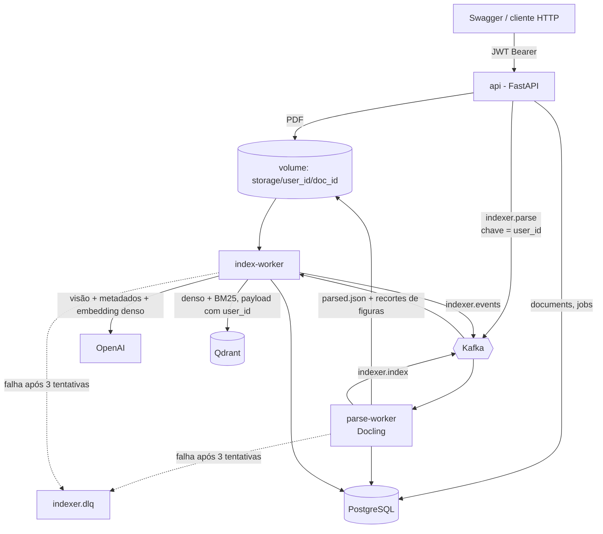

# Indexador de Demonstrações Financeiras

Primeiro dos dois sistemas da solução. Recebe PDFs de demonstrações financeiras por uma API
multiusuário e os indexa no Qdrant com **vetor denso (semântico)** e **vetor esparso (BM25)**,
prontos para a busca híbrida com RRF que o segundo sistema (o agente de análise) vai fazer.

Não tem frontend: tudo é testável pelo Swagger em `http://localhost:8000/docs`.

## Como rodar

Pré-requisitos: Docker com Compose e pelo menos 8 GB de memória disponíveis para o Docker (o
parse-worker chega a 4 GB; no Docker Desktop com WSL 2 o padrão é metade da RAM da máquina).

```bash
cp .env.example .env        # preencha OPENAI_API_KEY e JWT_SECRET
docker compose up --build   # kafka, postgres, qdrant, api, parse-worker, index-worker
```

A primeira construção demora (cerca de 25 minutos na máquina de desenvolvimento): a imagem do
parse-worker tem 4,3 GB, com PyTorch só-CPU e os modelos do Docling já baixados, para que nada
seja baixado em execução. A imagem da API e do index-worker tem 786 MB. As construções
seguintes reaproveitam as camadas e levam segundos.

Depois, no Swagger (`/docs`):

1. `POST /auth/register` — crie um usuário.
2. Botão **Authorize** — informe usuário e senha (o Swagger faz o login e guarda o token).
3. `POST /api/documents` — envie um PDF (há três em `data/pdfs/`). Resposta: `doc_id` e `job_id`.
4. `GET /api/jobs/{job_id}` — acompanhe até `status = done` (durante o parse, o progresso é por página).
5. `GET /api/documents/{doc_id}/chunks` e `POST /api/search` — confira o que foi indexado.

Ou tudo de uma vez, pela linha de comando:

```bash
uv run python scripts/smoke.py    # registra, loga, envia os 3 PDFs, acompanha e imprime tempos e custos
```

O dashboard do Qdrant fica em `http://localhost:6333/dashboard`.

### Desenvolvimento fora do Docker

```bash
docker compose up -d kafka postgres qdrant
uv sync                                    # inclui Docling/torch (grupo "parse")
uv run pytest                              # 74 testes, sem rede nem contêiner
uv run python -m app.warmup                # baixa os modelos uma vez
uv run uvicorn app.main:app --port 8000
uv run python -m app.workers.parse_worker
uv run python -m app.workers.index_worker
```

Sem chave da OpenAI, `EMBEDDING_PROVIDER=fake` roda o pipeline inteiro com um vetor denso sem
significado (o BM25 continua real). Serve para exercitar a mecânica, não para avaliar a busca.

## Arquitetura



| Peça | Papel |
|---|---|
| **api** | Autentica, valida o PDF, grava o arquivo e o job, publica no Kafka e responde `202`. Não processa nada. |
| **parse-worker** | Docling: PDF → elementos com página (títulos, parágrafos, tabelas em Markdown, recortes de figuras) e OCR dos recortes. Pesado em CPU. |
| **index-worker** | Figuras, metadados, chunking, embeddings e gravação no Qdrant. Quase só rede; não depende de Docling nem de torch. |
| **Kafka** | Duas filas de trabalho, uma de eventos e uma de mensagens mortas. |
| **PostgreSQL** | Usuários, documentos e jobs (estado, progresso, tempos, tokens, custo). |
| **Qdrant** | Uma coleção, dois vetores por ponto, isolamento por `user_id`. |

Dois tipos de worker porque as cargas são diferentes: o parse é limitado por CPU e leva minutos;
a indexação é limitada por chamadas de rede e leva segundos. Cada um escala sozinho:

```bash
docker compose up -d --scale parse-worker=2 --scale index-worker=3
```

### Filas

| Tópico | Produz | Consome | Conteúdo |
|---|---|---|---|
| `indexer.parse` | api | parse-worker | `{job_id, user_id, doc_id, attempt}` |
| `indexer.index` | parse-worker, api | index-worker | `{job_id, user_id, doc_id, attempt, reason}` |
| `indexer.events` | workers | sistema do agente | `document.indexed` / `document.failed` |
| `indexer.dlq` | workers | — | mensagem original + erro |

- A mensagem leva só referências; o PDF fica no volume compartilhado.
- **Chave = `user_id`.** Os documentos de um usuário ficam em ordem na mesma partição, e quem
  envia cem PDFs não trava a fila dos outros.
- **Ao menos uma vez.** O offset só é confirmado depois que a etapa terminou. As etapas são
  idempotentes (parse em cache, ids de ponto determinísticos, apaga-antes-de-gravar), então
  uma reentrega após queda do worker não duplica nada.
- **Retry.** Falha transitória volta à fila com `attempt+1` e espera crescente; na terceira vai
  para a DLQ e o job fica `failed` com a mensagem de erro. `POST /api/jobs/{id}/retry` reenfileira
  na etapa que falhou, sem refazer o parse.
- **Parse longo.** `max_poll_records=1` e `max_poll_interval_ms` de 30 minutos no parse-worker;
  sem isso o broker expulsaria o consumidor no meio de um PDF grande.
- Se o Kafka recusar a publicação, o job é marcado `failed` e a API responde `503`: nada fica
  "na fila" sem estar.

### Autenticação e isolamento

`POST /auth/login` devolve um JWT (HS256) com `sub = user_id`. O `user_id` **nunca é parâmetro**:
vem do token assinado, então ninguém age em nome de outro trocando um id. O isolamento existe em
três camadas:

- **Postgres:** chave primária `(user_id, doc_id)`; toda consulta filtra por usuário.
- **Disco:** `storage/{user_id}/{doc_id}/`; o nome enviado pelo cliente nunca vira caminho.
- **Qdrant:** o filtro por `user_id` é montado dentro do `VectorStore`, não nas rotas — não existe
  chamada ao índice sem ele. O índice de payload usa `is_tenant=true`.

Recurso de outro usuário responde `404`, não `403`, para não confirmar que o id existe.

## O pipeline, etapa por etapa

### 1. Parse (Docling)

Os três PDFs têm texto nativo, mas as tabelas da Brasal e da Millet não têm bordas. O Docling
reconstrói a estrutura dessas tabelas (TableFormer) e informa a página de cada elemento, que é o
que permite citar a origem. O resultado é gravado em `parsed.json`, num esquema próprio do
projeto — por isso o index-worker não precisa de Docling.

- **Fontes de sistema são obrigatórias no Linux.** O modelo de layout trabalha sobre a página
  renderizada, e estes PDFs referenciam Arial sem embutir a fonte em várias páginas. Numa imagem
  `python:slim`, sem nenhuma fonte, as letras viram "caixinhas", o modelo classifica páginas
  inteiras como figura e as tabelas somem — sem erro nenhum, porque o texto extraído continua
  certo. Na Millet isso derrubava de 37 para 8 tabelas. A imagem do parse-worker instala
  `fonts-liberation` (mesmas métricas de Arial/Times/Courier) e o worker se recusa a subir num
  Linux sem fontes.
- **Conversão em lotes de 10 páginas** (`PARSE_PAGE_BATCH`). O Docling guarda as páginas
  renderizadas até o fim de cada conversão; com a Light (124 páginas) convertida de uma vez, o
  worker passou de 5,7 GB e esgotou a memória e o swap do Docker. Em lotes, o pico ficou em
  4,0 GB nos três documentos e não cresce com o número de páginas.
- **Marcador de lista preservado.** O Docling separa o marcador ("3.1", "b)") do texto de um
  item de lista numerada; o parser junta os dois de novo, porque a numeração define a seção.
- OCR só é ligado quando o documento tem página sem texto nativo.
- A camada de texto de cada página também é guardada (via `pypdf`), para conferir gráficos.
- O parse fica em cache por arquivo: retry, correção de metadados e reindexação não o repetem.

### 2. Figuras (visão + conferência)

Cada gráfico é recortado e transcrito por um modelo de visão com saída estruturada. Como um
modelo de visão pode ler um número errado, **cada valor só entra no índice se os mesmos dígitos
aparecerem numa segunda fonte independente**:

1. **o texto nativo da página** — gráfico vetorial, em que os rótulos são texto do PDF; ou
2. **o OCR do recorte** (RapidOCR, rodado no parse-worker) — gráfico colado no PDF como imagem,
   em que os números são só pixels. Um segundo leitor, de outra tecnologia, precisa ter lido o
   mesmo número; um dígito solto no OCR não vale como prova.

O que não confere em nenhuma das duas é descartado do texto e registrado em `unverified_values`.
O chunk guarda `verified_ratio`, `verified_by_ocr` (quantos valores só o OCR confirmou) e
`extraction_method = "vision_llm"`, e o próprio texto diz quantos valores vieram de cada fonte.
A conferência garante que o número está no gráfico; a associação entre número e rótulo
continua sendo a do modelo de visão. Logotipos são filtrados
por área antes de qualquer chamada.

### 3. Metadados

- **Empresa, período e tipo:** uma chamada ao LLM sobre as três primeiras páginas, com evidência
  obrigatória (página + trecho). O valor só é aceito se o trecho existir literalmente naquela
  página; senão vale o regex e, por fim, `null`. Precedência: usuário > LLM com evidência > regex.
- **Unidade (R$ mil / R$ milhões):** regex determinística, **por chunk**. No relatório da Light o
  texto da administração está em milhões e as demonstrações em milhares; uma unidade por
  documento estaria errada em metade dele.
- `PATCH /api/documents/{doc_id}` corrige e reindexa a partir do cache.

### 4. Chunking estrutural

Segue a estrutura do documento em vez de cortar por tamanho fixo:

- **Texto:** parágrafos da mesma seção agrupados até ~450 tokens, corte em fronteira de parágrafo.
- **Tabela:** um chunk por tabela, em Markdown, com as linhas de título que a antecedem (período,
  "Valores expressos em milhares de reais"). Tabela muito grande é dividida por linhas, repetindo
  o cabeçalho em cada parte. Uma tabela nunca é cortada no meio de uma linha.
- **Seções:** a hierarquia vem da numeração das notas ("22." > "22.1" > "a)"), que é explícita.
  Títulos com "--Continuação" no topo da página seguinte não abrem seção nova.
  O rótulo "título" vem do modelo de layout e muda com o ambiente (no Linux, com outra fonte,
  "3.1 Políticas contábeis" saiu como item de lista). Por isso uma linha curta, numerada,
  iniciada por maiúscula e sem pontuação final também é tratada como título, desde que continue
  a sequência das notas — o que impede uma enumeração qualquer ("1. Identificar o contrato") de
  virar seção.
- **Cabeçalhos corridos** (nome da empresa e "Notas explicativas..." no topo de toda página) são
  removidos; senão virariam "seção" de tudo e gerariam dezenas de chunks idênticos.
- **Cabeçalho de contexto:** cada chunk é embutido com um prefixo determinístico, por exemplo
  `[Brasal Brasília Holding S.A. | 2022 | R$ mil | 21. Receita operacional líquida | p. 43]`.
  Uma tabela sozinha não diz de que empresa, período ou nota é. O campo `text` do payload fica
  sem o prefixo, literal, para citação.

### 5. Embeddings e Qdrant

- **Denso:** OpenAI `text-embedding-3-small` (1536 dimensões, cosseno).
- **Esparso:** BM25 do FastEmbed com stemmer e stopwords em português. A coleção usa
  `Modifier.IDF`, então o IDF é calculado pelo Qdrant sobre a coleção inteira.

Os dois são calculados sobre o mesmo texto e gravados no mesmo ponto.

## Contrato do índice (para o sistema do agente)

Coleção `financial_docs`:

| Item | Valor |
|---|---|
| Vetor denso | `dense`, 1536, COSINE |
| Vetor esparso | `bm25`, `modifier = IDF` |
| Id do ponto | UUIDv5 de `"{user_id}:{doc_id}:{chunk_index}"` |
| `doc_id` | 16 primeiros hex do SHA-256 do arquivo |

Payload: `user_id`, `doc_id`, `file_name`, `company`, `period`, `doc_type`, `unit`, `chunk_index`,
`chunk_type` (`text` \| `table` \| `figure`), `extraction_method` (`native_text` \| `table_model` \|
`vision_llm`), `verified_ratio`, `verified_by_ocr`, `unverified_values`, `section_path`, `page_start`, `page_end`,
`text`, `context_header`, `token_count`, `suspicious`, `indexed_at`, `pipeline_version`.

Índices de payload: `user_id` (tenant), `doc_id`, `company`, `chunk_type`, `extraction_method`,
`page_start`.

Busca híbrida com RRF, como `POST /api/search` faz:

```python
scope = Filter(must=[FieldCondition(key="user_id", match=MatchValue(value=user_id))])
client.query_points(
    "financial_docs",
    prefetch=[
        Prefetch(query=dense_vector, using="dense", limit=32, filter=scope),
        Prefetch(query=SparseVector(indices=..., values=...), using="bm25", limit=32, filter=scope),
    ],
    query=FusionQuery(fusion=Fusion.RRF),
    limit=8,
)
```

## Combate à alucinação na indexação

- Texto e tabelas são extraídos de forma determinística; o LLM não reescreve nem resume nada.
- As duas únicas chamadas de LLM (figuras e metadados) têm saída validada por schema e são
  conferidas contra uma fonte que não é o LLM: o texto nativo do PDF e, para gráficos em
  imagem, o OCR do recorte. O que não confere não entra.
- O texto é preservado como está no documento, inclusive erros da fonte (ex.: "1;061;410" na
  nota 3.3 da Brasal). Sinalizar inconsistência é papel do agente, não do indexador.
- Todo chunk carrega página e seção; cada origem pode ser aberta no PDF.

## Segurança

- **Credenciais:** só em `.env` (fora do Git); `.env.example` documenta as variáveis.
- **Senhas:** Argon2. **Tokens:** JWT com expiração. O login responde igual para senha errada e
  usuário inexistente.
- **Upload:** assinatura `%PDF-`, limite de tamanho e de páginas, leitura de estrutura com `pypdf`.
  PDF com senha de abertura é recusado; PDF só com restrição de permissões (caso da Brasal) é aceito.
- **Conteúdo malicioso no documento:** o texto do PDF é sempre dado. Chunks com padrões de
  injeção de prompt ("ignore as instruções anteriores", "system prompt") recebem
  `suspicious = true` — são indexados, mas marcados para o agente tratar. Nas chamadas de LLM, o
  conteúdo vai em mensagem de usuário delimitada e nada do que o modelo devolve é executado.

## Medições

Feitas em 11/11/2026 num Intel Core i5-10400 (12 threads, 16 GB, sem GPU), com os seis serviços
em contêineres (`docker compose up`), OpenAI real (`text-embedding-3-small` e `gpt-4o-mini`),
`TABLE_MODE=accurate` e um parse-worker.

| Documento | Páginas | Parse (Docling) | Indexação | Chunks (texto / tabela / figura) | Tokens de embedding | Tokens de LLM (entrada / saída) | Custo |
|---|---|---|---|---|---|---|---|
| Brasal | 51 | 303 s (5,9 s/pág) | 9 s | 143 (80 / 63 / 0) | 40.270 | 9.938 / 97 | US$ 0,0023 |
| Millet | 43 | 219 s (5,1 s/pág) | 7 s | 126 (89 / 37 / 0) | 39.796 | 1.074 / 89 | US$ 0,0010 |
| Light | 124 | 1.027 s (8,3 s/pág) | 31 s | 405 (269 / 129 / 7) | 140.674 | 143.954 / 1.913 | US$ 0,0255 |
| **Total** | 218 | 26 min | 47 s | 674 | 220.740 | 154.966 / 2.099 | **US$ 0,029** |

- O parse é 97% do tempo e é a etapa que escala com mais parse-workers (ou GPU). Reenviar um
  arquivo já parseado leva segundos: parse, transcrição de figuras e metadados ficam em cache.
- O custo é dominado pelos gráficos da Light: cada recorte enviado ao modelo de visão custa
  de 9 a 16 mil tokens de entrada. Os embeddings dos três documentos somam US$ 0,0044.
- Pico de memória do parse-worker: 4,0 GB.
- Fora do Docker (Windows, mesma máquina) o parse levou 241 s, 173 s e 932 s. A contagem de
  chunks varia um pouco entre os dois ambientes (Brasal 147 no Windows, 143 no Linux) porque a
  fonte substituta muda a segmentação de alguns parágrafos; as tabelas batem (uma diferença: o
  índice da p. 2 da Brasal sai como tabela no Windows e como texto no Linux).

O que foi verificado de ponta a ponta, em contêineres e com a OpenAI real:

- Os três PDFs indexados; a DRE da Brasal (p. 8) é um único chunk de tabela; a gestão de capital
  da Millet (p. 42) e o endividamento da Light (p. 10, "3,32x") estão nos chunks esperados.
- Na Light, o relatório da administração sai com `unit = "R$ milhões"` e as demonstrações com `"R$ mil"`.
- **Metadados pelo LLM com evidência:** empresa e tipo dos três documentos aceitos com o trecho
  literal da p. 1. O período da Millet veio do regex, porque o trecho citado pelo modelo não
  existia literalmente na página — o fallback funcionou como desenhado.
- **Gráficos da Light:** 9 recortes passaram no filtro de área; 2 foram classificados como
  decorativos e 7 transcritos, todos com `verified_ratio = 1`. Em 3 deles os valores existem no
  texto da página (perdas totais na p. 6, incluindo "26,51%" e "21,53%"; arrecadação na p. 6;
  PECLD/ROB na p. 7). Os outros 4 são imagens e foram confirmados pelo OCR do recorte: efeito
  médio do reajuste tarifário (p. 5, 7 valores), consumo por classe (p. 5), carga fio e perda
  não-técnica (p. 6, 10 valores) e composição acionária (p. 11, 4 valores). Antes do OCR esses
  4 ficavam fora do índice. O OCR dos 9 recortes levou 17 s e não refaz o parse nem a chamada
  ao modelo de visão.
- **Busca híbrida:** "alavancagem dívida líquida EBITDA covenants" traz a Light p. 10 no topo,
  seguida das notas de covenants; "Lei 14.385" (termo exato) traz as páginas 114 e 28 da Light;
  "risco de liquidez e vencimento das dívidas" traz a nota de risco de liquidez da Light e da Millet.
- Reenvio do mesmo PDF: mesmo `doc_id`, mesma contagem de pontos.
- parse-worker derrubado no meio de um documento: a mensagem foi reentregue e o job terminou.
- Chave da OpenAI inválida: três tentativas, mensagem na DLQ, job `failed`; após corrigir,
  `POST /api/jobs/{id}/retry` concluiu sem refazer o parse.
- Segundo usuário não lista, não lê e não encontra na busca os documentos do primeiro.

## Premissas e limitações

- Os três PDFs fornecidos são demonstrações **anuais de 2022**, não trimestrais; `period` sai como `2022`.
- A página citada é a do arquivo PDF (1-based), não a numeração impressa, que diverge na Light.
- O parse em CPU leva minutos por documento na primeira vez (ver medições acima).
- Valor de gráfico só é indexado se confirmado pelo texto da página ou pelo OCR do recorte. Se
  o gráfico é uma imagem e o OCR não lê o número (texto muito pequeno, por exemplo), ele fica só
  em `unverified_values`. A conferência também não valida a qual rótulo o número pertence.
- A hierarquia de seções depende da numeração das notas. Subtítulo sem numeração em página onde
  o título da nota não aparece fica sem o ancestral — a escolha foi perder o ancestral a exibir
  um ancestral errado.
- `create_all` cria as tabelas no startup; não há migrações.

## Caminho para produção no Azure

| Aqui | Em produção |
|---|---|
| Volume compartilhado | Azure Blob Storage |
| Kafka em contêiner | Event Hubs (protocolo Kafka) ou Service Bus |
| Workers no compose | Container Apps com escala por tamanho de fila (KEDA); parse em GPU |
| Docling | Azure AI Document Intelligence (layout) para volume alto |
| Qdrant | Azure AI Search com busca híbrida e RRF nativos |
| OpenAI | Azure OpenAI no AI Foundry, com Batch API para embeddings |
| Logs em stdout | Application Insights / OpenTelemetry, com tempo e custo por etapa |
| JWT próprio | Microsoft Entra ID |
