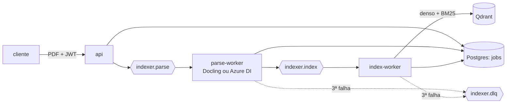

# Indexador

Recebe PDFs por uma API com login, transforma cada documento em trechos (chunks) com página e
seção, e grava no Qdrant com dois vetores para busca híbrida. Os fluxos estão desenhados em
[docs/fluxos.html](docs/fluxos.html).



## Pipeline

1. **API** (FastAPI): valida o PDF, grava em `storage/{user}/{doc}/`, cria o job, publica no
   Kafka e responde `202`.
2. **Parse**: PDF → elementos (título, parágrafo, tabela em Markdown, recorte de gráfico) com
   página, em `parsed.json`. Dois parsers trocáveis por `parser` no `config/ajustes.yaml`, sem
   reiniciar, com cache por parser.
3. **Indexação**: gráficos transcritos por um modelo de visão e **conferidos** contra o texto da
   página e o OCR; metadados (empresa, período) aceitos só com trecho copiado da página; unidade
   decidida por chunk, por regra; chunks cortados pela estrutura (texto ~450 tokens, tabela
   inteira com título e notas); prefixo de contexto no vetor; denso (`text-embedding-3-small`) +
   BM25 em português.
4. **Busca**: `POST /api/search`, híbrida com RRF, filtrada sempre pelo usuário.

| | Docling | Azure Document Intelligence |
|---|---|---|
| 3 PDFs, 218 páginas | 26 min em CPU | 86 s |
| Custo | zero | ~US$ 10 por mil páginas |
| Worker | 4,3 GB, pico de 4 GB de RAM | 825 MB |

## Chunks

O corte segue a estrutura do documento, não um tamanho fixo
([app/indexacao/trechos.py](app/indexacao/trechos.py)). Os tamanhos ficam no
`config/ajustes.yaml` e valem para os documentos processados depois da mudança. Os tokens são
contados com o `tiktoken` (`cl100k_base`).

| Etapa | Regra | Valor |
|---|---|---|
| Limpeza | Cabeçalho e rodapé corridos saem: linha curta repetida em muitas páginas, quase sempre na borda (o nome da empresa, "As notas explicativas são parte integrante..."). Tabelas e figuras nunca saem. | até 60 tokens; em 5 páginas ou 8% do documento |
| Limpeza | O índice (sumário) sai: ele repete o nome de todas as seções e casaria com qualquer busca. Letra solta de logotipo também sai. | — |
| Seção | Cada chunk guarda o caminho da seção, tirado da numeração das notas ("22." > "22.1" > "a)"), com regras para título quebrado e "(continuação)" na outra página. Título novo fecha o chunk anterior. | — |
| Texto | Parágrafos da mesma seção agrupados até o alvo, cortando sempre entre parágrafos. | `chunk_target_tokens: 450` |
| Texto | Parágrafo que sozinho passa do teto é dividido em fim de frase. | `chunk_max_tokens: 800` |
| Texto | Sobreposição: o último parágrafo de um chunk se repete no seguinte, se for curto. | até 120 tokens |
| Tabela | Um chunk por tabela, com as linhas curtas logo acima dela na mesma página (o título: "Demonstrações dos resultados", "(em milhares de reais)"). A nota de rodapé logo abaixo ("(a) Não auditado") vai junto. | até 4 linhas, 160 tokens |
| Tabela | Tabela grande é dividida por linhas, repetindo o título e o cabeçalho em cada parte ("parte 1 de 3"). | `table_max_tokens: 1500` |
| Gráfico | Um chunk por gráfico, com a transcrição do modelo de visão conferida contra o texto da página e o OCR, e a legenda. | — |
| Contexto | Empresa, período, unidade, seção e página entram como prefixo **só no texto vetorizado**: `[Brasal Brasília Holding S.A. \| 2022 \| R$ mil \| 21. Receita operacional líquida \| p. 43]`. O texto guardado fica literal, para a citação bater com o PDF. | — |
| Unidade | Decidida por chunk, por regra, sem LLM: no próprio chunk, no texto da página, nos valores citados ("R$1.817 milhões"), na convenção da página anterior. Nada achado: fica vazia. | — |
| Vetores | Dois por chunk, no mesmo ponto do Qdrant: denso (`text-embedding-3-small`, 1536) e BM25 em português. | — |
| Segurança | Trecho com padrão de injeção de prompt é indexado com `suspicious=true`. | — |

## Filas e isolamento

- Chave Kafka = `user_id`; entrega ao menos uma vez com etapas idempotentes; retry com espera
  crescente, DLQ na terceira falha; `POST /api/jobs/{id}/retry` retoma na etapa que falhou.
- Isolamento em três camadas: Postgres `(user_id, doc_id)`, pasta por usuário, filtro obrigatório
  no Qdrant (`is_tenant`). Recurso de outro usuário responde `404`.
- Trechos com padrão de injeção de prompt são indexados com `suspicious=true`.

## Rodar

```bash
cp .env.example .env          # só chaves: OPENAI_API_KEY, JWT_SECRET (e a Azure, se usar)
docker compose up -d --build  # kafka, postgres, qdrant, api, parse-worker, index-worker
uv run python scripts/smoke.py   # cria usuário, envia os PDFs de data/pdfs e mede

uv run pytest                 # sem rede nem contêiner
```

Só com Azure, sem a imagem do Docling: `docker compose -f docker-compose.yml -f docker-compose.azure.yml up -d --build`.

Para ver por dentro: o Kafka UI em http://localhost:8080 (tópicos `indexer.parse`, `indexer.index`,
`indexer.events` e `indexer.dlq`, mensagens e grupos de consumo) e o painel do Qdrant em
http://localhost:6333/dashboard (coleção `financial_docs`). Nenhum dos dois pede login.

`config/ajustes.yaml` guarda o que se ajusta: parser (`docling` ou `azure`), modo das tabelas,
tamanho dos chunks, modelo e preços da OpenAI, limites de envio e tentativas. A API relê a
cada pedido e os workers a cada mensagem; trocar o parser monta o novo no próximo PDF. O que
não pode mudar com documentos já indexados (modelo e dimensão dos embeddings, idioma do BM25)
fica no código. Erro no arquivo aparece em `GET /health` (`components.ajustes`).

| Rota | Função |
|---|---|
| `POST /auth/register`, `/auth/login` | Usuário e JWT |
| `POST/GET /api/documents`, `GET/PATCH/DELETE /api/documents/{id}` | Documentos |
| `GET /api/jobs/{id}`, `POST /api/jobs/{id}/retry` | Progresso, tempos, custo, retry |
| `GET /api/documents/{id}/chunks`, `POST /api/search` | Chunks e busca |

## Mapa do código

```
config/ajustes.yaml      parser, chunks, preços, limites (relido sem reiniciar)

app/
├─ main.py               a API (:8000) e o /health
├─ config.py             .env (chaves) + config/ajustes.yaml
├─ schemas.py            o formato das rotas e das mensagens do Kafka
├─ telemetria.py
│
├─ api/                  AS ROTAS
│  ├─ auth.py            cadastro e login (JWT)
│  ├─ documents.py       envio, lista, remoção e reindexação
│  ├─ jobs.py            progresso, tempos, custo, retry
│  ├─ search.py          busca híbrida
│  └─ deps.py            o usuário de cada pedido
│
├─ workers/              OS CONSUMIDORES DO KAFKA
│  ├─ parse_worker.py    indexer.parse → lê o PDF → indexer.index
│  └─ index_worker.py    indexer.index → trechos, embeddings, Qdrant
│
├─ leitura/              LER O PDF
│  ├─ parsing.py         a escolha do parser e o formato comum
│  ├─ azure.py           Azure Document Intelligence
│  ├─ docling.py         Docling, na máquina
│  ├─ figuras.py         recortes de gráfico e a leitura deles
│  └─ ocr.py             OCR local dos gráficos (RapidOCR)
│
├─ indexacao/            DO DOCUMENTO LIDO AO ÍNDICE
│  ├─ indexar.py         o passo a passo da indexação
│  ├─ trechos.py         cortar em trechos com página e seção
│  ├─ metadados.py       empresa, período e tipo do documento
│  ├─ llm.py             chamadas à OpenAI (gráficos e metadados)
│  ├─ embeddings.py      vetores densos e esparsos (BM25)
│  └─ qdrant.py          gravar, buscar e apagar, sempre filtrando pelo usuário
│
└─ infra/                INFRAESTRUTURA
   ├─ banco.py, modelos.py, repo.py    Postgres: usuários, documentos, jobs
   ├─ arquivos.py        a pasta de cada usuário e documento
   ├─ kafka.py           publicar, consumir, retry e DLQ
   ├─ seguranca.py       senha (Argon2), JWT e o usuário de cada pedido
   └─ warmup.py          carregar os modelos antes do primeiro PDF

scripts/                 smoke.py, eval_search.py, audit_index.py
```
