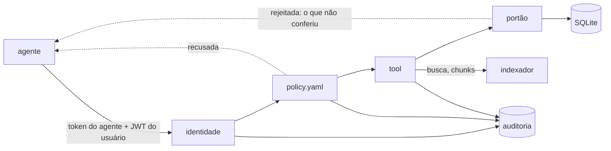

# Servidor MCP

A única porta dos agentes para documentos e ferramentas. Decide o que cada agente pode chamar,
confere tudo o que é gravado, calcula com fórmulas fixas, registra cada chamada e monta o
relatório. Os fluxos estão desenhados em [docs/fluxos.html](docs/fluxos.html).



## Governança

- **Dois eixos**: o token do agente (JWT curto assinado com `MCP_AGENT_SECRET`) decide quais
  tools existem; o JWT do usuário (`X-User-Token`, repassado só ao indexador) decide quais
  documentos existem. Os dois têm de ser do mesmo usuário.
- **`policy.yaml`**: tools e limite de chamadas por agente, aplicada no servidor
  (`tools/list` só mostra o permitido), relida sem reiniciar. Agente fora do arquivo não tem
  acesso. Cada tool que grava tem um dono; o orquestrador não lê trecho de documento.
- **Auditoria**: toda chamada, com argumentos, resultado e hash da política (`GET /auditoria`).

## Portões

| Gravação | O que é conferido |
|---|---|
| `salvar_indicador` | O agente aponta chunk, linha e coluna; o servidor lê a célula, confere o ano da coluna, a unidade e que a linha é do indicador; o ano anterior sai da mesma linha. Texto: o trecho existe no chunk e contém o número |
| `salvar_nao_encontrado` | O servidor procura os termos no documento; se aparecem com valor, recusa mostrando a página. A busca vira evidência |
| `fechar_extracao` | Os 8 indicadores com valor ou ausência; valores de apoio para calcular o que falta; validações automáticas |
| análise, alertas, respostas | Citação literal no chunk; números só por marcador (`{{doc.campo}}`) ou dentro de trecho citado |

Calculado (variação, EBITDA, margem, dívida líquida, alavancagem, capex) usa fórmula fixa e nunca
aparece como informado. As validações (`ebitda_divergente`, `margem_divergente`,
`periodo_nao_confirmado`…) viram alertas com os dois lados da conta.

## Pendências

`pendencias` define a ordem: extração → revisão das fontes e análise → perguntas (com tudo de
todos os documentos) e resumos → relatório. As tools de gravação recusam o que chega antes da
hora, e o que ficou mais antigo que sua base volta como desatualizado. `montar_relatorio` gera o
Markdown a partir da base.

Com `doc_id`, `pendencias` lista só o que falta para o relatório daquela empresa (extração,
revisão, análise e resumo dela, sem as perguntas comparativas), e `montar_relatorio_empresa`
monta o relatório dela: resumo, indicadores, análise e alertas. Ele vale para a impressão do
documento em que foi montado.

## Rodar

```bash
cp .env.example .env          # MCP_AGENT_SECRET, ADMIN_KEY
docker compose up -d --build  # :8100, endpoint MCP em /mcp (Streamable HTTP)
uv run pytest
```

## Estrutura

```
app/server.py     endpoint MCP: identidade, política e auditoria em cada chamada
app/auth.py  policy.py  audit.py
app/tools/        rag, extraction, analysis, answers, reporting
app/formulas.py   cálculos e validações
app/pending.py    pendências e ordem
app/report.py     relatório
policy.yaml       quem pode o quê
```
