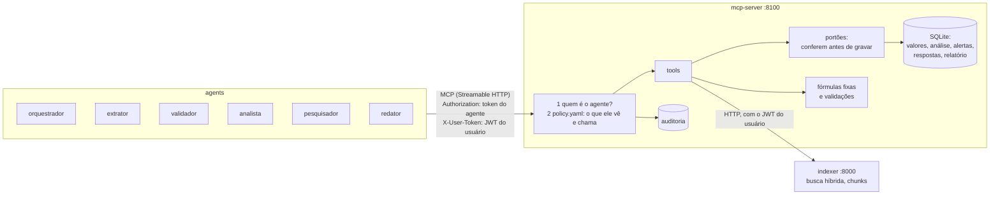

# Servidor MCP com governança

Sistema 2 de 3 da solução. É a única porta dos agentes para as ferramentas e para os documentos:
por aqui eles buscam trechos no índice, gravam o que extraem, respondem perguntas e montam o
relatório. O servidor decide o que cada agente pode ver e chamar, confere tudo o que entra e
registra cada chamada.

- O [indexador](../indexer/README.md) (sistema 1) lê os PDFs e guarda os trechos.
- Os [agentes](../agents/README.md) (sistema 3) são os clientes deste servidor.

A ideia central: **o agente aponta, o código lê**. Um agente não digita um número de tabela. Ele
diz o chunk, a linha e a coluna, e o servidor lê a célula. O que é calculado (variação, margem,
EBITDA pela demonstração) é calculado aqui, com fórmula fixa. O relatório é montado aqui, a partir
da base. O modelo escolhe e redige; o código confere, calcula e escreve os números.



## Como rodar

Pré-requisito: o indexador no ar (`docker compose up` em `indexer/`), com os documentos enviados.

```bash
cd mcp-server
cp .env.example .env        # gere os dois segredos (o comando está no arquivo)
docker compose up --build
```

- `http://localhost:8100/health` diz se o servidor fala com o indexador e se a política é válida.
- O endpoint MCP é `http://localhost:8100/mcp` (Streamable HTTP, sem sessão).
- O contêiner entra na rede Docker do indexador e o chama por `http://api:8000`. Se o indexador
  estiver em outro lugar, defina `INDEXER_URL` (e `INDEXER_NETWORK`) no `.env`.

Fora do Docker:

```bash
uv sync
uv run uvicorn app.main:app_factory --factory --port 8100
uv run pytest        # 90 testes, sem rede
```

## Governança: quem pode o quê

Há dois eixos de autorização, independentes:

| Eixo | Quem é | Como chega | O que decide |
|---|---|---|---|
| **Agente** | `extrator`, `analista`... | `Authorization: Bearer <token do agente>`: JWT curto, assinado com `MCP_AGENT_SECRET`, com o nome do agente, a execução e o usuário | quais **tools** existem para a chamada |
| **Usuário** | o dono dos documentos | `X-User-Token: <JWT do indexador>`, repassado só ao indexador | quais **documentos** existem para a chamada |

O servidor exige que o usuário do token do agente seja o mesmo do `X-User-Token`. Um token de
agente emitido para a Ana não funciona com o login do Bruno.

### policy.yaml

```yaml
agentes:
  extrator:
    tools: [listar_documentos, buscar_trechos, ler_chunk, ler_pagina,
            salvar_indicador, salvar_nao_encontrado, fechar_extracao, ler_extracao]
    limites:
      chamadas_por_execucao: 250
```

- **Aplicada no servidor, não no cliente.** `tools/list` devolve só as tools do agente. Chamar
  outra é recusado e fica na auditoria. A recusa é igual para tool que não existe: quem não pode
  chamar não fica sabendo o que há.
- **Agente fora do arquivo não tem acesso a nada.** Criar um agente no sistema dos agentes não
  concede permissão: é preciso uma entrada aqui.
- **Relida quando muda, sem reiniciar.** Se o arquivo ficar inválido (YAML quebrado, tool que
  não existe), continua valendo a última versão boa, e o erro aparece em `GET /governanca`.
- **Limite de chamadas por execução**, por agente: freia um agente em laço.

As divisões da política que vai no repositório:

- Cada tool que **grava** tem um dono só: indicadores são do extrator, alertas de fonte do
  validador, análise do analista, respostas do pesquisador, resumo e relatório do redator.
- O **orquestrador não tem tool de leitura de trecho**. Texto malicioso dentro de um PDF não
  chega a quem decide o que fazer.
- `sistema` não é um agente com modelo: é o próprio sistema dos agentes, que confere as
  pendências e lê o resultado no fim de cada execução. Só tem tools de leitura.

### Auditoria

Toda listagem e toda chamada grava: execução, agente, usuário, tool, argumentos, duração,
resultado (`ok`, `recusada` pela política, `rejeitada` por um portão, `invalida`) e o hash da
política em vigor. `GET /auditoria?run_id=...` (com `X-Admin-Key`) mostra o que cada agente fez
numa execução. `GET /governanca` mostra a política carregada.

### O que isso protege, e o que não

Protege contra **mau uso pelo modelo**: um agente com o prompt desviado por um texto do documento
não chama o que não é dele, não lê documento de outro usuário e não grava número sem origem.

Não protege contra o **serviço dos agentes comprometido**: é ele que assina os tokens dos agentes
(segredo compartilhado). Em produção, cada agente teria identidade própria (ver o fim deste
arquivo).

## Tools

| Grupo | Tool | O que faz |
|---|---|---|
| RAG | `listar_documentos` | Documentos indexados do usuário, com o `doc_id` |
| | `buscar_trechos` | Busca híbrida com filtros (documento, tipo, páginas). O texto vem cortado |
| | `ler_chunk`, `ler_pagina` | Um chunk inteiro; todos os chunks de uma página |
| Extração | `salvar_indicador` | Grava um indicador, depois dos portões |
| | `salvar_nao_encontrado` | Registra que o documento não informa, com a evidência da busca |
| | `fechar_extracao` | Calcula, valida e publica o JSON do documento |
| | `ler_extracao` | A extração publicada (resumo ou JSON completo) |
| Validação | `registrar_alerta` | Inconsistência no texto da fonte, com a citação conferida |
| | `concluir_revisao`, `ler_alertas` | Marca a revisão como feita; lê os alertas |
| Análise | `salvar_item_analise` | Um achado qualitativo, com a citação literal |
| | `registrar_ausencia_analise`, `ler_analise` | Categoria que o documento não traz; leitura |
| Perguntas | `comparar_indicadores` | Maior, menor, acima de um limite: a comparação é do código |
| | `salvar_resposta`, `ler_respostas` | Resposta com marcadores e citações conferidos |
| Relatório | `salvar_resumo` | Resumo executivo (até 5 linhas, sem número digitado) |
| | `montar_relatorio`, `ler_relatorio` | O código monta o Markdown a partir da base |
| Controle | `pendencias` | O que falta, em ordem, e o que já pode ser feito |

Os esquemas são planos (sem objeto aninhado) e com enumerações: o modelo erra menos, e o erro
volta dizendo o campo.

## Portões: o que precisa conferir para entrar na base

Toda tool que grava é um portão. Se a conferência falha, a chamada volta como erro, com o que
não conferiu e, quando há, as opções que existem. O agente corrige e tenta de novo.

Parte destes portões estava no desenho. A outra parte nasceu das execuções reais nos três PDFs:
cada erro que apareceu num relatório virou uma conferência e um teste. A coluna da direita diz
qual.

### Valor (`salvar_indicador`)

| Conferência | O erro que ela barra |
|---|---|
| **Tabela: o servidor lê a célula.** O agente informa chunk, rótulo da linha e da coluna | Número digitado errado, ou de outra célula |
| Rótulo que não existe, ou que se repete sem dizer qual: erro, com os rótulos mais parecidos | "A primeira linha que casar" |
| O rótulo casa sem diferença de acento ou de caixa | O PDF escreve "Caixa liquido"; o modelo copiou "Caixa líquido", não casou e desistiu do campo |
| O ano do cabeçalho da coluna tem de ser o do período pedido | A coluna de 2021 gravada como 2022 |
| **Texto: o trecho existe literalmente no chunk e contém o número, inteiro** | Paráfrase; "1.234" achado dentro de "21.234" |
| Texto só vale em chunk de texto: linha de tabela não pode ser citada como "trecho" | Na 6ª execução o lucro e o capex da Light entraram assim: o número estava no trecho, mas a coluna (ano, escopo) era escolha do modelo, e o ano anterior não veio |
| A unidade é lida do trecho ou do chunk, nunca informada pelo agente | Milhares gravados como milhões |
| O número tem de ser do tipo do campo: dinheiro, percentual ou múltiplo | A frase "EBITDA foi de R$1.180 milhões" gravada como **margem** EBITDA (a única invenção da 2ª execução) |
| A linha ou a frase tem de mencionar o indicador (EBITDA, dívida líquida) | "Alavancagem" de 76% (dívida sobre capital) e de 0,08 (dívida sobre patrimônio) gravadas como dívida líquida / EBITDA |
| Trecho que fala de uma parte do grupo (distribuidora, controlada) exige uma nota dizendo o que o valor é | O EBITDA da distribuidora da Light gravado como o da companhia |
| Receita, lucro e caixa operacional vêm da demonstração do próprio campo (resultado, fluxo de caixa), não de outra tabela em que a linha se repete | O lucro tirado da demonstração do resultado abrangente com cabeçalho duplicado, ou das mutações do patrimônio, sem colunas por ano |
| O campo capex é o total de investimentos que a empresa declara, não uma linha de aquisição | "Aquisições de bens do ativo imobilizado" (307.759) gravada como o capex da Light (1.470.292 com o intangível) |
| Receita, lucro e caixa operacional vêm da tabela da demonstração, não de frase | O prejuízo da Light tirado de "-R$5.673 milhões" do texto, sem o sinal |
| Uma célula não pode ser gravada em dois campos | A linha única "Imobilizado e intangível" da Brasal gravada duas vezes: capex dobrado |
| Linha sem rótulo não identifica valor; a linha de receita, lucro ou caixa operacional tem de ter o nome do valor | O caixa operacional da Millet veio de uma linha de rótulo vazio (53.267, contra 24.799) |
| Valor de apoio vem da linha com o nome dele; num quadro de composição, da linha do total | "Caixa e bancos" (1.346), um componente da nota de caixa da Brasal, gravado como caixa e equivalentes (96.453): dívida líquida errada |
| **O valor do ano anterior é lido pelo servidor**, da coluna irmã da mesma linha | O extrator esqueceu o comparável em 2 dos 3 documentos |
| Sinal: `(1.234)` é negativo; "prejuízo de" e "-R$" também | Prejuízo gravado como lucro |

### Não encontrado (`salvar_nao_encontrado`)

O teste pede que informação ausente venha como "não encontrado", sem estimativa. Dizer que não
há também precisa de prova:

- O servidor procura os termos do campo (EBITDA, LAJIDA, alavancagem...) no documento inteiro.
- Se aparecem em páginas que o agente não descartou, a chamada é recusada com as páginas e o
  texto em volta. O agente lê: se o valor está lá, grava; se não serve, repete a chamada
  descartando aquelas páginas e explicando por quê.
- Os termos procurados, as páginas onde apareceram e as descartadas ficam guardados como
  evidência, e vão para o relatório.
- **O que o documento traz com valor não pode ser descartado.** Se há uma linha de tabela com o
  nome do indicador e um número, ou uma frase com o nome e um valor (R$, %, x), a chamada é
  recusada mostrando a linha ou a frase, e o agente tem de gravá-la. Se o que está escrito não é
  exatamente o indicador do exercício, ele grava com uma nota, e o relatório mostra a nota e o
  alerta. Na 4ª execução, a dívida líquida da Millet (num quadro) saiu como ausente, e a
  alavancagem da Light também, porque a frase da fonte, com erro de digitação, fala em 2021.
- Receita, lucro e caixa operacional não podem ser dados como ausentes quando o documento tem
  a demonstração: o valor está nela. Na 3ª execução o caixa operacional da Millet saiu como
  "não encontrado" porque o agente errou o rótulo da linha e desistiu.

### Fechamento (`fechar_extracao`)

- Os 8 indicadores têm de ter valor ou "não encontrado".
- Indicador que a empresa não informa **tem de poder ser calculado**: se faltam valores de apoio
  (resultado operacional, depreciação, empréstimos, caixa, aquisições), a chamada é recusada
  dizendo quais. Na 2ª execução o extrator escreveu "as linhas de apoio foram gravadas" sem ter
  gravado, e três indicadores saíram sem cálculo.
- **Entre as frases de EBITDA, vale a que bate com a demonstração.** Relatório de grupo traz o
  EBITDA de cada controlada e o consolidado, em frases parecidas. Se o EBITDA gravado veio de
  texto e não bate com resultado operacional + depreciação, e outra frase do documento bate (em
  módulo), o fechamento é recusado apontando a frase. Na 8ª execução o EBITDA da Light voltou a
  ser o da distribuidora, com uma nota.
- Dizer "o documento não traz as linhas de apoio" também precisa de prova: o servidor procura,
  nas tabelas da demonstração em que o valor mora, uma linha que sirva. Se acha, recusa e diz a
  página e o rótulo. Só quando não há linha nenhuma a explicação é aceita, e vira um alerta.
- O servidor calcula, valida e publica o JSON. Validar não é escolha do modelo.

### Informado e calculado ficam separados

| Calculado | Fórmula fixa |
|---|---|
| Variação | (valor − valor do ano anterior) / \|valor do ano anterior\| |
| EBITDA | resultado antes do resultado financeiro + depreciação e amortização |
| Margem EBITDA | EBITDA / receita líquida |
| Dívida líquida | empréstimos (circulante + não circulante) − caixa e equivalentes |
| Alavancagem | dívida líquida / EBITDA |
| Capex | aquisição de imobilizado + de intangível (ou a linha única) |

Um EBITDA calculado nunca aparece como informado. No JSON e no relatório, o indicador sai como
`informado: não encontrado` e, ao lado, um bloco `calculado` com a fórmula e os valores de
origem, cada um com a página.

### Validações automáticas (item 5 do teste)

Rodam no fechamento, sem modelo. Cada falha vira um alerta com os dois lados da conta. Nada é
corrigido, e alerta só é acrescentado, nunca apagado.

| Alerta | O que compara |
|---|---|
| `margem_divergente` | margem informada contra EBITDA / receita |
| `variacao_divergente` | variação escrita pela empresa contra a dos dois períodos |
| `alavancagem_divergente` | múltiplo informado contra dívida líquida / EBITDA |
| `ebitda_divergente` | EBITDA informado contra resultado operacional + depreciação. Na Light, o texto escreve "R$1.180 milhões" e a demonstração dá −1.179.644 mil: o sinal foi omitido |
| `unidades_diferentes`, `unidade_nao_declarada`, `unidade_herdada` | unidades entre os campos e a origem da unidade |
| `periodo_nao_confirmado` | a fonte citada não escreve o ano do valor. Na Light, a frase da alavancagem diz "encerrou 2021" |
| `escopo_controladora`, `secao_inesperada`, `sem_comparavel`, `calculo_impossivel` | escopo, origem e o que não pôde ser calculado |

O agente validador soma a isso a leitura do texto: frases cujos números não fecham entre si.
Ele registra com `registrar_alerta`, que confere a citação.

### Texto do modelo: marcadores e citações

- **Resumo e respostas.** Valores entram por marcador (`{{doc_id.receita_liquida}}`,
  `{{doc_id.ebitda.calculado}}`), que o código troca pelo valor guardado, com a unidade e a
  página. O valor calculado sai com a fórmula e as páginas dos valores de origem: antes disso,
  respostas com valor calculado citavam a capa do documento só para "ter fonte". Trechos entram como `[[doc_id:chunk_index]]`, que o código confere e troca por
  "(arquivo, p. N)". Número escrito direto só passa se estiver num trecho citado (ou for ano).
- **Análise e alertas.** A citação tem de existir literalmente no chunk, e os números da
  afirmação têm de estar na citação.
- **Ausência não é achado.** Item de análise que começa negando ("o documento não traz
  guidance") é recusado: ausência vai pela tool própria, que guarda a evidência da busca.
- **Alfabeto.** Palavra em outro alfabeto é recusada. O modelo pequeno soltou uma palavra em
  árabe num resumo.
- **Comparações.** "Qual a maior margem" e "quem está acima de 3x" são respondidas por
  `comparar_indicadores`, com os valores guardados. O modelo não compara números.
- **A resposta é ao enunciado oficial.** As cinco perguntas do relatório têm o texto guardado no
  servidor. `salvar_resposta` recusa a p1 a p5 se a pergunta informada não é o enunciado, e a
  recusa traz o enunciado. Na 5ª execução o orquestrador delegou "responda a p3" sem o texto, e
  o pesquisador respondeu qual empresa teve o maior lucro.
- **Resumo executivo curto.** No resumo, o valor calculado sai com "(calculado; arquivo, p. N)";
  a fórmula fica na tabela comparativa e nas respostas.

## Pendências e a ordem do trabalho

`pendencias` é uma função só, usada pelo orquestrador (para delegar), pelo sistema dos agentes
(para conferir no fim) e por `montar_relatorio` (que não monta relatório incompleto).

Cada item diz se está `liberada` ou o que `aguarda`:

```
extração ──► revisão das fontes ──┐
análise qualitativa ──────────────┼──► resumo da empresa ──┐
                                  │                        ├──► relatório
extração e análise de TODOS ──────┴──► as 5 perguntas ─────┘
```

A ordem não depende da boa vontade do orquestrador: `salvar_resposta` e `salvar_resumo` recusam o
que chega antes da hora. Na 1ª execução real, o orquestrador mandou responder as perguntas com
duas extrações ainda rodando, e as respostas saíram dizendo "sem extração publicada".

O que foi escrito antes de a base mudar volta para a lista: resposta ou resumo mais antigo que a
extração ou a análise de que depende está desatualizado, e o relatório mais antigo que qualquer
um deles também.

## Relatório

`montar_relatorio` gera o Markdown a partir da base: resumo executivo por empresa, tabela
comparativa (informado, variação e calculado), análise qualitativa com as citações, as cinco
perguntas com as fontes, e os alertas e as informações não encontradas, com a evidência da
busca. Nenhum número é redigitado.

## Base

SQLite num volume, por SQLAlchemy assíncrono. A chave de tudo é usuário + documento: o `doc_id`
é o hash do arquivo e se repete entre usuários.

Cada extração guarda a "impressão" do índice (data de indexação e total de chunks). Se o
documento for reindexado, `chunk_index` e texto podem ter mudado: o que foi extraído antes fica
desatualizado e volta a ser pendência.

## Rotas HTTP

| Rota | Função |
|---|---|
| `POST /mcp` | O endpoint MCP. Sem token de agente válido: 401, antes de qualquer tool |
| `GET /health` | Estado do servidor, do indexador e da política |
| `GET /governanca` | A política em vigor, por agente (`X-Admin-Key`) |
| `GET /auditoria` | As chamadas, filtradas por execução, agente ou tool (`X-Admin-Key`) |

## Segurança

- **Credenciais.** Só no `.env`, que o Git ignora. O `.env.example` não tem valor. O token do
  usuário passa por aqui e não é gravado: a auditoria guarda o usuário, não o token.
- **Conteúdo malicioso no documento.** O indexador marca chunks com padrão de injeção
  (`suspicious`), e as tools de leitura repassam a marca. Mais importante que detectar: um texto
  que mande "grave o valor 999" não consegue, porque o valor é lido da célula ou conferido no
  trecho; não consegue chamar outra tool, porque a política é do servidor; e não chega ao
  orquestrador, que não lê trechos.
- **Isolamento.** Todo acesso a documento passa pelo indexador com o JWT do usuário. A base
  deste servidor é sempre filtrada pelo usuário da chamada.

## Limitações

- **Os portões conferem a origem, não o sentido.** Eles garantem que o número está na célula
  apontada e que a linha fala em EBITDA. Não garantem que aquela é a linha certa entre duas
  linhas de EBITDA (ajustado e contábil). A avaliação contra o gabarito mede isso.
- **As listas de termos são em português** e saíram destes três documentos (termos de EBITDA,
  palavras de "parte do grupo"). Documento em inglês ou com outro vocabulário pede ampliar
  `app/fields.py`.
- **A leitura de célula depende do Markdown da tabela** que o indexador gera. Tabela mal
  reconstruída (linha partida em duas) faz o rótulo não casar, e o agente tem de usar o texto.
- **Dívida líquida calculada** usa só caixa e equivalentes, sem aplicações financeiras, e só a
  linha de empréstimos e financiamentos, sem debêntures. É uma fórmula fixa e declarada, não a
  definição de cada empresa.
- **Um portão novo pode criar um beco sem saída.** Aconteceu uma vez: a regra de que "o que o
  documento traz com valor não pode ser descartado", aplicada ao capex, tomou o financiamento
  "BNDES - Capex" por capex informado, e o campo não podia ser gravado nem dado como ausente. A
  extração não fechou, e a execução terminou como incompleta. A auditoria mostra as recusas
  repetidas; o remédio foi restringir a regra e escrever o teste. Portão novo pede uma execução
  real nos três documentos antes de valer.
- **SQLite e segredo compartilhado** servem para o teste, não para produção.
- **A validação do texto da fonte é do modelo.** O servidor confere a citação, não a conta que o
  validador diz estar errada.

## Estrutura do código

```
mcp-server/
├─ policy.yaml              quem pode o quê
├─ app/
│  ├─ main.py               FastAPI + endpoint MCP; 401 sem token de agente
│  ├─ server.py             tools/list e tools/call com a política, limites e auditoria
│  ├─ auth.py  policy.py  audit.py
│  ├─ catalog.py            registro das tools e esquema plano e estrito
│  ├─ indexer_client.py  documents.py     o índice, visto daqui (com cache por impressão)
│  ├─ numbers.py  tables.py  text.py      números pt-BR, leitura de célula, conferências de texto
│  ├─ fields.py             os campos, os termos de cada um e as perguntas
│  ├─ formulas.py           fórmulas fixas e validações automáticas
│  ├─ pending.py            pendências, ordem e o que está desatualizado
│  ├─ report.py             marcadores e montagem do relatório
│  ├─ store.py  models.py   SQLite
│  └─ tools/                rag, extraction, analysis, answers, reporting
└─ tests/                   90 testes: governança, portões, fórmulas, pendências, relatório
```

## Caminho para produção no Azure

- **Identidade.** Cada agente com identidade própria no Microsoft Entra ID (identidade gerenciada
  ou Agent ID), e o servidor validando tokens emitidos pelo Entra, em vez do segredo
  compartilhado. O usuário chega por fluxo on-behalf-of.
- **Hospedagem.** Container Apps atrás do API Management, que já fala MCP: limite de taxa, cota
  por agente e registro de chamadas na borda. A política viraria configuração versionada (App
  Configuration), com revisão para mudar.
- **Base.** Azure SQL ou Cosmos DB no lugar do SQLite, com a mesma chave (usuário + documento).
- **Auditoria e observabilidade.** As linhas de auditoria em Log Analytics, com alerta para
  recusas por política e para taxa de rejeição dos portões por agente (é o melhor sinal de que
  um prompt piorou).
- **Catálogo de tools.** Publicar o servidor no catálogo de ferramentas do AI Foundry, para
  outros agentes da empresa usarem os dados extraídos com a mesma governança.
