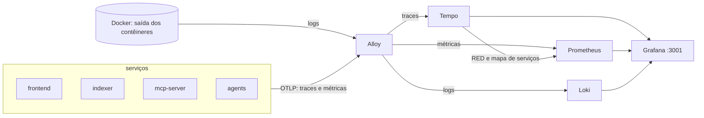

# Observabilidade

Traces, métricas e logs dos quatro serviços num lugar só: **Tempo**, **Prometheus**, **Loki** e
**Grafana**, com o **Grafana Alloy** como coletor único. Os fluxos estão desenhados em
[docs/fluxos.html](docs/fluxos.html).



## O que é coletado

| Sinal | De onde | Como |
|---|---|---|
| **Traces** | os quatro serviços | OpenTelemetry (`app/telemetria.py` em cada serviço Python, `src/instrumentation.server.ts` no frontend), exportado por OTLP/HTTP ao Alloy |
| **Métricas** | os serviços, o Qdrant e a própria pilha | OTLP (contadores e histogramas próprios) e scrape; o Tempo gera as de requisição (taxa, erro, latência) a partir dos spans |
| **Logs** | os contêineres dos quatro serviços | o Alloy lê a saída pelo Docker; rótulos `projeto`, `servico`, `nivel` |

**Um trace atravessa tudo.** O contexto (`traceparent`) vai junto em cada chamada HTTP (frontend →
orquestrador → especialistas por A2A → servidor MCP → indexador) e, no indexador, dentro da
mensagem do Kafka (upload → parse → indexação). Uma pergunta no chat aparece como uma árvore só:
cada onda do grafo, cada especialista, cada chamada ao modelo (com os tokens, pela instrumentação
do PydanticAI), cada tool no MCP e cada busca no índice.

**Log ↔ trace.** Toda linha de log dos serviços Python traz `trace_id=` e `span_id=`. No Grafana,
a linha abre o trace, e o trace mostra as linhas dele.

**A conversa vai junto.** O orquestrador põe o id da conversa no *baggage* do OpenTelemetry, que
segue o `traceparent` nas chamadas HTTP (e vai como cabeçalho na conexão MCP, que a instrumentação
do httpx não alcança). Cada serviço copia o id para os spans que abre (`conversa.id`) e para as
linhas de log (`conversa=`). O span da execução leva também `conversa.rotulo` (a primeira mensagem
e o id), `execucao.custo_usd` e `execucao.tokens`. Assim os painéis filtram uma conversa inteira,
de todos os serviços, sem pôr o id como rótulo de métrica no Prometheus.

## Métricas próprias

| Métrica | Rótulos |
|---|---|
| `agentes_execucoes_total`, `agentes_execucao_duracao_seconds` | `tipo`, `estado` |
| `agentes_tokens_total`, `agentes_custo_usd_total` | `agente`, `modelo`, `tipo` (entrada, cache, saída) |
| `agentes_delegacoes_total`, `agentes_especialista_duracao_seconds` | `agente`, `estado` |
| `agentes_intencoes_total` | `intencao` (pergunta, relatorio, relatorio_empresa, fora_do_escopo), `fonte` (roteador ou llm): quem decidiu a intenção de cada mensagem do chat |
| `agentes_avaliacao_taxa`, `agentes_avaliacao_acertos`, `agentes_avaliacao_de` | `medida` (status_certo, invencao, perguntas_certas...), `tipo` (relatorio, relatorio_empresa): a nota do último relatório contra o gabarito |
| `agentes_avaliacoes_total` | `resultado` (avaliada, sem_gabarito, erro) |
| `mcp_tool_chamadas_total`, `mcp_tool_duracao_seconds` | `agente`, `tool`, `resultado` (ok, rejeitada, recusada, invalida, erro) |
| `indexador_mensagens_total`, `indexador_etapa_duracao_seconds` | `etapa` (parse, index), `resultado` (ok, retry, dlq) |
| `indexador_paginas_total`, `indexador_chunks_total`, `indexador_custo_usd_total` | `parser` |
| `traces_spanmetrics_*`, `traces_service_graph_*` | geradas pelo Tempo: por serviço e operação |

## Painéis

| Painel | Mostra |
|---|---|
| **Visão geral** (página inicial) | requisições, erros e latência por serviço, execuções (traces), custo dos agentes, chamadas de tool, operações mais lentas, mapa dos serviços, erros nos logs e logs |
| **Agentes** | a nota do último relatório contra o gabarito (status, valores, invenções, perguntas, inconsistências), custo e tokens por agente, chamadas de tool e o que os portões barraram, delegações, duração, execuções recentes (traces), os passos e o raciocínio de cada execução |
| **Indexador** | mensagens por etapa, falhas, duração do parse e da indexação, páginas, chunks, custo, requisições da API, documentos processados (traces) |

**Filtro por conversa.** Os três painéis têm a mesma lista **Conversa** no alto: escolhida uma,
números, gráficos, traces e logs passam a ser só dela. Os links entre os painéis (no alto, à
direita) levam a conversa e o período junto, e **Limpar filtros** volta tudo para All. O que não
filtra diz "(todas as conversas)" no título: o mapa dos serviços, o Qdrant no ar e, no painel
Agentes, a nota e o custo ao longo do tempo, que ficam no Prometheus para comparar dias (15 dias de
histórico). No Indexador, a leitura dos PDFs não é de uma conversa: com uma escolhida, o que
aparece é o que ela pediu à API (busca e trechos).

Os números e gráficos vêm do Tempo (métricas por TraceQL, calculadas a partir dos spans), e não do
Prometheus: é o que deixa filtrar por conversa sem pôr o id como rótulo de métrica. Os spans levam
o que antes só a métrica tinha (custo e tokens por agente, estado da delegação, a nota do
relatório, páginas e chunks do indexador). A latência é aproximada (o Tempo mede a duração em
faixas que dobram de tamanho) e o período vai até 72 h, a retenção dos traces.

Para investigar, a aba **Explore** do Grafana consulta as três fontes direto (TraceQL no Tempo,
LogQL no Loki, PromQL no Prometheus).

## Rodar

```bash
docker compose up -d     # Grafana em http://localhost:3001 (abre sem login; admin/admin para editar)
```

Suba antes o indexador, que cria a rede `indexer_default`. Os quatro serviços já apontam para o
coletor (`OTEL_EXPORTER_OTLP_ENDPOINT=http://alloy:4318` nos composes). Para desligar a exportação
de um serviço, deixe a variável vazia no `.env` dele. Com a pilha fora do ar, os serviços seguem
normalmente; os erros de exportação são silenciados.

| Porta | Serviço |
|---|---|
| 3001 | Grafana |
| 4317 / 4318 | OTLP (gRPC / HTTP), para serviços rodando fora do Docker |
| 9090 | Prometheus |
| 3100 | Loki |
| 3200 | Tempo |
| 12345 | interface do Alloy |

O texto das mensagens dos modelos (prompts, respostas e o que as tools devolveram) entra nos traces
com `traces_com_conteudo: true` em `agents/config/ajustes.yaml`, ligado neste repositório: abrindo
uma chamada `chat` no trace, aparecem as mensagens, como no LangSmith. Vale na próxima chamada, sem
reiniciar. Leva trechos dos documentos para o Tempo; desligue se isso não puder sair da aplicação.

Retenção: 3 dias de traces, 7 de logs, 15 de métricas.

Para acompanhar uma execução enquanto ela acontece, há a [sala dos agentes](../sala/README.md):
os agentes desenhados trabalhando, a partir dos passos do orquestrador e da auditoria do servidor
MCP, e uma aba com os logs do Loki.

## Estrutura

```
alloy/config.alloy         coletor: OTLP, scrape e logs do Docker
tempo/tempo.yaml           traces e o gerador de métricas
loki/loki.yaml             logs
prometheus/prometheus.yml  métricas (recebe por remote write)
grafana/provisioning/      fontes (já ligadas entre si) e painéis
grafana/dashboards/        visao-geral, agentes, indexador
```
