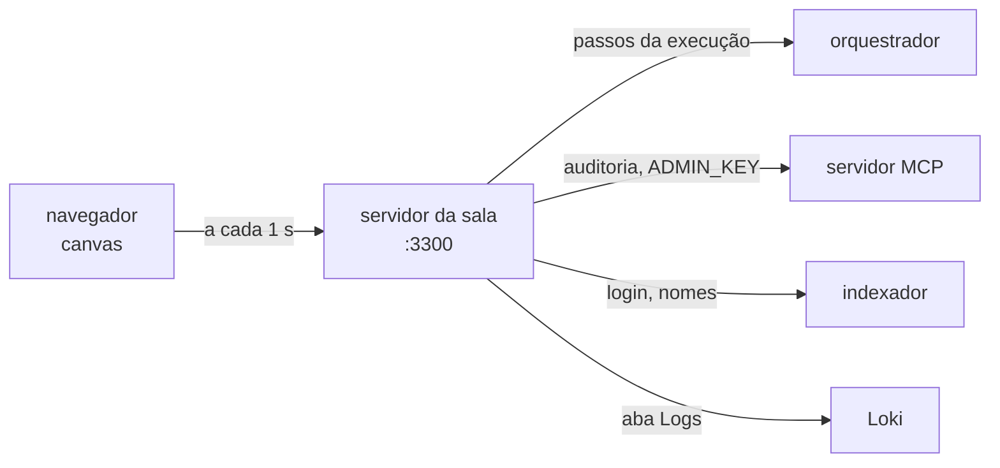

# Sala dos agentes

A execução dos agentes em tempo real, desenhada como um escritório em pixel art: o usuário, o
orquestrador, os cinco especialistas, o servidor MCP (racks) e o indexador (arquivo). Cada passo
gravado pelo orquestrador e cada chamada de tool registrada na auditoria do servidor MCP vira uma
ação: andar até a mesa de alguém, falar, pensar, mandar um envelope ao rack. Uma aba de logs mostra
os eventos da execução e as linhas do Loki.




- **Dados reais, sem simulação**: passos de `GET /api/execucoes/{id}` e auditoria de
  `GET /auditoria?run_id=`, a mesma que o servidor grava a cada chamada.
- **Envelopes**: verde quando a tool passou, vermelho quando o portão barrou, com o motivo num balão.
- **Repetir** em 1×, 2×, 4× ou 8×: refaz uma execução no ritmo em que aconteceu.
- **Seguir a mais nova**: abre sozinha a execução que acabou de começar.

Limites: uma sessão por vez (o login fica no servidor da sala); o raciocínio dos especialistas chega
quando cada um termina; as mesas são as dos cinco especialistas atuais.

## Rodar

```bash
cp .env.example .env    # ADMIN_KEY: a mesma do servidor MCP
docker compose up -d    # http://localhost:3300, com o login do chat
```

Sem build: a imagem do uv roda o servidor com as dependências fixadas no compose, e a pasta é
montada. Depende do indexador, do servidor MCP e dos agentes; a aba de logs usa a observabilidade.

```
servidor.py   FastAPI: login, execuções, passos + auditoria, Loki
index.html    a sala (canvas) e a aba de logs
```

Fluxos com imagens: [docs/fluxos.html](docs/fluxos.html).
