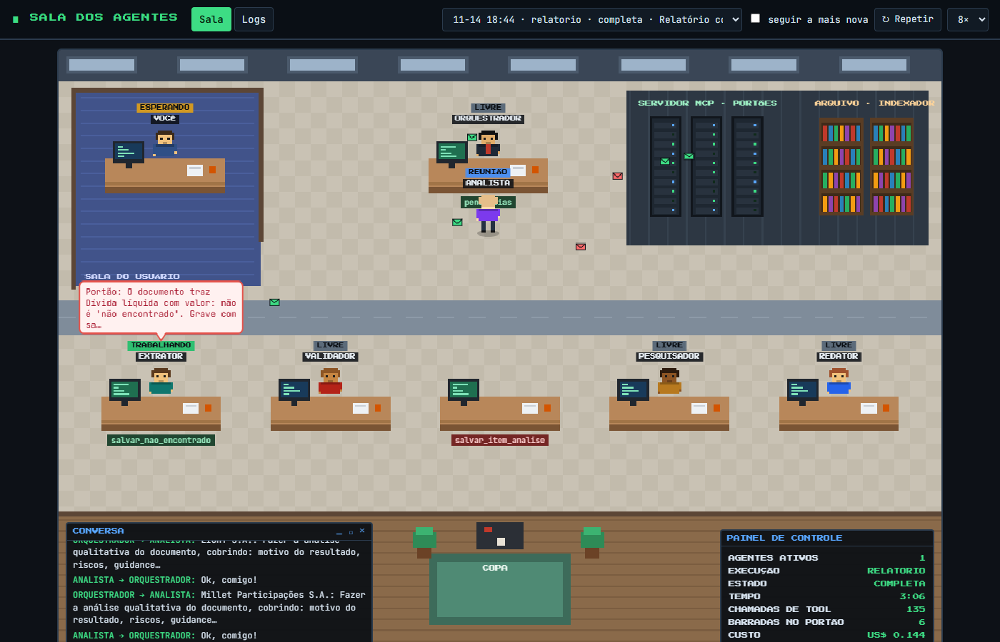
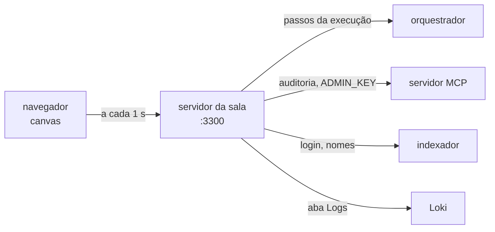

# Sala dos agentes

A execução dos agentes em tempo real, desenhada como um escritório em pixel art: o usuário, o
orquestrador, os cinco especialistas, o servidor MCP (racks) e o indexador (arquivo). Cada passo
gravado pelo orquestrador e cada chamada de tool registrada na auditoria do servidor MCP vira uma
ação: andar até a mesa de alguém, falar, pensar, mandar um envelope ao rack. Uma aba de logs mostra
os eventos da execução e as linhas do Loki.





- **Dados reais, sem simulação**: passos de `GET /api/execucoes/{id}` e auditoria de
  `GET /auditoria?run_id=`, a mesma que o servidor grava a cada chamada.
- **Envelopes**: verde quando a tool passou, vermelho quando o portão barrou, com o motivo num balão.
- **Repetir** em 1×, 2×, 4× ou 8×: refaz uma execução no ritmo em que aconteceu.
- **Seguir a mais nova**: abre sozinha a execução que acabou de começar.
- **Conversa**: a execução inteira, com o texto completo das falas, dos pensamentos e das recusas
  dos portões; minimizar, maximizar, filtro por texto ou agente, filtro por tipo e rolagem.
- **Modos**: a mesma execução com três caras, escolhidas no alto à direita (ou por `?modo=`):
  - **Caverna do Dragão** (o padrão): o orquestrador é o Mestre dos Magos, que some quando anda; os
    especialistas são a turma (Hank, Eric, Presto, Sheila, Diana) e o usuário é o Bobby, com a Uni.
    A Tiamat guarda o servidor MCP e cospe fogo em quem o portão barra; o Vingador aparece quando a
    execução falha.
  - **Escritório**: o escritório em pixel art.
  - **Psicodélico**: o orquestrador é o Mestre Yoda, que levita e fala com a ordem trocada, num
    arco-íris que gira (o botão Calmar desacelera).

Limites: uma sessão por vez (o login fica no servidor da sala); o raciocínio dos especialistas chega
quando cada um termina; as mesas são as dos cinco especialistas atuais.

## Rodar

```bash
cp .env.example .env    # ADMIN_KEY: a mesma do servidor MCP
docker compose up -d    # http://localhost:3300, com o login do chat
```

Sem build: a imagem do uv roda o servidor com as dependências fixadas no compose, e a pasta é
montada. Depende do indexador, do servidor MCP e dos agentes; a aba de logs usa a observabilidade.

## Mapa do código

```
servidor.py          FastAPI: login, execuções, passos + auditoria, Loki, e serve pagina/
pagina/
├─ index.html        a estrutura: cabeçalho, sala, janelas, aba de logs, login
├─ modos.js          os modos: escolhe o estilo e carrega os scripts, em ordem
├─ sala.css          o visual do escritório
├─ cena.js           o escritório: lugares, pessoas, fila de ações e desenho no canvas
├─ conversa.js       a janela de conversa (filtros, minimizar, maximizar) e o painel
├─ eventos.js        passo do orquestrador / chamada da auditoria → ação na sala
├─ dados.js          API da sala, eventos da aba Logs, abrir, repetir e acompanhar
├─ logs.js           as abas e os logs do Loki
├─ inicio.js         login e o começo
├─ caverna.css/.js   modo Caverna do Dragão: redesenha a cena e dá as falas de cada um
└─ psicodelico.css/.js  modo Psicodélico
```

Os scripts são clássicos e carregados em ordem por `modos.js`: o que um declara, os seguintes
enxergam. O script de um modo entra depois dos outros e substitui as funções de desenho de
`cena.js` (e embrulha `evento`, `chamada` e as falas); os eventos e os dados são os mesmos em todos
os modos. Para mudar o que acontece na sala com um evento, o lugar é `eventos.js`; para mudar o
desenho, `cena.js` ou o script do modo.

Fluxos com imagens: [docs/fluxos.html](docs/fluxos.html).
